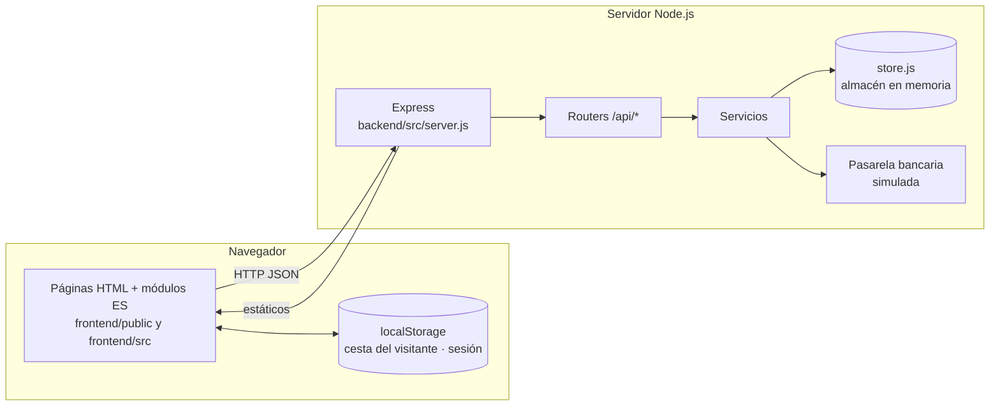
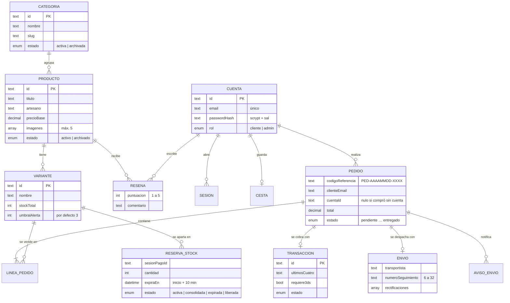

# Memoria del proyecto: TiendaOnline

**Tienda online de artesanía española, especializada en cerámica**

Equipo: 4 personas (`eab41-ua`, `ab336-ua`, `aps207-ua`, `hlm11-ua`) · Fecha de la memoria: 17 de noviembre de 2026 · Estado del código: rama `feat/demos-funcionalidades`, que parte de `main` (commit `201333d`) y añade los arreglos encontrados al grabar las demos, la grabación de las demos y esta documentación; pendiente de fusionar en `main` (véase [§11](#11-demo))

---

## Índice

1. [Portada y resumen](#1-portada-y-resumen)
2. [URL del repositorio en GITHUB](#2-url-del-repositorio-en-github)
3. [Introducción](#3-introducción)
4. [Análisis](#4-análisis)
5. [Diseño](#5-diseño)
6. [Implementación](#6-implementación)
7. [Pruebas y validación](#7-pruebas-y-validación)
8. [Despliegue y uso](#8-despliegue-y-uso)
9. [Planificación y seguimiento](#9-planificación-y-seguimiento)
10. [Conclusiones](#10-conclusiones)
11. [Demo](#11-demo)
12. [Anexos](#12-anexos)

---

## 1. Portada y resumen

**TiendaOnline** es una tienda web de piezas artesanales hechas en España (cerámica, textil, madera y metal). Cubre el ciclo completo de una venta: el catálogo con filtros, la cesta que se conserva entre visitas, el pago con tarjeta con verificación 3D Secure, la cuenta del comprador con el seguimiento de sus pedidos, las reseñas de compradores verificados, la administración del catálogo con alertas de stock, la preparación y el envío de los pedidos con aviso automático, y el resumen de ventas exportable a CSV.

**Para quién.** Tiene dos roles y un público sin cuenta:

- **Visitante** (sin cuenta): navega por el catálogo, llena la cesta y paga.
- **Cliente** (rol `cliente`): además consulta su historial y el seguimiento de sus pedidos, recibe los avisos de envío y valora las piezas que ha comprado.
- **Administración** (rol `admin`): gestiona el catálogo y las existencias, prepara y despacha los pedidos y consulta los informes de ventas.

**Resultado.** Las ocho historias de usuario (`001`–`008`) y una feature transversal de identidad visual (`009`) están implementadas en una aplicación Node.js + Express con un frontend en JavaScript y CSS sin frameworks. A fecha de esta memoria pasan las **209 pruebas automáticas** (21 de unidad, 85 de contrato y 103 de integración) ejecutándolas archivo a archivo. De las **225 tareas** de los `tasks.md`, queda **1 abierta**: la validación manual de 004. No hay medidas de tiempo cronometradas a mano (véase [§7.5](#75-validación-manual)), pero cada funcionalidad tiene un **vídeo de demostración grabado sobre la aplicación real** (véase [§11](#11-demo)).

El proyecto se ha desarrollado con **Spec Kit** (desarrollo guiado por especificaciones): cada funcionalidad nace de una `spec.md` y pasa por `plan.md`, `research.md`, `data-model.md`, `contracts/`, `quickstart.md`, `tasks.md` e implementación. Esta memoria se apoya en esos documentos, que se conservan en `specs/`.

---

## 2. URL del repositorio en GITHUB

El código fuente de la aplicación está publicado en GitHub: <https://github.com/hlm11-ua/tiendaOnline>

---

## 3. Introducción

### 3.1 Contexto

Un taller de artesanía vende piezas únicas o de tirada corta: hay pocas unidades de cada una, varias variantes (color, tamaño) y precios que el artesano puede cambiar. Los compradores son particulares que llegan desde un enlace o un buscador, a menudo sin cuenta, y la empresa la gestionan pocas personas que hacen a la vez de catálogo, almacén y envíos.

### 3.2 Problema que resuelve

- **No vender lo que no hay.** Con 1 a 10 unidades por pieza, dos compradores pueden querer la última a la vez. La cesta no puede pedir más de lo que existe, y el stock tiene que quedar apartado mientras se paga.
- **Cobrar con seguridad.** El pedido solo existe cuando el banco autoriza el cargo; las compras grandes necesitan verificación reforzada (PSD2) y los rechazos se explican al comprador.
- **Que el comprador no pierda el hilo.** La cesta se conserva aunque cierre el navegador, y después de pagar puede ver en qué fase está su pedido y su código de seguimiento sin escribir al taller.
- **Confianza en las opiniones.** Las reseñas solo valen si son de quien compró la pieza, y una sola vez.
- **Gestión con poca gente.** La administración necesita dar de alta piezas con fotos y variantes, enterarse antes de quedarse sin existencias, despachar con transportista y saber qué se vende y cuánto se factura.

### 3.3 Objetivos

1. Implementar las ocho historias de usuario como funcionalidades independientes que comparten un único almacén de datos.
2. Que cada criterio de éxito sea **verificable por una persona no técnica** desde la propia aplicación (principio IV de la constitución), con datos sembrados y tarjetas de prueba.
3. Mantener la solución **simple**: un servidor Express, almacén en memoria y frontend sin frameworks (principio I).
4. Interfaz en español de España y precios en euros (principio II), con una identidad visual común (feature 009).
5. Una suite de pruebas automáticas que proteja las reglas delicadas: stock, reservas, pago, fases del pedido y permisos.

### 3.4 Constitución del proyecto

El proyecto se rige por una constitución (`.specify/memory/constitution.md`, versión 1.0.0, ratificada el 13 de octubre de 2026) con cinco principios:

| Principio | Resumen |
|-----------|---------|
| I. Simplicidad ante todo | Entre dos soluciones, la más simple; prohibida la complejidad anticipada y la abstracción prematura. |
| II. Idioma y mercado | Todo en español de España (`es-ES`); moneda única en euros con formato español. |
| III. Cero alcance fantasma | No se implementa nada que no esté en la `spec.md`; las ideas nuevas se registran como propuesta. |
| IV. Verificable por personas no técnicas | Cada criterio de éxito se comprueba usando la aplicación, sin leer código ni bases de datos. |
| V. Respeto por los datos del usuario | Solo los datos imprescindibles; sin claves ni secretos en el código. |

---

## 4. Análisis

### 4.1 Actores y roles

| Actor | Rol en el sistema | Qué puede hacer |
|-------|-------------------|-----------------|
| Visitante | — | Buscar y filtrar en el catálogo (001), leer reseñas (005), llenar la cesta (002), pagar (003) y consultar un envío por su referencia (007). |
| Cliente | `cliente` | Todo lo anterior, más crear cuenta e iniciar sesión, consultar su historial y las fases de sus pedidos y recibir avisos de envío (004), valorar lo que ha comprado (005) y confirmar la recepción (007). Su cesta se fusiona con la de la cuenta (002). |
| Administración | `admin` | Gestionar categorías, productos, variantes, imágenes y existencias, con alertas de stock bajo (006); preparar, despachar, rectificar y entregar pedidos (007); consultar y exportar las ventas (008). |
| Pasarela bancaria | Simulada | Autoriza o deniega el cobro, exige 3D Secure y confirma pagos por webhook (003). |

La cuenta de administración se siembra al arrancar (`ADMIN_EMAIL` y `ADMIN_PASSWORD`, con valores de desarrollo por defecto); el registro público siempre crea cuentas `cliente`.

### 4.2 Historias de usuario

El enunciado de cada historia procede de la sección _Input_ de su `spec.md`.

| Spec | Historia | Prioridad |
|------|----------|-----------|
| 001 | Como **visitante** quiero navegar por las categorías y filtrar por precio, productor y disponibilidad para encontrar fácilmente lo que busco. | P1 categorías y filtros combinados; P2 sincronización con la URL; P3 estado vacío y restablecer |
| 002 | Como **usuario** quiero guardar en mi carrito _n_ productos y que el carrito persista si abandono la sesión y vuelvo más tarde, sin que supere la cantidad real que hay en el stock. | P1 |
| 003 | Como **usuario** quiero realizar de forma segura los pagos con tarjeta, de modo que el pedido solo se dé por confirmado una vez que la entidad de pago haya autorizado el cargo. | P1 |
| 004 | Como **usuario** quiero crear una cuenta e iniciar sesión para mantener mi sesión activa, consultar el historial de mis compras y hacer seguimiento de las fases de mi pedido. | P1 |
| 005 | Como **usuario** quiero dejar un único comentario y valoración de cada artículo que he comprado únicamente. | P1 compra verificada y publicación; P2 única valoración y vista pública |
| 006 | Como **empresa** quiero administrar mis productos (fichas, imágenes, variantes y stock) y sus categorías, y recibir un aviso cuando el stock esté a punto de agotarse. | P1 |
| 007 | Como **empresa** quiero procesar los pedidos, empaquetarlos y registrar el número de seguimiento para que el cliente reciba un aviso automático de que su compra está en camino. | P2 |
| 008 | Como **empresa** quiero un resumen de ventas y productos más vendidos por periodos, y exportar los datos a un formato externo. | P2 |

La feature `009` no es una historia de usuario: unifica la cabecera, la navegación y la paleta de colores de las ocho (véase [§6.4](#64-decisiones-tomadas-sobre-la-marcha)).

### 4.3 Requisitos funcionales

Cada spec numera sus requisitos como `FR-nnn`. Se resumen por historia; el texto íntegro está en cada `spec.md`.

**Valores de negocio** (definidos una sola vez en `backend/src/config/constants.js`)

| Valor | Cifra |
|-------|-------|
| Reserva de existencias durante el pago | 10 minutos |
| Umbral de 3D Secure | compras de más de 100,00 € |
| Código OTP válido de la pasarela de prueba | `1234` |
| Duración de la sesión del cliente | 30 días |
| Longitud mínima de la contraseña | 8 caracteres |
| Umbral de alerta de stock por defecto | 3 unidades |
| Imágenes por producto | máximo 5, de 5 MB, en JPEG, PNG o WebP |
| Artículos distintos en la cesta | máximo 50 |
| Envío estimado | 0,00 € |
| Código de seguimiento | 6 a 32 caracteres alfanuméricos |
| Transportistas | Correos de España, SEUR, MRW, GLS, DHL Express y «Otro» |
| Ranking de ventas | 5 productos |

**Por historia**

| Spec | Requisitos clave |
|------|------------------|
| 001 Catálogo | Navegación por categorías; filtros por rango de precio, productor y «solo en stock» que se combinan (Y lógica); los filtros se reflejan en la URL y un enlace compartido abre con ellos aplicados; precios invertidos o no numéricos se corrigen sin error; estado vacío con botón para restablecer. |
| 002 Cesta | Cesta del visitante guardada en el navegador y cesta de la cuenta en el servidor; fusión al iniciar sesión sumando cantidades hasta el stock disponible; nunca más unidades que las existentes; validación en tiempo real que reajusta cantidades y aplica el precio vigente con aviso; piezas agotadas o archivadas bloquean la tramitación; sugerencias sin artículos agotados. |
| 003 Pago | Reserva de existencias de 10 minutos al iniciar el pago; tokenización de la tarjeta en el navegador (el número completo nunca llega a la tienda); autorización directa hasta 100 € y desafío 3D Secure por encima; rechazos por fondos o tarjeta bloqueada sin crear pedido y liberando el stock; el pedido solo se crea al autorizarse el cobro; webhook bancario idempotente para compras desatendidas; recibo con referencia del pedido. |
| 004 Cuentas | Registro con correo único y contraseña de al menos 8 caracteres; sesión de 30 días; historial de compras propio; cuatro fases visibles (pendiente, pagado, salido de la tienda, entregado) con código de seguimiento; la administración actualiza la fase; nadie consulta pedidos ajenos (IDOR). |
| 005 Reseñas | Solo puede valorar quien tiene un pedido pagado o entregado de la pieza; una única valoración por comprador y pieza; puntuación de 1 a 5 estrellas y comentario obligatorios; lectura pública con nota media recalculada al instante. |
| 006 Administración | Alta y edición de categorías y productos con imágenes y variantes (variante «Única» si no se indica ninguna); ajuste de stock por variante; alerta cuando las existencias bajan del umbral; no se archiva una categoría con productos activos; un producto con ventas se archiva en lugar de borrarse; solo el rol `admin`. |
| 007 Logística | Listado de pedidos para el taller; flujo secuencial pagado → en preparación → salido de la tienda → entregado; despacho con transportista y código de seguimiento válidos; aviso automático (correo simulado, vista de seguimiento y buzón de la cuenta); rectificación de erratas con segundo aviso; entrega confirmada por la administración o por el comprador. |
| 008 Ventas | Facturación bruta, pedidos cobrados y ticket medio por periodo (7 días, 30 días, 1 año o rango personalizado); ranking de los 5 productos más vendidos por unidades con desempate por facturación; solo cuentan pedidos cobrados; exportación a CSV compatible con Excel; solo el rol `admin`. |

### 4.4 Requisitos no funcionales

| Ámbito | Requisito | Fuente |
|--------|-----------|--------|
| Rendimiento | Aviso automático de envío en menos de 3 s tras despachar (objetivo de diseño: menos de 1 s). | 007 SC-002, plan de 007 |
| Fiabilidad | Nunca se vende más stock del existente; las reservas de pago descuentan del stock disponible para el resto de compradores. | 002, 003 |
| Seguridad del pago | El número de tarjeta y el CVV se tokenizan en el navegador y no se almacenan (PCI-DSS). | 003, constitución V |
| Seguridad de cuentas | Contraseñas con scrypt y sal; cada comprador solo ve sus pedidos. | 004 |
| Privacidad | Solo los datos imprescindibles (nombre, correo, código de seguimiento); sin datos personales en los logs. | constitución V, 007 T018 |
| Accesibilidad | Contraste AA (4,5:1) en todos los textos; navegación sin desplazamiento horizontal a 375 px. | 009 FR-007, FR-010 |
| Idioma y formato | Español de España; euros con coma decimal (`45,50 €`); CSV con `;` y BOM UTF-8 para Excel. | constitución II, 008 FR-005 |
| Compatibilidad | Navegadores actuales de escritorio y móvil. | plan de cada spec |

### 4.5 Reglas que cruzan historias

La parte más delicada del análisis es el pedido, que recorre cuatro historias. El flujo central, «comprar una pieza y recibirla»:

1. **002** valida la cesta contra las existencias y el precio vigente, y entrega su contenido al pago.
2. **003** reserva las unidades durante 10 minutos (dejan de contar como disponibles para otros compradores), cobra y, solo si el banco autoriza, crea el pedido en estado `pagado` y consolida la reserva descontando el stock.
3. **006** recalcula la alerta de stock bajo de cada variante a partir de ese descuento.
4. **007** prepara (`en_preparacion`), despacha con código de seguimiento (`salido_tienda`) y emite el aviso; la entrega (`entregado`) la confirma el taller o el comprador.
5. **004** muestra cada cambio de fase y los avisos en «Mi Cuenta», con refresco automático cada 5 segundos.
6. **005** permite valorar la pieza en cuanto el pedido está pagado o entregado, y **008** lo cuenta como venta en todas las fases salvo `pendiente`.

---

## 5. Diseño

### 5.1 Arquitectura

Un único servidor Node.js que sirve la API y los ficheros del frontend:

```text
tiendaOnline/
├── backend/src/
│   ├── server.js          # Express: estáticos + monta las rutas /api/*
│   ├── config/            # constants.js (valores de negocio y estados)
│   ├── middleware/        # auth (rol admin), cart-identity, error-handler
│   ├── models/            # store.js (almacén en memoria) y entidades
│   ├── services/          # lógica de negocio por funcionalidad
│   ├── controllers/       # traducen HTTP ↔ servicios
│   └── routes/            # un router por funcionalidad
├── frontend/
│   ├── public/            # 8 páginas HTML (catálogo, cesta, pago, cuenta, logística, admin)
│   └── src/               # components/, services/ (clientes HTTP), styles/
├── tests/                 # unit/, contract/, integration/ (node:test)
├── demos/                 # grabación automática de los vídeos (rama sin fusionar)
├── docs/                  # agrupamiento.md (reparto) y memoria.md (este documento)
└── specs/                 # especificaciones Spec Kit (001 a 009)
```



- **Un solo almacén.** `backend/src/models/store.js` es un objeto en memoria con un `Map` por entidad, los datos sembrados (4 categorías, 4 productos con sus variantes y existencias, y la cuenta de administración) y un método por operación. Todas las funcionalidades lo comparten; `store.reset()` lo devuelve al estado inicial y lo usan las pruebas.
- **Capas por funcionalidad.** Cada funcionalidad tiene su router, su controlador y su servicio. Las reglas viven en los servicios (`logistics.service.js`, `payment-gateway.service.js`…) y los controladores solo traducen peticiones y errores.
- **Frontend sin frameworks.** Cada página HTML carga módulos ES de `frontend/src/components/` (componentes que pintan HTML) y `frontend/src/services/` (clientes de la API). Los estilos comparten el tema `tema-ceramica.css` (009) y cada página añade su hoja.

### 5.2 Modelo de datos

Definido en el `data-model.md` de cada spec e implementado en `backend/src/models/`.



**Máquinas de estado**

```text
Pedido
(pago autorizado) ─003→ pagado ─007→ en_preparacion ─007→ salido_tienda ─007 (taller o comprador)→ entregado
                                                               └─007 rectificar código (sigue en salido_tienda, segundo aviso)

Reserva de stock
activa ─003 (cobro autorizado)→ consolidada
activa ─003 (rechazo o abandono)→ liberada
activa ─003 (pasan 10 min)→ expirada

Variante (alerta, 006)
normal ─(stock ≤ umbral)→ stock_bajo ─(stock = 0)→ agotado    (y de vuelta al reponer)
```

### 5.3 Contrato de la API

Cada spec define el suyo en `contracts/` (OpenAPI en YAML). Convenciones comunes:

- Prefijo `/api`, JSON y mensajes de error en español con formato `{ error, codigo, mensaje }`. Códigos HTTP: 400 validación o transición no permitida, 401 sin sesión, 403 sin rol suficiente o pedido ajeno, 404 no existe, 409 conflicto de negocio (por ejemplo stock insuficiente o email duplicado).
- Las rutas de administración exigen el rol `admin` (middleware `requireAdminRole`).

| Módulo | Rutas principales | Acceso |
|--------|-------------------|--------|
| `/api/catalogo` | `GET /filtros`, `GET /productos`, `GET /productos/:id` | público |
| `/api/carrito` | `GET /`, `DELETE /`, `POST /items`, `PUT/DELETE /items/:varianteId`, `POST /validar-stock`, `POST /fusionar` | visitante o cliente |
| `/api/pagos` | `POST /iniciar`, `POST /procesar`, `POST /verificar-3ds`, `POST /:sesionPagoId/liberar`, `POST /webhook` | público (webhook firmado) |
| `/api/auth` | `POST /registro`, `POST /login`, `POST /logout`, `GET /me` | público / cliente |
| `/api/pedidos` | `GET /mis-compras`, `GET /mis-compras/:ref`; `PUT /:ref/fase` | cliente; admin |
| `/api/resenas` | `GET /producto/:productoId`, `GET /elegibilidad/:productoId`, `POST /` | público / comprador verificado |
| `/api/admin` | categorías (`GET/POST/PUT`, `PATCH /:id/archivar`), productos (`GET/POST/PUT/DELETE`), `PATCH /variantes/:id/stock`, `GET /alertas-stock` | admin |
| `/api/logistica` | `GET /transportistas`, `GET /pedidos/:ref`, `GET /pedidos/:ref/avisos`, `POST /pedidos/:ref/entregar`; `GET /pedidos`, `POST /pedidos/:ref/preparar`, `/despachar`, `/rectificar-tracking` | público; admin |
| `/api/admin/ventas` | `GET /resumen`, `GET /exportar` | admin |

### 5.4 Decisiones técnicas y por qué se tomaron

Recogidas en el `research.md` de cada spec, con la alternativa descartada.

| # | Decisión | Por qué | Alternativa descartada |
|---|----------|---------|------------------------|
| D1 | Node.js con Express y módulos ES; frontend en HTML, CSS y JavaScript sin frameworks | Una sola pila, sin compilación ni dependencias de frontend (principio I). | React o Vue con empaquetador. |
| D2 | Almacén en memoria compartido (`store.js`) con datos sembrados | Arranca sin instalar ni configurar nada y cada prueba parte del mismo estado con `reset()`. | Base de datos externa. |
| D3 | Reserva temporal de existencias de 10 minutos al iniciar el pago | Evita vender la misma pieza dos veces sin bloquear el stock indefinidamente. | Descontar el stock al añadir a la cesta. |
| D4 | Pasarela bancaria simulada y tokenización en el navegador | Prueba los escenarios de 3D Secure y rechazo sin claves externas y sin que el número de tarjeta llegue a la tienda. | Integrar un proveedor real en v1. |
| D5 | Cesta en `localStorage` para visitantes y en el servidor para cuentas, con fusión al iniciar sesión | El visitante no pierde la cesta y no se obliga a registrarse para comprar. | Cesta solo en el servidor. |
| D6 | Sesión por token de 30 días y contraseñas con scrypt | Sin dependencias externas (`node:crypto`) y cumpliendo la persistencia pedida. | JWT o proveedor de identidad. |
| D7 | Avisos de envío simulados y observables en la propia aplicación | El evaluador ve el correo generado sin servidor SMTP (principio IV). | Envío real de correos. |
| D8 | CSV generado en el servidor con `;`, BOM UTF-8 y euros con coma decimal | Se abre directamente en Excel en español. | Exportar JSON o XLSX. |
| D9 | Hoja de tema común con variables CSS y cabecera estática en cada página (009) | Unifica el aspecto reutilizando los nombres de variable existentes y funciona sin JavaScript. | Plantillas en el servidor o inyectar la cabecera por JS. |

---

## 6. Implementación

### 6.1 Pila tecnológica

| Capa | Tecnología |
|------|------------|
| Lenguaje | JavaScript (módulos ES), Node.js 18 o superior (desarrollado con Node.js 24) |
| Servidor | Express 4 (única dependencia de la aplicación), `node:crypto` para scrypt, tokens y UUID |
| Frontend | HTML, CSS con variables (tema `tema-ceramica.css`) y JavaScript sin frameworks; fuentes Fraunces (títulos) y Nunito Sans (texto) |
| Datos | Almacén en memoria (`backend/src/models/store.js`) |
| Pruebas | Ejecutor nativo `node:test` y `node:assert`; peticiones HTTP reales con `fetch` contra la aplicación |
| Demos | `puppeteer-core` (Chrome del sistema) y `ffmpeg-static`, solo en `demos/` |
| Metodología | Spec Kit, con la integración de Claude Code (`.claude/skills/`) |

### 6.2 Estructura del repositorio

Tamaño aproximado: servidor ~6 100 líneas (49 ficheros), frontend ~13 800 (55 ficheros entre `public/` y `src/`) y pruebas ~5 700 (27 ficheros).

```text
backend/src/
├── server.js, config/constants.js
├── middleware/     # auth.js, account-auth.js, cart-identity.js, error-handler.js
├── models/         # store.js, product, category, cart, order, transaction,
│                   # stock-reservation, shipment, review, account, session, sales-report
├── services/       # catalog, catalog-admin, cart, stock-reservation, payment-gateway,
│                   # order, auth, account-order, logistics, review, sales-report
├── controllers/    # uno por funcionalidad
└── routes/         # uno por funcionalidad

frontend/
├── public/         # catalogo, cart, checkout, cuenta, logistica, seguimiento, admin/catalogo, admin/ventas
└── src/
    ├── components/ # catalogo/, cuenta/, resenas/, admin/, cart-view, checkout-form,
    │               # payment-3ds-modal, logistics-orders-table, dispatch-modal, site-header…
    ├── services/   # un cliente HTTP por API
    └── styles/     # tema-ceramica.css + una hoja por página

tests/              # unit/ (3), contract/ (8), integration/ (16)
specs/              # 001…009 (spec, plan, research, data-model, contracts, quickstart, tasks, checklists)
```

### 6.3 Partes más relevantes del código

**a) Valores de negocio en un único lugar** — `backend/src/config/constants.js`:

```js
export const CONSTANTS = {
  RESERVATION_TIMEOUT_MINUTES: 10,
  THREE_DS_THRESHOLD_EUR: 100.00,
  CURRENCY: 'EUR',
  LOCALE: 'es-ES',
  ORDER_STATUS: {
    PENDING: 'pendiente', PAID: 'pagado', IN_PREPARATION: 'en_preparacion',
    SHIPPED: 'salido_tienda', DELIVERED: 'entregado'
  },
  TRACKING: { MIN_LENGTH: 6, MAX_LENGTH: 32, PATTERN: /^[A-Za-z0-9\-_]{6,32}$/ },
  CATALOG: { DEFAULT_ALERT_THRESHOLD: 3, IMAGE_LIMITS: { MAX_COUNT: 5, MAX_SIZE_BYTES: 5 * 1024 * 1024 } },
  // …
};
```

Servicios, validaciones y pruebas leen de aquí los estados, umbrales y límites.

**b) Stock disponible = stock físico − reservas activas** — `store.getAvailableStock()` y `stock-reservation.service.js`. La cesta (002) y el pago (003) consultan siempre el stock disponible, no el físico, así que una pieza apartada por otro comprador durante su pago ya no se puede añadir. Al autorizarse el cobro la reserva se consolida y se descuenta el stock; si caduca o el pago falla, se libera.

**c) El pedido solo existe tras la autorización** — `payment-gateway.service.js` y `order.service.js`. La pasarela simulada decide el escenario por los últimos 4 dígitos de la tarjeta de prueba (0101 sin fondos, 0180 bloqueada, 9999 error técnico) y pide 3D Secure por encima de 100 €. Solo con la transacción autorizada se crea el pedido en `pagado`. El webhook bancario es idempotente: confirmar dos veces la misma transacción no crea dos pedidos.

**d) Fases del pedido secuenciales** — `logistics.service.js`. Cada transición comprueba la fase de origen (solo se despacha un pedido en preparación, solo se entrega uno que ha salido), valida transportista y código de seguimiento, y genera el aviso correspondiente (salida, rectificación o entrega) en el mismo paso.

**e) Validación de la cesta en tiempo real** — `cart.service.js`. Al abrir la cesta se contrasta cada línea con el stock disponible y el precio vigente; si algo cambió, la cantidad se reajusta o se aplica el nuevo precio y se devuelve un aviso que la pantalla muestra al comprador.

**f) Reseñas solo de compradores verificados** — `review.service.js`. La elegibilidad comprueba, por este orden, que hay usuario, que no ha valorado ya la pieza y que tiene un pedido pagado o entregado que la contiene.

**g) Agregaciones de ventas y CSV** — `sales-report.service.js`. Filtra los pedidos cobrados del periodo, calcula facturación, número de pedidos y ticket medio, ordena el ranking por unidades con desempate por facturación y genera el CSV con BOM, punto y coma e importes en formato español.

### 6.4 Decisiones tomadas sobre la marcha

Cambios que no estaban en la primera versión de las specs, registrados en los commits, pull requests y `tasks.md`:

- **Convergencia de 007** (hlm11-ua/tiendaOnline#19). Al comparar código y spec con `/speckit-converge` se añadieron tres tareas: no despachar un pedido que no ha pasado por «en preparación» (FR-002), mostrar los avisos de envío en «Mi Cuenta» (FR-004) y ordenar el listado del taller por fase y fecha (FR-001).
- **Identidad visual unificada (009)** (hlm11-ua/tiendaOnline#21). Cada persona había dado a su parte una cabecera y un tema oscuro propios. Se especificó y se implementó una identidad común: paleta tierra (crema, arcilla, terracota, oliva, ocre y ladrillo) con contraste AA calculado, la misma cabecera en las siete páginas y un único color por fase del pedido en todas las pantallas.
- **Tarjetas de prueba válidas** (hlm11-ua/tiendaOnline#20). Las tarjetas «3DS» y «Denegada» del checkout no pasaban la validación Luhn y se rechazaban en el navegador. La pasarela, además, buscaba los códigos de prueba en todo el token, incluida la marca de tiempo, y podía denegar por azar una tarjeta válida.
- **Pruebas que caducaban con el tiempo** (hlm11-ua/tiendaOnline#20). Las de ventas usaban fechas fijas de octubre y consultaban «los últimos 30 días»; pasaron a usar fechas relativas.
- **Errores encontrados al grabar las demos** (rama `feat/demos-funcionalidades`, sin fusionar):
  - Las reseñas tomaban la identidad del comprador de unas claves que nadie escribía, con un comprador ficticio por defecto, así que ningún cliente real podía valorar. Ahora toman la sesión de «Mi Cuenta» (004).
  - El alta de productos desde el panel fallaba siempre con `"null" is not valid JSON`, porque la página no recogía bien los datos del formulario; la edición también estaba rota.
  - El mensaje de pago rechazado quedaba oculto bajo la cabecera fija de 009.

---

## 7. Pruebas y validación

### 7.1 Estrategia

Tres niveles automáticos, más validación manual guiada por los `quickstart.md`:

| Nivel | Herramienta | Qué cubre | Dónde |
|-------|-------------|-----------|-------|
| Unidad | `node:test` | Lógica pura: fusión de cestas, cálculos de la cesta y tarjetas de prueba y escenarios de la pasarela. | `tests/unit` |
| Contrato | `node:test` + `fetch` | Cada ruta de la API: formato de respuesta, códigos de error, permisos por rol. | `tests/contract` |
| Integración | `node:test` + `fetch` | Flujos completos con la aplicación real (cesta → pago → pedido → logística), escenarios de cada `quickstart.md`, estáticos servidos e identidad visual. | `tests/integration` |

Siguiendo Spec Kit, las tareas de prueba de cada `tasks.md` aparecen antes que las de implementación. Las pruebas levantan la aplicación en un puerto libre y llaman a la API por HTTP; el almacén se reinicia con `store.reset()` antes de cada caso.

### 7.2 Resultados de las pruebas automáticas

Ejecutadas el 17 de noviembre de 2026 archivo a archivo (`node --test --test-concurrency=1 tests/**/*.test.js`):

| Suite | Ficheros | Pruebas | Resultado |
|-------|---------:|--------:|-----------|
| Unidad | 3 | 21 | Todas pasan |
| Contrato | 8 | 85 | Todas pasan |
| Integración | 16 | 103 | Todas pasan |
| **Total** | **27** | **209** | **Todas pasan** |

Con `npm test` en paralelo, en un equipo poco cargado, también pasan todas (184 pruebas en 12,5 s el 16 de noviembre, antes de añadir las de 009). Con el equipo muy cargado han aparecido cortes `ECONNRESET` puntuales en archivos que abren un servidor por petición; ninguno indicaba un fallo de la aplicación.

No hay linter ni comprobación de tipos configurados.

### 7.3 Pruebas de reglas críticas

- `cart-sync.test.js`: reservas simultáneas que reducen el stock, piezas agotadas o archivadas y precios actualizados.
- `cart-merge.test.js`: fusión de cestas al iniciar sesión, con recorte al stock disponible.
- `checkout-flow.test.js` y `quickstart-scenarios.test.js`: pago directo, 3D Secure con código correcto e incorrecto, fondos insuficientes, reserva caducada y webhook idempotente.
- `tarjetas-prueba.test.js`: las tarjetas que ofrece el formulario superan la validación Luhn y la marca de tiempo no altera el resultado.
- `logistica-flow.test.js` y `logistica-api.test.js`: flujo de fases, rechazo de saltos de fase, rectificación y avisos visibles en la cuenta del comprador.
- `cuentas-seguimiento-flow.test.js`: registro, sesión, historial, fases y prevención de acceso a pedidos ajenos.
- `quickstart-resenas.test.js`: compra verificada, valoración única y validaciones.
- `catalog-flow.test.js`: el archivado lógico conserva los productos con ventas.
- `sales-report-flow.test.js`: solo cuentan los pedidos cobrados; desempate del ranking; formato del CSV.
- `identidad-visual.test.js`: cabecera común en las siete páginas, sin colores del tema anterior y un color por fase.

### 7.4 Pruebas en navegador

No hay pruebas automáticas de extremo a extremo en navegador. Lo más cercano son los **vídeos de demostración** (véase [§11](#11-demo)): un guion por funcionalidad recorre la aplicación real en Chrome, pulsando y escribiendo como lo haría una persona. Al grabarlos aparecieron los tres errores de interfaz descritos en [§6.4](#64-decisiones-tomadas-sobre-la-marcha), que ninguna prueba de API detectaba.

### 7.5 Validación manual

Cada spec tiene un `quickstart.md` con escenarios manuales numerados que se recorren con los datos sembrados y las tarjetas de prueba.

**Estado.** 002, 003, 006, 007 y 009 tienen una tarea de validación manual y figura como hecha. En **004** sigue abierta (T022), igual que su issue (hlm11-ua/tiendaOnline#4). 001, 005 y 008 no tienen tarea manual: sus escenarios del quickstart se validan con baterías automáticas (`quickstart-catalogo-publico`, `quickstart-resenas` y `quickstart-ventas`). No hay **medidas cronometradas registradas** de los criterios de tiempo de las specs. Solo 007 SC-002 (aviso en menos de 3 s) se mide automáticamente: la prueba de quickstart exige menos de 1 s. La spec 002 figura como `Implemented`; las demás mantienen el estado `Draft` en su cabecera, aunque su código está fusionado.

---

## 8. Despliegue y uso

### 8.1 Requisitos previos

Node.js 18 o superior y npm. No hace falta base de datos ni Docker.

### 8.2 Instalación y arranque

```bash
npm install
npm start          # http://localhost:3000 (o el puerto de la variable PORT)
```

**Variables de entorno** (todas opcionales):

| Variable | Valor por defecto | Uso |
|----------|-------------------|-----|
| `PORT` | `3000` | Puerto del servidor |
| `ADMIN_EMAIL` | cuenta de desarrollo | Correo de la cuenta de administración sembrada |
| `ADMIN_PASSWORD` | clave de desarrollo | Contraseña de esa cuenta; debe cambiarse fuera de desarrollo |

Como el almacén es en memoria, **reiniciar el servidor borra pedidos, cuentas, cestas del servidor y reseñas** y vuelve a los datos sembrados.

### 8.3 Comandos útiles

| Comando | Qué hace |
|---------|----------|
| `npm start` | Arranca la tienda |
| `npm run dev` | Arranca la tienda y la reinicia al cambiar el código |
| `npm test` | Ejecuta las pruebas de unidad, contrato e integración |
| `cd demos && npm install && npm run grabar` | Graba los vídeos de demostración (véase [§11](#11-demo)) |
| `cd demos && npm run unir` | Une los vídeos en `demo-completa.mp4` |

### 8.4 Integración continua

El repositorio no tiene integración continua configurada (no hay `.github/workflows`). Las pruebas se ejecutan en local antes de cada pull request.

### 8.5 Datos de ejemplo

Al arrancar se siembran 4 categorías (Cerámica, Textil, Madera, Joyería y Metal), 4 productos con sus variantes y existencias (entre 1 y 10 unidades) y la cuenta de administración. El checkout ofrece cuatro tarjetas de prueba (pago directo, 3D Secure con código `1234`, sin fondos y bloqueada).

### 8.6 Manual de usuario breve

**Como visitante o cliente**

1. **Buscar una pieza** (_Catálogo_): elegir una categoría y acotar por precio, taller y «solo productos en stock». La dirección de la página guarda los filtros, así que se puede compartir.
2. **Comprar**: pulsar «Comprar» en una pieza. La cesta suma los artículos, impide pedir más unidades de las que hay y avisa si cambia el precio o las existencias.
3. **Pagar**: pulsar «Tramitar pedido». Las piezas quedan reservadas 10 minutos. Por encima de 100 € el banco pide un código de verificación. Si el pago se rechaza, se explica el motivo y no se cobra nada.
4. **Mi Cuenta**: crear la cuenta con correo y contraseña de al menos 8 caracteres. Allí aparecen el historial, la fase de cada pedido, el código de seguimiento y los avisos de envío.
5. **Valorar**: en la tarjeta de una pieza comprada, «Opiniones»; elegir de 1 a 5 estrellas y escribir un comentario. Solo una vez por pieza.
6. **Seguir un envío** (_Envíos_): introducir la referencia del pedido y, al recibirlo, pulsar «He recibido mi pedido».

**Como administración** (enlace _Administración_, visible solo con el rol `admin`)

1. **Catálogo e inventario**: crear categorías y productos con fotos y variantes, ajustar el stock de cada variante y revisar las alertas de stock bajo. No se puede archivar una categoría con productos activos.
2. **Gestión logística** (_Envíos_): iniciar la preparación de un pedido pagado, despacharlo con transportista y código de seguimiento, ver el correo de aviso generado, rectificar el código si hubo una errata y marcar la entrega.
3. **Informes de ventas**: elegir el periodo (7 días, último mes, último año o personalizado), revisar facturación, pedidos, ticket medio y el ranking de las 5 piezas más vendidas, y exportar a CSV.

---

## 9. Planificación y seguimiento

### 9.1 Método de trabajo

Cada historia siguió el flujo de Spec Kit, con una rama por funcionalidad y un pull request para fusionarla:

`/speckit-specify` (spec) → `/speckit-clarify` → `/speckit-plan` (plan, research, data-model, contracts, quickstart) → `/speckit-tasks` (tasks) → `/speckit-implement` → `/speckit-converge` (cuando hacía falta).

El reparto entre las cuatro personas está en [`docs/agrupamiento.md`](agrupamiento.md): persona 1 con 001 y 005, persona 2 con 002 y 004, persona 3 con 003 y 007 (y después 009) y persona 4 con 006 y 008. A diferencia de un reparto teórico, aquí el trabajo sí lo hizo un equipo: los pull requests de cada historia los abrió la persona asignada en su spec.

### 9.2 Tareas por especificación

Estado de los `tasks.md` a 17 de noviembre de 2026:

| Spec | Tareas hechas | Tareas abiertas | Qué queda abierto |
|------|--------------:|----------------:|-------------------|
| 001 Catálogo con filtros | 26 | 0 | — |
| 002 Cesta persistente | 25 | 0 | — |
| 003 Pago con tarjeta | 29 | 0 | — |
| 004 Cuentas y seguimiento | 22 | 1 | T022: validar a mano los 5 escenarios del quickstart |
| 005 Reseñas y valoraciones | 27 | 0 | — |
| 006 Administración del catálogo | 21 | 0 | — |
| 007 Logística y envíos | 23 | 0 | — (incluye las 3 tareas de convergencia) |
| 008 Resumen de ventas | 17 | 0 | — |
| 009 Identidad visual | 34 | 0 | — |
| **Total** | **224** | **1** | Una validación manual |

### 9.3 Iteraciones

Reconstruidas a partir del historial de git y de los pull requests (51 commits entre el 13 de octubre y el 16 de noviembre de 2026):

| Fechas | Iteración | Contenido |
|--------|-----------|-----------|
| 13–14 oct | Fundamentos, pago y logística | Constitución, configuración de Spec Kit y especificaciones de las ocho historias. Implementación de 003 (pago con tarjeta, fusionada el 14) y de 007 (logística y envíos). |
| 19–20 oct | Empresa | Fases de Spec Kit de 006 (administración del catálogo) y plan de 002 revisado para no chocar con el resto de historias. Fusión de 007 y 006. |
| 27 oct – 3 nov | Informes | Fases de Spec Kit de 008 (clarify, plan, tasks, analyze e implement) y su fusión; avance de la implementación de 002. |
| 6–10 nov | Comprador y escaparate | 002 (cesta), 001 (catálogo con filtros) y 005 (valoraciones). |
| 13–14 nov | Cuenta | Arreglos de la cesta persistente y 004 (cuentas y seguimiento). |
| 16 nov | Convergencia e interfaz | Convergencia de 007, especificación e implementación de 009 (identidad visual), corrección de las tarjetas de prueba y de las pruebas de ventas. |
| 16–17 nov | Demos | Vídeos de demostración por funcionalidad y arreglos encontrados al grabarlos (rama sin fusionar). |

### 9.4 Historial de commits

- 51 commits del equipo (algunas personas aparecen con más de un nombre de autor según el equipo desde el que confirmaron), incluidos los commits de _merge_ de cada pull request.
- Ramas por funcionalidad con prefijo `feat/` o `fix/` (`feat/pagoTarjeta`, `feat/logistica`, `feat/admin-catalogo`, `feat/gestion-carrito`, `feat/elaboracion-catalogo`, `feat/valoraciones`, `feat/cuentas-seguimiento`…).
- Mensajes en español; los más recientes con título y cuerpo que explica el qué y el porqué.

### 9.5 Issues y pull requests

- **Issues**: una por historia (hlm11-ua/tiendaOnline#1 a hlm11-ua/tiendaOnline#9, abiertas por `hlm11-ua`). Están cerradas todas menos hlm11-ua/tiendaOnline#4 (004 Cuentas y seguimiento), coherente con su tarea de validación pendiente.
- **Pull requests**: 12 fusionados en `main` (hlm11-ua/tiendaOnline#10 a hlm11-ua/tiendaOnline#21); la tabla de [`docs/agrupamiento.md`](agrupamiento.md) indica qué persona y qué historia corresponde a cada uno.

---

## 10. Conclusiones

### 10.1 Qué se consiguió

- **Cobertura completa de las historias.** Las ocho historias y la feature de identidad visual están implementadas y fusionadas, con 224 tareas cerradas.
- **Reparto real en equipo.** Cada persona llevó dos historias relacionadas, con su rama y su pull request, siguiendo el orden de dependencias previsto.
- **Reglas de stock y pago coherentes.** Stock disponible descontando reservas, reserva de 10 minutos, pedido solo tras autorización y fases secuenciales comprobadas en el servidor.
- **Valores de negocio en un único lugar**, en `constants.js`.
- **Base de pruebas sólida.** 209 pruebas automáticas, con flujos de integración que recorren la aplicación real por HTTP y una batería por cada `quickstart.md`.
- **Interfaz unificada y accesible.** Tema común con contraste AA verificado y diseño adaptable a móvil.
- **Demostración reproducible.** Ocho vídeos que se regeneran con un comando a partir de la aplicación real.

### 10.2 Problemas encontrados

- **Integración tardía entre historias.** Cada persona probaba su parte por la API, y algunas uniones fallaban en el navegador sin que ninguna prueba lo detectara: las reseñas no reconocían la sesión de las cuentas y el alta de productos desde el panel fallaba siempre. Se descubrieron al grabar las demos.
- **Aspecto distinto en cada parte.** Cada persona creó su propia cabecera y tema, y fue necesaria una feature completa (009) para unificarlos.
- **Pruebas frágiles.** Las de ventas dependían de fechas fijas y empezaron a fallar con el paso del tiempo; una prueba de estáticos fallaba de forma intermitente en paralelo por reutilizar conexiones.
- **Seguridad de la API pendiente.** Las rutas de administración aceptan la cabecera `x-user-role: admin` (o `Authorization: Bearer admin`) además de una sesión de administrador, y las reseñas identifican al comprador por cabeceras `x-usuario-*` que envía el propio navegador. Permite hacerse pasar por otro.
- **Datos volátiles.** El almacén en memoria simplifica todo, pero un reinicio borra pedidos, cuentas y reseñas.
- **Estado documental sin cerrar.** Siete de las nueve specs siguen en `Draft` y queda una validación manual abierta.

### 10.3 Trabajo futuro

Pendiente de lo ya especificado:

1. Fusionar la rama `feat/demos-funcionalidades` (demos y los tres arreglos encontrados al grabarlas).
2. Recorrer la validación manual de 004 (T022), cerrar hlm11-ua/tiendaOnline#4 y pasar las specs implementadas a `Implemented`.
3. Registrar medidas de tiempo de los criterios de éxito que las piden.

Mejoras fuera del alcance actual (requieren entrar antes en la especificación, según el principio III):

- **Autorización basada solo en la sesión**: retirar la cabecera `x-user-role` y el token `Bearer admin`, e identificar al autor de las reseñas por su token de sesión.
- **Persistencia** en una base de datos para no perder datos al reiniciar.
- Integración continua que ejecute `npm test` en cada pull request, y pruebas de extremo a extremo en navegador que cubran las uniones entre historias.
- Pasarela de pago real y envío real de correos.
- Despliegue de producción (HTTPS, variables seguras, copias de seguridad).

---

## 11. Demo

La demo son **ocho vídeos MP4 (1280 × 720), uno por funcionalidad**, y un vídeo que los une todos (`demo-completa.mp4`, 15 minutos y 10 segundos). Cada vídeo empieza con una tarjeta de presentación con la estética de la tienda (grupo y público, título, descripción y lista de escenarios). Después recorre la aplicación real: cada escenario lleva un rótulo («Escenario N de M · …») y un cursor marca dónde se pulsa.

| Vídeo | Duración | Escenarios |
|-------|---------:|------------|
| `001-catalogo-filtros.mp4` | 1:20 | Categorías, rango de precio, taller y stock, enlace compartido, sin resultados |
| `002-carrito-persistente.mp4` | 1:38 | Totales, límite de stock, persistencia, compra simultánea, cambio de precio, vaciar |
| `003-pago-tarjeta.mp4` | 1:57 | Pago directo, 3D Secure, sin fondos, tarjeta bloqueada, reserva caducada |
| `004-cuentas-seguimiento.mp4` | 1:58 | Validaciones, registro, sesión, fases, despacho en directo, cerrar sesión |
| `005-resenas-valoraciones.mp4` | 2:05 | Sin compra, validación, publicar, una sola vez, vista pública |
| `006-administracion-catalogo.mp4` | 2:18 | Categoría, alta con variantes, alerta, reponer, archivar bloqueado, sin rol |
| `007-logistica-envios.mp4` | 2:19 | Empaquetar, código inválido, despacho con correo, rectificar, el comprador confirma |
| `008-resumen-ventas.mp4` | 1:37 | Último mes, ranking, rango de fechas, CSV, periodo vacío, sin rol |

**Acceso a la demo:** se entrega aparte en `DemoSSD_G01.zip`. Es una página estática: basta abrir `index.html` en el navegador, sin servidor. Permite ver la demo completa o cada historia por separado, con un índice que salta directamente a cada escenario (anterior/siguiente, velocidad y atajos «n» y «p»). Los vídeos y sus pósteres se cargan desde la carpeta `video/`, así que la página debe abrirse sin moverla de ahí. Necesita conexión solo para las fuentes tipográficas; sin ella usa las del sistema.

Para regenerarlos (`demos/README.md`): `cd demos`, `npm install`, `npm run grabar` y `npm run montar` (que también genera la demo completa y la página en `demos/sitio/`). Los segundos de inicio de cada escenario se obtienen de los propios vídeos, reconociendo el número del rótulo «Escenario N de M». El script arranca la tienda en un puerto libre, reinicia el almacén antes de cada demo y crea sus clientes y pedidos ficticios, así que cada vídeo parte siempre de los mismos datos.

---

## 12. Anexos

### 12.1 Repositorio

La URL del repositorio en GitHub está en el [apartado 2](#2-url-del-repositorio-en-github). Rama principal: `main`.

### 12.2 Especificaciones completas

| Documento | Ubicación |
|-----------|-----------|
| Constitución | `.specify/memory/constitution.md` |
| Reparto del trabajo | `docs/agrupamiento.md` |
| Catálogo con filtros | `specs/001-catalogo-filtros/` |
| Cesta persistente | `specs/002-carrito-persistente/` |
| Pago con tarjeta | `specs/003-pago-tarjeta/` |
| Cuentas y seguimiento | `specs/004-cuentas-seguimiento/` |
| Reseñas y valoraciones | `specs/005-resenas-valoraciones/` |
| Administración del catálogo | `specs/006-administracion-catalogo/` |
| Logística y envíos | `specs/007-logistica-envios/` |
| Resumen de ventas | `specs/008-resumen-ventas/` |
| Identidad visual | `specs/009-identidad-visual-ceramica/` |
| Valores de negocio | `backend/src/config/constants.js` |
| Almacén y datos sembrados | `backend/src/models/store.js` |
| Demos | `demos/README.md` |

Cada carpeta de spec contiene `spec.md`, `plan.md`, `research.md`, `data-model.md`, `contracts/`, `quickstart.md`, `tasks.md` y `checklists/requirements.md`.

### 12.3 Glosario

| Término | Significado |
|---------|-------------|
| Producto | Pieza del catálogo (título, artesano, precio base, imágenes, categoría). |
| Variante | Versión concreta de un producto (color, tamaño o «Única») con su propio stock y umbral de alerta. |
| Stock disponible | Stock físico de una variante menos las unidades apartadas en pagos en curso. |
| Reserva de stock | Unidades apartadas durante 10 minutos mientras se paga; se consolida, se libera o caduca. |
| 3D Secure | Verificación reforzada del banco (código por SMS) exigida en compras de más de 100 €. |
| Tokenización | Sustitución del número de tarjeta por un token en el navegador, para que la tienda nunca lo reciba. |
| Webhook | Aviso del banco al servidor que confirma un cobro aunque el comprador haya cerrado el navegador. |
| Fases del pedido | `pendiente`, `pagado`, `en_preparacion`, `salido_tienda`, `entregado`. |
| Código de seguimiento | Identificador del transportista (6 a 32 caracteres) para seguir el envío. |
| Aviso de envío | Notificación automática al comprador al despachar, rectificar o entregar un pedido. |
| Compra verificada | Pedido pagado o entregado que contiene la pieza; requisito para valorarla. |
| Alerta de stock bajo | Aviso a la administración cuando las existencias de una variante bajan de su umbral. |
| IDOR | Acceso indebido a datos de otra persona cambiando un identificador; se evita comprobando la propiedad del pedido. |
| Spec Kit | Conjunto de herramientas de desarrollo guiado por especificaciones usado en el proyecto. |
| Convergencia | Comparación entre código y spec (`/speckit-converge`) que añade como tareas lo que falta por construir. |
