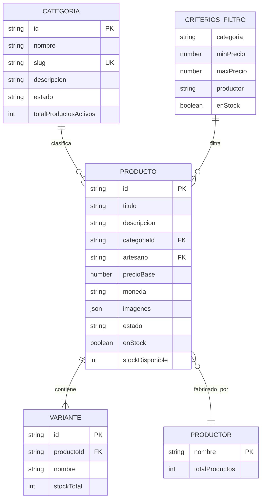

# Data Model: 001 - Catálogo de productos con filtros y sincronización de URL

**Branch**: `001-catalogo-filtros`  
**Date**: 2026-11-06  
**Status**: Completed  
**Feature Spec**: [spec.md](./spec.md)

---

## 1. Entidades del Dominio



---

## 2. Definición Detallada de Entidades

### 2.1. Categoria (Catálogo Público)

Representa las agrupaciones temáticas de productos artesanales en la tienda.

| Campo | Tipo | Obligatorio | Descripción | Ejemplo |
|---|---|:---:|---|---|
| `id` | `string` | Sí | Identificador único de la categoría | `"cat-ceramica"` |
| `nombre` | `string` | Sí | Nombre visible en español (2 a 80 caracteres) | `"Cerámica"` |
| `slug` | `string` | Sí | Slug URL-friendly normalizado sin tildes ni caracteres especiales | `"ceramica"` |
| `descripcion` | `string` | No | Breve texto descriptivo de la categoría | `"Piezas torneadas a mano..."` |
| `estado` | `string` | Sí | Estado de publicación (`"activa"` o `"archivada"`) | `"activa"` |
| `totalProductosActivos` | `number` | Sí | Conteo de productos activos adscritos a la categoría | `6` |

**Reglas de negocio**:
- En la vista pública del catálogo solo se listan y permiten filtrar categorías con `estado === "activa"`.
- La navegación por categoría puede realizarse por su `slug` o por su `id`.

---

### 2.2. Productor / Artesano

Representa al artesano, taller o marca creador de los artículos.

| Campo | Tipo | Obligatorio | Descripción | Ejemplo |
|---|---|:---:|---|---|
| `nombre` | `string` | Sí | Nombre comercial o personal del artesano | `"Taller Hermanos Alfareros"` |
| `totalProductos` | `number` | Sí | Cantidad de productos disponibles de dicho productor | `4` |

**Reglas de negocio**:
- La lista de productores seleccionables en el filtro se deduce dinámicamente de los productos activos en el catálogo.

---

### 2.3. Producto (Ficha de Catálogo Público)

Representa el artículo artesanal expuesto para su descubrimiento y compra.

| Campo | Tipo | Obligatorio | Descripción | Ejemplo |
|---|---|:---:|---|---|
| `id` | `string` | Sí | Identificador unívoco del producto | `"art-001"` |
| `titulo` | `string` | Sí | Título descriptivo del artículo | `"Jarrón de Cerámica Esmaltada Azul"` |
| `descripcion` | `string` | No | Explicación detallada de la pieza y técnicas artesanales | `"Pieza de gres esmaltada a mano..."` |
| `categoriaId` | `string` | Sí | Identificador de la categoría asociada | `"cat-ceramica"` |
| `categoriaNombre`| `string` | Sí | Nombre visible de la categoría asociada | `"Cerámica"` |
| `categoriaSlug`  | `string` | Sí | Slug unívoco de la categoría para enlaces | `"ceramica"` |
| `artesano` | `string` | Sí | Nombre del productor o taller artesanal | `"Taller Hermanos Alfareros"` |
| `precioBase` | `number` | Sí | Precio unitario oficial en euros con 2 decimales | `45.00` |
| `precioFormateado` | `string` | Sí | Importe con formato regional español y símbolo euro | `"45,00 €"` |
| `moneda` | `string` | Sí | Código de divisa oficial única (`"EUR"`) | `"EUR"` |
| `imagenes` | `Array<Imagen>` | Sí | Lista de recursos gráficos (mínimo 1 imagen o placeholder) | Ver detalle abajo |
| `enStock` | `boolean` | Sí | Indicador booleano de existencias disponibles (`stockDisponible > 0`) | `true` |
| `stockDisponible`| `number` | Sí | Suma de unidades disponibles en stock no reservadas | `5` |
| `estado` | `string` | Sí | Estado del producto (`"activo"` o `"archivado"`) | `"activo"` |

#### Subtipo: Imagen
```json
{
  "url": "/public/uploads/jarron-ceramica-1.webp",
  "nombreArchivo": "jarron-ceramica-1.webp",
  "esPrincipal": true
}
```

---

### 2.4. CriteriosFiltro (Parámetros de Búsqueda y URL)

Estructura de datos que modela el conjunto de filtros aplicados en un momento determinado.

| Parámetro | Clave en URL | Tipo | Validación y Saneamiento | Valor por Defecto |
|---|---|---|---|---|
| Categoría | `categoria` | `string` | Slug de categoría válido; si no coincide con ninguna categoría activa, se evalúa como sin resultados. | `null` (todas) |
| Precio Mínimo | `minPrecio` | `number` | Número $\ge 0$. Si `minPrecio > maxPrecio`, se invierten o ajustan automáticamente. | `null` |
| Precio Máximo | `maxPrecio` | `number` | Número $\ge 0$. | `null` |
| Productor | `productor` | `string` | Cadena de texto que coincide con el artesano. Coincidencia sin distinción de mayúsculas/minúsculas. | `null` |
| Disponibilidad en Stock | `enStock` | `boolean` | Si es `true`, filtra productos con `enStock === true`. Si es `false` o no está presente, incluye tanto disponibles como agotados. | `false` |

---

### 2.5. MetadatosFiltros (Respuesta para Inicialización de Filtros)

Estructura devuelta por el endpoint `/api/catalogo/filtros` para construir los controles de la interfaz.

```json
{
  "categorias": [
    {
      "id": "cat-ceramica",
      "nombre": "Cerámica",
      "slug": "ceramica",
      "totalProductos": 2
    },
    {
      "id": "cat-textil",
      "nombre": "Textil",
      "slug": "textil",
      "totalProductos": 1
    }
  ],
  "productores": [
    "Taller Hermanos Alfareros",
    "Tejeduría Tradicional de la Sierra",
    "Ebanistería Rural El Olivo"
  ],
  "rangoPrecio": {
    "min": 10.00,
    "max": 250.00
  }
}
```

---

## 3. Lógica de Filtrado y Reglas de Negocio

1. **Conjunción Lógica (AND estricto)**:
   $$\text{Producto Coincide} = (\text{Filtro Categoría}) \land (\text{Filtro Precio Mínimo}) \land (\text{Filtro Precio Máximo}) \land (\text{Filtro Productor}) \land (\text{Filtro Stock})$$
2. **Productos Archivados Excluidos**:
   - Solo se exponen y filtran productos con `estado === "activo"`.
3. **Persistencia y Normalización**:
   - Al cambiar cualquier control en el frontend, la URL se actualiza mediante `URLSearchParams` y `history.pushState`.
   - Si un valor de filtro se deselecciona o vuelve a su valor por defecto, su clave se elimina por completo de los parámetros de consulta de la URL.
