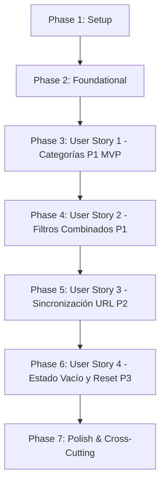

# Tasks: 001 - Catálogo de productos con filtros y sincronización de URL

**Branch**: `001-catalogo-filtros` | **Fecha**: 2026-11-06 | **Spec**: [spec.md](./spec.md) | **Plan**: [plan.md](./plan.md)

Desglose secuencial de tareas ordenadas por dependencias para la implementación del catálogo público interactivo de artesanías: navegación por categorías temáticas, filtros combinados multidimensionales (rango de precio en euros €, productor o artesano, disponibilidad en stock), sincronización bidireccional en tiempo real con los parámetros query de la URL (SEO e historial), estado amigable sin resultados y restablecimiento de filtros en un clic.

---

## Phase 1: Setup (Infraestructura Compartida)

**Propósito**: Configuración de constantes globales del catálogo, límites y cliente HTTP base para el consumo de la API pública.

- [X] T001 Actualizar constantes del sistema con rutas de catálogo público, parámetros query admitidos y configuración regional española en `backend/src/config/constants.js`
- [X] T002 [P] Crear cliente HTTP para interactuar con los endpoints públicos `/api/catalogo/*` en `frontend/src/services/catalog-api.service.js`
- [X] T003 [P] Crear hoja de estilos CSS base y diseño responsivo para la maquetación del catálogo, filtros y cuadrícula de productos en `frontend/src/styles/catalogo.css`

---

## Phase 2: Foundational (Prerrequisitos Bloqueantes)

**Propósito**: Servicios centrales de backend, controladores, rutas públicas y contenedor HTML base necesarios antes de construir las historias de usuario.

**⚠️ CRÍTICO**: Ninguna tarea de historia de usuario puede comenzar hasta que esta fase esté completada.

- [X] T004 [P] Implementar pruebas de contrato OpenAPI para los endpoints públicos (`/api/catalogo/productos` y `/api/catalogo/filtros`) en `tests/contract/catalogo-publico-api.test.js`
- [X] T005 [P] Implementar servicio base de catálogo con métodos de filtrado y consulta de metadatos sobre `store.js` en `backend/src/services/catalog.service.js`
- [X] T006 Implementar controlador REST de catálogo público con saneamiento de parámetros y códigos de estado HTTP en `backend/src/controllers/catalog.controller.js`
- [X] T007 Registrar y montar las rutas públicas en `backend/src/routes/catalog.routes.js` y habilitar el servicio de `/catalogo` y `catalogo.html` en `backend/src/server.js`
- [X] T008 Crear estructura HTML5 semántica y accesible (`<main>`, `<aside role="search">`, `<section aria-label="Catálogo">`) en `frontend/public/catalogo.html`

**Checkpoint**: Base de datos en memoria, endpoints REST públicos y plantilla HTML listos. Puede comenzar la implementación de las historias de usuario.

---

## Phase 3: User Story 1 - Navegación y Filtrado por Categorías (Priority: P1) 🎯 MVP

**Meta**: Permitir al visitante explorar la lista de categorías disponibles, seleccionar una de ellas para ver exclusivamente los productos asociados y observar la actualización visual de la ruta.

**Independent Test**: Acceder a `/catalogo.html`, seleccionar la categoría "Cerámica" y comprobar que solo se muestran piezas de cerámica, la categoría se resalta visualmente y la ruta refleja la selección.

### Pruebas de User Story 1
- [X] T009 [P] [US1] Implementar pruebas de integración de navegación por categorías y filtrado exclusivo en `tests/integration/catalogo-publico-flow.test.js`

### Implementación de User Story 1
- [X] T010 [US1] Añadir en `backend/src/services/catalog.service.js` la resolución y filtrado por categoría (`categoriaId` o `slug` exacto) asegurando que solo se expongan productos con `estado === "activo"`
- [X] T011 [P] [US1] Implementar componente de visualización y selección interactiva de categorías temáticas en `frontend/src/components/catalogo/category-nav.js`
- [X] T012 [P] [US1] Implementar componente de cuadrícula de tarjetas de productos con fotografía, título, artesano, precio formateado en euros (`€`) e indicador de stock en `frontend/src/components/catalogo/product-grid.js`
- [X] T013 [US1] Integrar la navegación por categorías y la recarga de productos en la vista principal en `frontend/public/catalogo.html`

**Checkpoint**: User Story 1 completa. El visitante puede navegar entre categorías temáticas de forma independiente (MVP funcional).

---

## Phase 4: User Story 2 - Filtrado Combinado Multidimensional (Precio, Productor y Stock) (Priority: P1)

**Meta**: Permitir al visitante acotar simultáneamente los productos mediante rango de precios (mínimo y máximo en €), productor o marca, y disponibilidad en stock (ocultando productos con existencias en cero), aplicando la conjunción lógica AND entre todos los filtros.

**Independent Test**: Ajustar precio mínimo a 10,00 €, precio máximo a 50,00 €, seleccionar "Taller Hermanos Alfareros" y activar "Solo en stock"; verificar que la lista exhibe únicamente productos que satisfacen todos los criterios a la vez.

### Pruebas de User Story 2
- [X] T014 [P] [US2] Agregar pruebas de integración para combinaciones multidimensionales de precio, productor y stock en `tests/integration/catalogo-publico-flow.test.js`

### Implementación de User Story 2
- [X] T015 [US2] Implementar lógica de filtrado acumulativo (rango de precios en €, productor case-insensitive y stock total disponible $> 0$ consultando variantes) con inversión automática si `minPrecio > maxPrecio` en `backend/src/services/catalog.service.js`
- [X] T016 [P] [US2] Implementar controles de formulario de filtros (campos numéricos de precio mínimo y máximo en €, selector desplegable de productores y toggle/checkbox de stock) en `frontend/src/components/catalogo/catalog-filters.js`
- [X] T017 [US2] Conectar los eventos de cambio de los filtros con la actualización de la cuadrícula de productos en `frontend/public/catalogo.html`

**Checkpoint**: User Story 2 completa. El visitante puede combinar libremente cualquier criterio de filtro para refinar su búsqueda.

---

## Phase 5: User Story 3 - Sincronización Bidireccional con la URL y Optimización SEO (Priority: P2)

**Meta**: Sincronizar en tiempo real cualquier cambio de filtros con los query params de la URL (`URLSearchParams` + `history.pushState`) y restaurar el estado de filtros y productos al abrir enlaces compartidos o navegar por el historial del navegador.

**Independent Test**: Abrir en ventana de incógnito `http://localhost:3000/catalogo.html?categoria=ceramica&minPrecio=15&maxPrecio=60&enStock=true`; comprobar que los selectores se preseleccionan con dichos valores y el catálogo muestra los productos ya filtrados.

### Pruebas de User Story 3
- [X] T018 [P] [US3] Agregar pruebas de sincronización de parámetros query de URL y tolerancia a valores inválidos o desconocidos en `tests/integration/catalogo-publico-flow.test.js`

### Implementación de User Story 3
- [X] T019 [P] [US3] Implementar módulo de serialización y lectura de parámetros de URL con `URLSearchParams`, invocación de `history.pushState` y escucha de `window.onpopstate` en `frontend/src/components/catalogo/url-sync.js`
- [X] T020 [US3] Conectar la sincronización de URL en el arranque y en cada modificación de filtros asegurando la eliminación de parámetros vacíos en `frontend/public/catalogo.html`

**Checkpoint**: User Story 3 completa. Las URLs son compartibles, indexables para SEO y totalmente compatibles con los botones Atrás/Adelante del navegador.

---

## Phase 6: User Story 4 - Estado Vacío y Restablecimiento Completo de Filtros (Priority: P3)

**Meta**: Presentar un mensaje descriptivo en español cuando ningún producto coincida con los filtros ("No se han encontrado productos con los filtros seleccionados") y ofrecer un botón visible para limpiar o restablecer todos los filtros a sus valores iniciales con un solo clic.

**Independent Test**: Definir un rango de precios sin artículos (ej. de 1 000,00 € a 2 000,00 €); verificar la aparición del mensaje de estado vacío y hacer clic en "Restablecer filtros" para volver al catálogo inicial completo con la URL limpia.

### Pruebas de User Story 4
- [X] T021 [P] [US4] Agregar prueba de integración para la detección de estado vacío y el restablecimiento total en `tests/integration/catalogo-publico-flow.test.js`

### Implementación de User Story 4
- [X] T022 [P] [US4] Implementar componente visual de aviso de estado vacío y botón accesible de acción única ("Restablecer filtros") en `frontend/src/components/catalogo/empty-state.js`
- [X] T023 [US4] Implementar el manejador de reseteo completo (limpieza de inputs, reseteo de URL y recarga del catálogo completo) en `frontend/public/catalogo.html`

**Checkpoint**: User Story 4 completa. El usuario dispone de una vía clara e inmediata de recuperación cuando su búsqueda no produce resultados.

---

## Phase 7: Polish & Cross-Cutting Concerns

**Propósito**: Verificación exhaustiva de calidad, directrices constitucionales y ejecución de la suite de pruebas automatizadas.

- [X] T024 [P] Auditar que el 100% de los textos, etiquetas ARIA, mensajes informativos y precios estén en español (`es-ES`) y en euros (`€`) con dos decimales conforme al Principio II
- [X] T025 [P] Implementar suite automatizada de validación de los 5 escenarios descritos en `quickstart.md` en `tests/integration/quickstart-catalogo-publico.test.js`
- [X] T026 Ejecutar la validación completa del sistema con `node --test tests/**/*.test.js` y verificar que los 26 criterios de aceptación se cumplan sin regresiones

---

## Dependencies & Execution Order

### Dependencias entre Fases

### Relaciones de Dependencia entre Historias de Usuario
- **US1 (P1 - Categorías)**: Requiere Foundational. Entrega el MVP base de catálogo navegable.
- **US2 (P1 - Filtros Combinados)**: Extiende US1 incorporando filtros de precio, productor y stock.
- **US3 (P2 - Sincronización URL)**: Se monta sobre US1 y US2 serializando los filtros activos en la URL.
- **US4 (P3 - Estado Vacío y Reset)**: Proporciona la capa de recuperación y reseteo integral sobre US1, US2 y US3.

---

## Oportunidades de Ejecución en Paralelo

### Fase 1 (Setup)
- `T002` (Cliente HTTP en `catalog-api.service.js`) y `T003` (Estilos en `catalogo.css`) pueden desarrollarse en paralelo tras `T001`.

### Fase 2 (Foundational)
- `T004` (Pruebas de contrato en `catalogo-publico-api.test.js`) y `T005` (Servicio en `catalog.service.js`) pueden desarrollarse en paralelo.

### Fase 3 (User Story 1)
- `T009` (Prueba de integración), `T011` (Componente de categorías `category-nav.js`) y `T012` (Cuadrícula `product-grid.js`) pueden implementarse en paralelo antes de la integración en `catalogo.html` (`T013`).

### Fase 4 (User Story 2)
- `T014` (Prueba de integración) y `T016` (Formulario `catalog-filters.js`) pueden desarrollarse en paralelo con la lógica del servicio `T015`.

### Fase 5 (User Story 3)
- `T018` (Prueba de integración) y `T019` (Módulo `url-sync.js`) pueden desarrollarse en paralelo.

### Fase 6 (User Story 4)
- `T021` (Prueba de integración) y `T022` (Componente `empty-state.js`) pueden desarrollarse en paralelo.

---

## Estrategia de Implementación

### MVP Primero (User Story 1 Únicamente)
1. Completar Fase 1 (Setup) y Fase 2 (Foundational).
2. Completar Fase 3 (User Story 1: Categorías y productos).
3. **Punto de parada y validación**: Verificar en navegador que la tienda muestra categorías y productos filtrados por categoría.
4. Despliegue/demostración del MVP.

### Entrega Incremental
1. Base lista (Setup + Foundational).
2. + User Story 1 → Catálogo funcional básico con navegación por categoría (MVP).
3. + User Story 2 → Capacidad de búsqueda avanzada combinando precios, artesanos y stock.
4. + User Story 3 → Enlaces compartibles por URL, soporte SEO e historial del navegador.
5. + User Story 4 → Manejo de búsquedas sin resultados y botón de reseteo en un clic.
6. Fase 7 → Validación exhaustiva de `quickstart.md` y suite global de pruebas.
