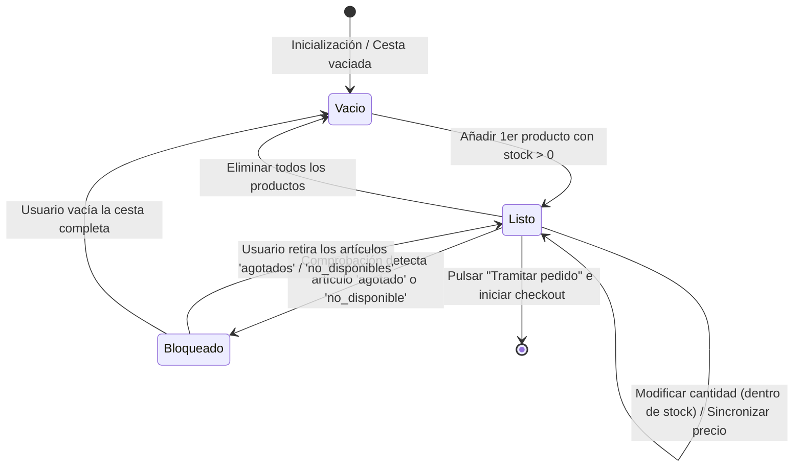
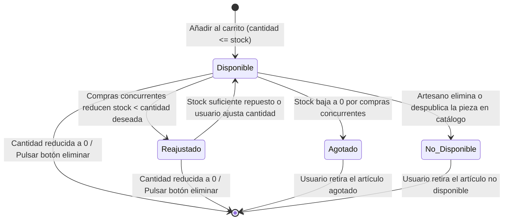

# Phase 1: Data Model - Carrito de Compras Persistente con Control de Stock

**Feature**: `specs/002-carrito-persistente/spec.md`  
**Responsable**: Desarrollador 2  
**Fecha**: 2026-10-19  

---

## 1. Entidades del Dominio

### 1.1. Carrito (`Cart`)
Representa el contenedor de compra del comprador, persistido en el cliente para visitantes anónimos o en el servidor para usuarios registrados.

| Campo | Tipo | Requerido | Descripción | Reglas de Validación |
| :--- | :--- | :--- | :--- | :--- |
| `id` | `string` | Sí | Identificador único del carrito (UUID v4 o id de sesión). | No vacío. Formato UUID. |
| `usuarioId` | `string \| null` | No | Identificador del usuario autenticado; `null` para anónimos. | ID de usuario válido si está autenticado. |
| `items` | `Array<LineaCarrito>`| Sí | Lista de artículos añadidos a la cesta. | Máximo 50 líneas. Sin duplicados de `varianteId`. |
| `subtotal` | `number` | Sí | Suma de los subtotales de las líneas disponibles en euros (€). | `>= 0.00`. Excluye líneas agotadas o no disponibles. |
| `gastosEnvioEstimados` | `number` | Sí | Estimación de gastos de envío en euros (€). | Fijo a `0.00` en v1 (FR-005). |
| `total` | `number` | Sí | Importe total a abonar en euros (`subtotal + gastosEnvioEstimados`). | `= subtotal` en v1. |
| `moneda` | `string` | Sí | Código de moneda oficial según la Constitución. | Constante `'EUR'`. |
| `fechaActualizacion` | `string` | Sí | Marca de tiempo ISO 8601 de la última alteración. | Formato ISO 8601 UTC. |
| `estado` | `string` | Sí | Estado operativo de la cesta para tramitación. | `'vacio' \| 'listo' \| 'bloqueado'` |

---

### 1.2. Línea de Carrito (`CartItem`)
Representa cada variante de producto artesanal incorporada al carrito de compra.

| Campo | Tipo | Requerido | Descripción | Reglas de Validación |
| :--- | :--- | :--- | :--- | :--- |
| `varianteId` | `string` | Sí | Identificador de la variante de artesanía (ej. `var-001-azul`). | Clave única en el catálogo. |
| `productoId` | `string` | Sí | Identificador del producto matriz (ej. `art-001`). | Referencia válida a catálogo. |
| `titulo` | `string` | Sí | Nombre y descripción de la pieza artesanal. | Longitud entre 3 y 150 caracteres. |
| `precioUnitario` | `number` | Sí | Precio unitario vigente en catálogo en euros (€). | `> 0.00`. Redondeado a 2 decimales. |
| `cantidad` | `number` | Sí | Unidades deseadas por el comprador. | Entero positivo (`1 <= cantidad <= stockDisponible`). |
| `stockDisponible`| `number` | Sí | Existencias físicas reales verificadas en tiempo real. | Entero `>= 0`. |
| `subtotalLinea` | `number` | Sí | Importe de la línea (`precioUnitario * cantidad`). | `= precioUnitario * cantidad`. `0.00` si está agotado/no disponible. |
| `estado` | `string` | Sí | Estado de disponibilidad de la línea. | `'disponible' \| 'reajustado' \| 'agotado' \| 'no_disponible'` |

---

### 1.3. Stock de Variante (`VariantStock`)
Entidad existente en el inventario del backend (`store.inventory`) consultada para las comprobaciones de stock.

| Campo | Tipo | Requerido | Descripción |
| :--- | :--- | :--- | :--- |
| `varianteId` | `string` | Sí | Identificador único de la variante. |
| `productoId` | `string` | Sí | Identificador del producto. |
| `titulo` | `string` | Sí | Nombre de la variante o pieza. |
| `precioUnitario`| `number` | Sí | Precio oficial vigente en catálogo. |
| `stockTotal` | `number` | Sí | Existencias físicas reales disponibles para venta inmediata. |
| `despublicado` | `boolean` | No | Indica si la pieza ha sido retirada o eliminada por el artesano. |

---

### 1.4. Notificación de Reajuste (`AdjustmentNotice`)
Objeto informativo retornado al cliente para componer avisos visuales destacados en la interfaz.

| Campo | Tipo | Descripción |
| :--- | :--- | :--- |
| `varianteId` | `string` | Identificador de la variante afectada. |
| `titulo` | `string` | Título del producto. |
| `tipo` | `string` | `'stock_reajustado' \| 'stock_agotado' \| 'precio_actualizado' \| 'producto_no_disponible'` |
| `mensaje` | `string` | Mensaje claro en español (`es-ES`) listo para mostrarse en la UI. |
| `cantidadPrevia` | `number?` | Cantidad que el usuario tenía antes de la verificación o fusión. |
| `cantidadNueva` | `number?` | Cantidad resultante tras el ajuste. |
| `precioPrevio` | `number?` | Precio que figuraba en la cesta local antes de actualizarse. |
| `precioNuevo` | `number?` | Precio vigente tras sincronizar con el catálogo. |

---

## 2. Diagrama de Transición de Estados

### Ciclo de Vida del Carrito (`Cart.estado`)

### Ciclo de Vida de una Línea de Carrito (`CartItem.estado`)

---

## 3. Reglas de Validación y Consistencia del Negocio

1. **Invariante de Inventario (FR-002)**: En ningún caso la suma de cantidades para una `varianteId` en un carrito puede ser mayor que su `stockTotal` actual en `store.inventory`.
2. **Exclusión de Importes en Líneas Inválidas (FR-008, Edge Cases)**: Las líneas en estado `'agotado'` o `'no_disponible'` tienen `subtotalLinea = 0.00` y no computan para el `subtotal` ni el `total` del carrito.
3. **Bloqueo de Tramitación (FR-008)**: Si al menos una línea tiene estado `'agotado'` o `'no_disponible'`, el estado global del carrito pasa a `'bloqueado'` y el botón "Tramitar pedido" queda deshabilitado en la UI.
4. **Validación de Cero Artículos (FR-001)**: Si `items.length === 0`, el estado es `'vacio'`, el subtotal y total son `0.00 €` y la tramitación queda deshabilitada.
5. **Formateo de Moneda (Principio II)**: Toda salida numérica formateada en la interfaz debe coincidir con `Intl.NumberFormat('es-ES', { style: 'currency', currency: 'EUR' })` (ej. `45,00 €`).
