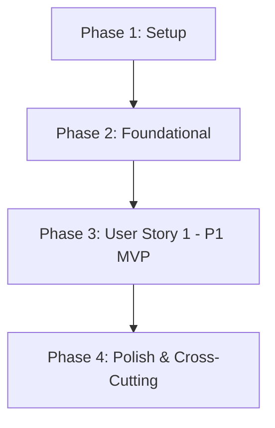
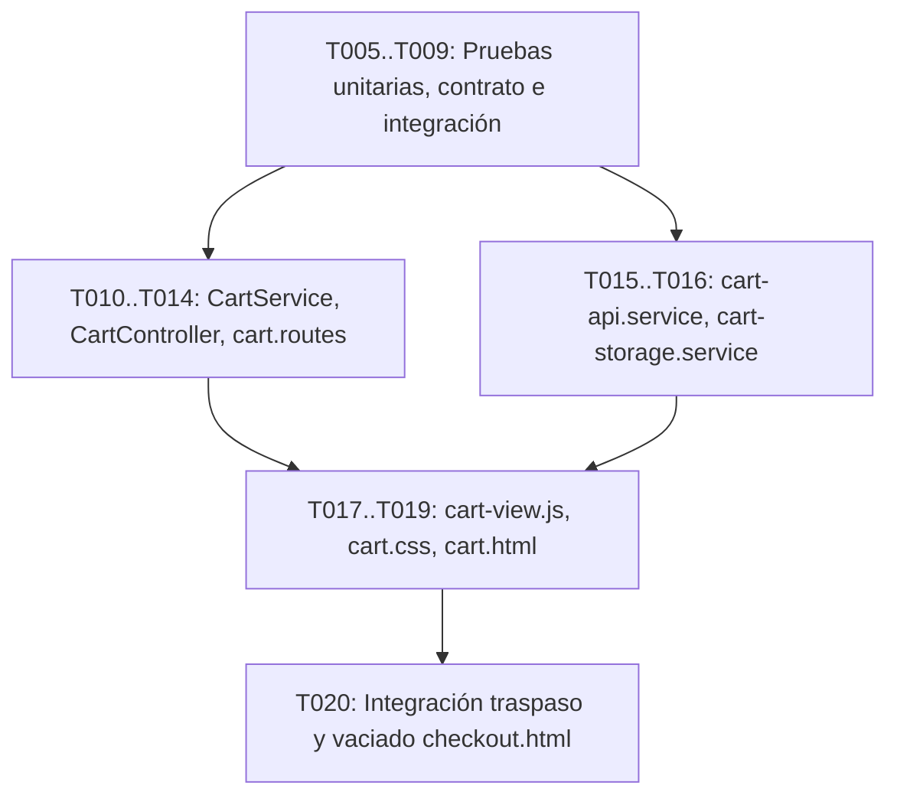

# Tasks: 002 - Carrito de Compras Persistente con Control de Stock

**Branch**: `feat/gestion-carrito` | **Fecha**: 2026-11-03 | **Spec**: [spec.md](./spec.md) | **Plan**: [plan.md](./plan.md)

Desglose de tareas ordenadas por dependencias para la implementación del carrito de compras persistente con control estricto de inventario en tiempo real, persistencia dual (LocalStorage / MemoryStore), algoritmo determinista de fusión de cestas al iniciar sesión, sincronización de precios de catálogo y tratamiento de zero-state.

---

## Phase 1: Setup (Infraestructura Compartida)

**Propósito**: Configuración de dependencias y parámetros compartidos del carrito.

- [X] T001 [P] Añadir constantes del carrito (clave `tienda_online_cart_v1`, estados de cesta y línea, tipos de avisos de reajuste) en `backend/src/config/constants.js`
- [X] T002 [P] Extender `MemoryStore` con mapa `this.carts` y métodos CRUD de carrito (`getCart`, `saveCart`, `deleteCart`) en `backend/src/models/store.js`

---

## Phase 2: Foundational (Prerrequisitos Bloqueantes)

**Propósito**: Componentes de dominio y routing base que deben estar operativos antes de implementar los flujos de usuario.

**⚠️ CRITICAL**: Ninguna tarea de la historia de usuario puede iniciarse hasta completar esta fase.

- [X] T003 [P] Implementar modelo de dominio `Cart` y `CartItem` con cálculo de subtotales y validaciones en `backend/src/models/cart.model.js`
- [X] T004 Configurar rutas Express del carrito y registrar la ruta estática `/carrito` en `backend/src/server.js`

**Checkpoint**: Base de almacenamiento y modelos lista. Puede comenzar la implementación de User Story 1.

---

## Phase 3: User Story 1 - Gestión del Carrito y Persistencia con Límite de Stock (Priority: P1) 🎯 MVP

**Meta**: Permitir a cualquier comprador añadir piezas artesanales a su cesta, ajustar unidades sin exceder el stock real disponible, persistir la cesta tras reiniciar sesión o navegador, fusionar carritos al autenticarse con avisos informativos, sincronizar precios con el catálogo en tiempo real y bloquear la tramitación si hay productos no disponibles o agotados.

**Independent Test**:
1. Añadir 3 unidades de un producto con stock 5; verificar subtotal en euros y estimación gratuita 0,00 €.
2. Intentar subir el selector por encima del stock real disponible (ej. 2 unidades en pieza única con stock 1); verificar bloqueo inmediato (< 100 ms) y alerta contextual.
3. Cerrar y reabrir el navegador; verificar que la cesta y subtotales se recuperan intactos desde `LocalStorage`.
4. Simular compra concurrente que reduzca el stock; verificar reajuste automático de cantidad y aviso visual.
5. Iniciar sesión con cesta anónima teniendo carrito previo en cuenta; verificar fusión y advertencias si se recortaron unidades.
6. Modificar precio en catálogo; verificar actualización automática y aviso informativo en la cesta.
7. Vaciar la cesta; verificar mensaje visible "Tu cesta está vacía" y botón "Tramitar pedido" inhabilitado.

### Pruebas de User Story 1

> **NOTA: Escribir y verificar que fallen antes de completar la implementación correspondiente.**

- [X] T005 [P] [US1] Pruebas de contrato para endpoints OpenAPI (`/api/carrito`, `/api/carrito/items`, `/api/carrito/validar-stock`, `/api/carrito/fusionar`) en `tests/contract/cart-api.contract.test.js`
- [X] T006 [P] [US1] Pruebas unitarias de cálculo de subtotales, rechazo de entradas inválidas y validación de stock disponible en `tests/unit/cart-service.test.js`
- [X] T007 [P] [US1] Pruebas unitarias del algoritmo de fusión de carritos y generación de avisos de reajuste en `tests/unit/cart-merge.test.js`
- [X] T008 [P] [US1] Pruebas de integración para sincronización y validación reactiva de stock disponible ante compras concurrentes en `tests/integration/cart-sync.test.js`
- [X] T009 [P] [US1] Pruebas de integración del flujo de cesta y persistencia en LocalStorage en `tests/integration/cart-flow.test.js`

### Servicios y Lógica de Negocio (Backend)

- [X] T010 [US1] Implementar `CartService` (métodos de adición, actualización de cantidad con validación entera, cálculo en euros y consulta a `store.getAvailableStock`) en `backend/src/services/cart.service.js`
- [X] T011 [US1] Implementar método de verificación de stock y sincronización de precios de catálogo (`validarStock`) en `backend/src/services/cart.service.js`
- [X] T012 [US1] Implementar método de fusión determinista de carritos (`fusionarCarritos`) con emisión de `AdjustmentNotice` en `backend/src/services/cart.service.js`

### Controladores y Rutas (Backend)

- [X] T013 [US1] Implementar `CartController` gestionando endpoints REST conforme al contrato OpenAPI y middleware de errores en `backend/src/controllers/cart.controller.js`
- [X] T014 [US1] Definir router Express y asociar controladores de cesta en `backend/src/routes/cart.routes.js`

### Capa de Servicios y Almacenamiento (Frontend)

- [X] T015 [P] [US1] Implementar cliente HTTP fetch hacia los endpoints `/api/carrito` en `frontend/src/services/cart-api.service.js`
- [X] T016 [P] [US1] Implementar servicio de persistencia dual `CartStorageService` con clave `tienda_online_cart_v1`, sincronización con API y método `clearCart` en `frontend/src/services/cart-storage.service.js`

### Interfaz de Usuario y Vistas (Frontend)

- [X] T017 [P] [US1] Implementar componente de vista reactiva `CartView` con renderizado de tabla, formateo `es-ES`, selector de cantidad con saneamiento de entradas no enteras y panel de avisos en `frontend/src/components/cart-view.js`
- [X] T018 [P] [US1] Crear hoja de estilos CSS responsiva para la tabla de artículos, avisos de reajuste y estado de cesta vacía en `frontend/src/styles/cart.css`
- [X] T019 [US1] Crear página HTML completa de la cesta de compras y orquestación de componentes en `frontend/public/cart.html`
- [X] T020 [US1] Integrar traspaso a checkout y vaciado automático de cesta (`clearCart`) tras confirmación de cobro en `frontend/public/checkout.html`

**Checkpoint**: User Story 1 completada de extremo a extremo, cumpliendo los 9 requisitos funcionales y 3 criterios de éxito medibles.

---

## Phase 4: Polish & Cross-Cutting Concerns

**Propósito**: Verificaciones de calidad, estándares constitucionales y validación de aceptación.

- [X] T021 [P] Auditar y asegurar que el 100% de los textos, etiquetas, mensajes de error y avisos estén en español de España (`es-ES`) y todos los precios formateados en euros (`XX,XX €`) conforme al Principio II
- [X] T022 [P] Validar que no se solicitan datos personales en la cesta anónima ni existen credenciales o secretos en configuración (Principio V)
- [X] T023 Ejecutar la suite completa de pruebas automatizadas con `npm test` verificando que todos los tests pasen
- [X] T024 Ejecutar la guía de validación manual paso a paso de los escenarios de aceptación descritos en `specs/002-carrito-persistente/quickstart.md`
- [X] T025 [US1] Implementar la sección "Te puede interesar" en `frontend/public/cart.html` mostrando únicamente artículos del catálogo con existencias disponibles (filtro `enStock` sobre `/api/catalogo/productos`) y ocultando la sección si no hay artículos disponibles (FR-009)

---

## Dependencies & Execution Order

### Dependencias entre Fases

### User Story Dependencies

- **User Story 1 (P1)**: Depende exclusivamente de Phase 2 (Foundational). Constituye el MVP autónomo e independiente.

### Orden de Ejecución Interno en User Story 1

---

## Parallel Opportunities

- **Phase 1**: `T001` y `T002` se pueden ejecutar en paralelo (archivos distintos: `constants.js` y `store.js`).
- **Phase 2**: `T003` se puede ejecutar en paralelo con la preparación de rutas de `T004`.
- **Phase 3 (Pruebas)**: `T005`, `T006`, `T007`, `T008` y `T009` se pueden redactar en paralelo al operar sobre archivos de prueba independientes.
- **Phase 3 (Frontend / Backend)**: Una vez definidas las firmas de `cart.service.js`, la capa cliente (`T015`, `T016`, `T017`, `T018`) puede desarrollarse en paralelo con el controlador backend (`T013`, `T014`).
- **Phase 4**: `T021` y `T022` se pueden auditar en paralelo antes de la ejecución de validaciones finales `T023` y `T024`.

---

## Implementation Strategy

### MVP First (User Story 1)

1. Completar **Phase 1 (Setup)** y **Phase 2 (Foundational)**.
2. Escribir pruebas de contrato y unitarias en **Phase 3** y verificar que fallen.
3. Implementar la lógica de negocio en backend (`CartService`, `CartController`, `cart.routes`).
4. Implementar la persistencia en `LocalStorage` y la vista reactiva `CartView` en `cart.html`.
5. Probar el flujo completo de cesta de compras de forma aislada.
6. Integrar el traspaso y vaciado con `checkout.html`.
7. Ejecutar validaciones y checklist de **Phase 4**.
