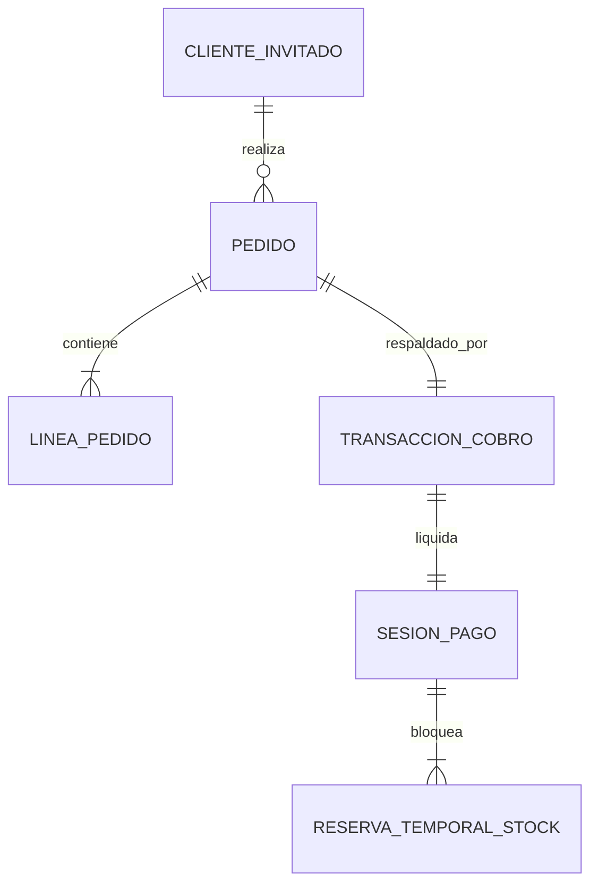
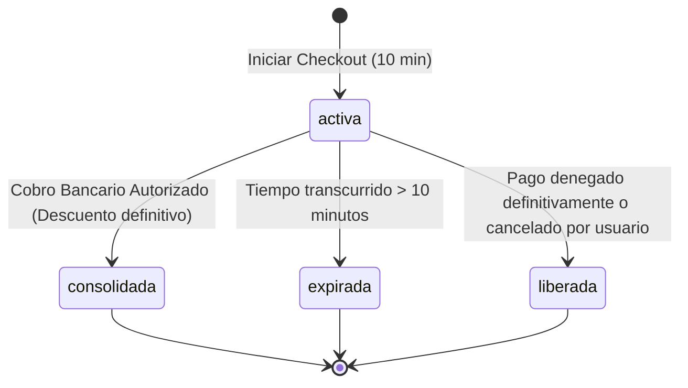
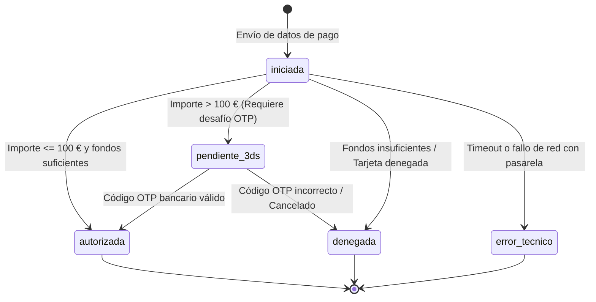
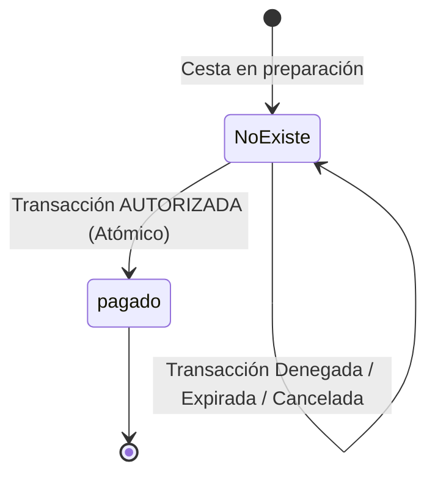

# Modelo de Datos: 003 - Pago Seguro con Tarjeta y Confirmación Condicionada

**Feature**: `003-pago-tarjeta` | **Fecha**: 2026-10-14  
**Contexto**: Define las entidades de datos, atributos, tipos, restricciones y transiciones de estado para el proceso de pago, reserva de stock y confirmación de pedidos.

---

## 1. Entidades del Dominio

### 1.1. Pedido (Order)
Representa la compra formalizada y respaldada financieramente. Se crea e inserta en la base de datos de forma atómica y **exclusivamente tras recibir la autorización exitosa del cobro** por parte de la entidad de pago (FR-003).

| Campo | Tipo | Requerido | Descripción y Reglas de Validación |
|-------|------|-----------|-------------------------------------|
| `id` | String (UUID) | Sí | Identificador interno único del pedido. |
| `codigoReferencia` | String | Sí | Código de pedido único visible para el usuario (formato `PED-YYYYMMDD-XXXX`). |
| `clienteNombre` | String | Sí | Nombre completo del comprador (mínimo 2 caracteres, máximo 100). |
| `clienteEmail` | String | Sí | Correo electrónico de contacto validado con formato RFC 5322. |
| `cuentaId` | String \| null | No | Identificador de cuenta de usuario registrada si el cliente inició sesión; `null` si es invitado. |
| `total` | Number (Decimal) | Sí | Importe total abonado en euros (€). Debe ser mayor que 0 y coincidir con la suma de líneas. |
| `estado` | String (Enum) | Sí | Estado del pedido. En esta versión nace y permanece en: `"pagado"`. |
| `transaccionId` | String (UUID) | Sí | Identificador de la transacción de cobro autorizada que respalda el pedido. |
| `fechaCreacion` | String (ISO 8601) | Sí | Marca temporal de la autorización del pago y creación del pedido. |
| `lineas` | Array\<LineaPedido\> | Sí | Lista de artículos y variantes adquiridas (mínimo 1 elemento). |

---

### 1.2. Línea de Pedido (OrderLine)
Detalle inmutable de cada producto y variante adquirido en el pedido.

| Campo | Tipo | Requerido | Descripción y Reglas de Validación |
|-------|------|-----------|-------------------------------------|
| `id` | String (UUID) | Sí | Identificador único de la línea de pedido. |
| `productoId` | String | Sí | Identificador de la pieza artesanal adquirida. |
| `varianteId` | String | Sí | Identificador de la variante específica (talla, color, acabado). |
| `titulo` | String | Sí | Nombre o denominación de la pieza al momento de la compra. |
| `precioUnitario` | Number (Decimal) | Sí | Precio unitario aplicado en euros con dos decimales (`0.00 €`). |
| `cantidad` | Integer | Sí | Número de unidades compradas (entero $\ge 1$). |
| `subtotal` | Number (Decimal) | Sí | Importe total de la línea (`precioUnitario * cantidad`). |

---

### 1.3. Reserva Temporal de Stock (StockReservation)
Bloqueo transitorio de existencias asignado al comprador mientras interactúa con el formulario de pago o el desafío bancario (FR-005).

| Campo | Tipo | Requerido | Descripción y Reglas de Validación |
|-------|------|-----------|-------------------------------------|
| `id` | String (UUID) | Sí | Identificador único de la reserva. |
| `sesionPagoId` | String (UUID) | Sí | Identificador de la sesión de checkout asociada. |
| `varianteId` | String | Sí | Identificador de la variante de producto bloqueada. |
| `cantidad` | Integer | Sí | Unidades bloqueadas para la compra (entero $\ge 1$). |
| `creadaEn` | String (ISO 8601) | Sí | Marca temporal del inicio de la reserva. |
| `expiresAt` | String (ISO 8601) | Sí | Marca temporal de expiración (`creadaEn` + 10 minutos). |
| `estado` | String (Enum) | Sí | `"activa"` \| `"consolidada"` \| `"expirada"` \| `"liberada"`. |

**Regla de cálculo de stock disponible**:
$$\text{Stock Disponible} = \text{Stock Físico} - \sum_{\text{estado}=\text{"activa"}} \text{cantidad}$$

---

### 1.4. Transacción de Cobro (PaymentTransaction)
Comprobante inmutable de la operación bancaria con la pasarela. **No almacena en ningún caso el PAN (número completo de tarjeta) ni el CVV**, cumpliendo con el Principio V y el Criterio SC-003.

| Campo | Tipo | Requerido | Descripción y Reglas de Validación |
|-------|------|-----------|-------------------------------------|
| `id` | String (UUID) | Sí | Identificador de la transacción interna. |
| `pasarelaRef` | String | Sí | Código de transacción devuelto por la pasarela bancaria. |
| `importe` | Number (Decimal) | Sí | Importe exacto cobrado en euros (€). |
| `moneda` | String | Sí | Constante `"EUR"`. |
| `ultimosCuatro` | String | Sí | Últimos 4 dígitos de la tarjeta para visualización en recibo (ej. `"4242"`). |
| `marcaTarjeta` | String | Sí | Marca comercial de la tarjeta (ej. `"Visa"`, `"Mastercard"`). |
| `requiere3ds` | Boolean | Sí | `true` si `importe > 100.00 €`, `false` si $\le 100.00 €$. |
| `estado` | String (Enum) | Sí | `"iniciada"` \| `"pendiente_3ds"` \| `"autorizado"` \| `"denegado"` \| `"error_tecnico"`. |
| `codigoRespuesta` | String | Sí | Código de estado bancario (ej. `"0000"` para éxito, `"0101"` fondos insuficientes, etc.). |
| `mensajeError` | String \| null | No | Descripción informativa del rechazo en español si la transacción fue denegada. |
| `fecha` | String (ISO 8601) | Sí | Marca temporal de la respuesta definitiva bancaria. |

---

## 2. Diagramas de Transición de Estados

### 2.1. Ciclo de Vida de la Reserva de Stock

### 2.2. Ciclo de Vida de la Transacción de Cobro

### 2.3. Creación Atómica del Pedido

