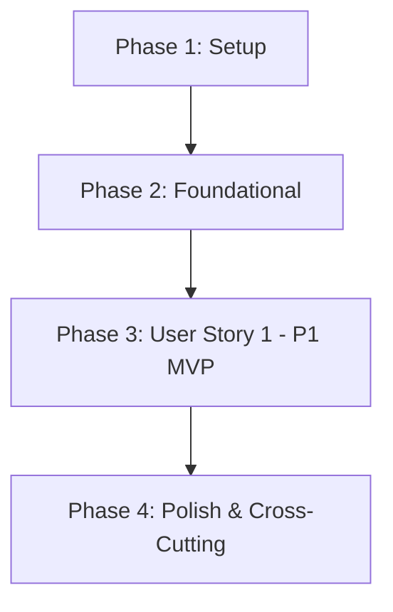

# Tasks: 003 - Pago Seguro con Tarjeta y Confirmación Condicionada

**Branch**: `003-pago-tarjeta` | **Fecha**: 2026-10-14 | **Spec**: [spec.md](./spec.md) | **Plan**: [plan.md](./plan.md)

Desglose de tareas ordenadas por dependencias para la implementación de la pasarela de pago seguro con tarjeta, control de stock temporal (10 minutos), 3D Secure condicional (> 100 €), webhook bancario e integración de compra como invitado.

---

## Phase 1: Setup (Infraestructura Compartida)

**Propósito**: Inicialización del proyecto, dependencias y estructura básica de directorios.

- [x] T001 Crear la estructura completa de directorios del proyecto backend y frontend en `backend/src/` y `frontend/src/`
- [x] T002 Inicializar la configuración del proyecto Node.js con scripts de ejecución y dependencias básicas en `package.json`
- [x] T003 [P] Configurar constantes compartidas del sistema (tiempo de reserva 10 min, umbral 3DS 100 €, moneda EUR) en `backend/src/config/constants.js`

---

## Phase 2: Foundational (Prerrequisitos Bloqueantes)

**Propósito**: Componentes de infraestructura base y almacenamiento que deben estar completados antes de implementar los flujos de usuario.

- [x] T004 [P] Implementar almacén de persistencia transaccional en memoria/archivo con operaciones atómicas en `backend/src/models/store.js`
- [x] T005 [P] Implementar middleware de gestión centralizada de errores y respuestas estructuradas en `backend/src/middleware/error-handler.js`
- [x] T006 [P] Implementar servicio emisor de tokens simulados y validador de formato de tarjeta (Luhn) en `frontend/src/services/card-tokenizer.service.js`
- [x] T007 Configurar servidor Express con middlewares de parsing JSON, cabeceras seguras y servicio de estáticos en `backend/src/server.js`

**Checkpoint**: Infraestructura base operativa. Comienza la implementación de la historia de usuario central.

---

## Phase 3: User Story 1 - Pasarela de Pago con Tarjeta y Confirmación de Compra (Priority: P1) 🎯 MVP

**Meta**: Permitir a cualquier comprador (invitado o registrado) pagar con tarjeta de forma segura, reservando el stock durante 10 minutos, completando el desafío 3D Secure si el importe supera 100 €, y persistiendo el pedido en estado "pagado" única y exclusivamente cuando la entidad bancaria autorice el cobro (síncronamente o vía webhook).

**Independent Test**:
1. Acceder con cesta $\le 100\text{ \euro}$, introducir datos de tarjeta válida; verificar creación atómica del pedido pagado, descuento de stock y emisión del recibo sin pantallas intermedias.
2. Acceder con cesta $> 100\text{ \euro}$; verificar que se despliega el modal 3DS y que el pedido solo se confirma tras introducir el código OTP correcto (`1234`).
3. Introducir tarjeta con saldo insuficiente o datos denegados; verificar que se informa en español, no se genera pedido y la cesta queda intacta.
4. Dejar transcurrir más de 10 minutos en la pantalla de pago; verificar que la reserva de existencias se libera y el cobro se bloquea.
5. Cerrar el navegador tras autorizar el pago; verificar que el webhook bancario procesa la confirmación de forma desatendida e idempotente.

### Pruebas de User Story 1

> **NOTA: Escribir y verificar que fallen antes de completar la implementación correspondiente.**

- [x] T008 [P] [US1] Pruebas de contrato para los endpoints de checkout (`/api/pagos/iniciar`, `/api/pagos/procesar`, `/api/pagos/verificar-3ds`, `/api/pagos/webhook`) en `tests/contract/checkout-api.test.js`
- [x] T009 [P] [US1] Pruebas de integración del ciclo de vida de cobro (autorización directa, 3DS, expiración de reserva e idempotencia de webhook) en `tests/integration/checkout-flow.test.js`

### Modelos y Lógica de Negocio

- [x] T010 [P] [US1] Crear modelo de Reserva Temporal de Stock y cálculo de stock disponible en `backend/src/models/stock-reservation.model.js`
- [x] T011 [P] [US1] Crear modelo de Transacción de Cobro con aislamiento estricto de PAN/CVV en `backend/src/models/transaction.model.js`
- [x] T012 [P] [US1] Crear modelo de Pedido y Línea de Pedido con persistencia atómica post-cobro en `backend/src/models/order.model.js`
- [x] T013 [US1] Implementar StockReservationService (bloqueo de 10 min, consolidación definitiva y liberación por expiración o fallo) en `backend/src/services/stock-reservation.service.js`
- [x] T014 [US1] Implementar PaymentGatewayService (simulador de pasarela con tarjetas de prueba, autorización directa, desafío 3DS para $> 100\text{ \euro}$ y firma de webhooks) en `backend/src/services/payment-gateway.service.js`
- [x] T015 [US1] Implementar OrderService (creación atómica del pedido pagado, consolidación de existencias y vaciado de carrito) en `backend/src/services/order.service.js`

### Controladores y Endpoints del Backend

- [x] T016 [US1] Implementar CheckoutController (`iniciarPago`, `procesarPago`, `verificar3DS`) en `backend/src/controllers/checkout.controller.js`
- [x] T017 [P] [US1] Implementar WebhookController con verificación de firma bancaria y control de idempotencia en `backend/src/controllers/webhook.controller.js`
- [x] T018 [P] [US1] Implementar OrderController para consulta y emisión del comprobante del pedido pagado en `backend/src/controllers/order.controller.js`
- [x] T019 [US1] Registrar y montar las rutas de pago y pedidos en `backend/src/routes/payment.routes.js` y `backend/src/routes/order.routes.js`

### Componentes de Interfaz de Usuario (Frontend)

- [x] T020 [P] [US1] Implementar cliente HTTP de interacción con la API de checkout en `frontend/src/services/payment-api.service.js`
- [x] T021 [P] [US1] Implementar componente de temporizador regresivo de reserva de stock (10 minutos) con aviso visual de expiración en `frontend/src/components/reservation-timer.js`
- [x] T022 [P] [US1] Implementar diálogo modal interactivo de desafío de autenticación 3D Secure en `frontend/src/components/payment-3ds-modal.js`
- [x] T023 [P] [US1] Implementar vista de justificante de compra y confirmación de pedido con código de referencia y desglose en euros en `frontend/src/components/order-receipt.js`
- [x] T024 [US1] Implementar componente de formulario de pago (datos de invitado: nombre y email, campos de tarjeta con tokenización y protección contra doble clic) en `frontend/src/components/checkout-form.js`
- [x] T025 [US1] Integrar la página HTML completa de checkout y orquestación de componentes en `frontend/public/checkout.html`
- [x] T026 [P] [US1] Crear hoja de estilos CSS responsiva para el formulario de pago, contador de reserva y modal bancario 3DS en `frontend/src/styles/checkout.css`

**Checkpoint**: User Story 1 completada de extremo a extremo, cumpliendo todos los criterios de aceptación y los 7 requisitos funcionales.

---

## Phase 4: Polish & Cross-Cutting Concerns

**Propósito**: Verificaciones de calidad, estándares constitucionales y validación de aceptación.

- [x] T027 [P] Auditar y asegurar que el 100% de los textos, alertas y mensajes bancarios estén en español de España (`es-ES`) y todos los precios en euros con formato estándar (`XX,XX €`) conforme al Principio II
- [x] T028 [P] Auditar el código y registros de backend para asegurar que ningún dato de tarjeta (PAN, CVV) sea almacenado o impreso en logs (SC-003, Principio V)
- [x] T029 Ejecutar la batería completa de validación manual paso a paso descrita en `specs/003-pago-tarjeta/quickstart.md`

---

## Dependencies & Execution Order

### Dependencias entre Fases

### Orden de Ejecución Interno en User Story 1
1. **Pruebas primero**: Escribir pruebas de contrato (`T008`) e integración (`T009`) asegurando que fallen antes del código de producción.
2. **Modelos**: Crear `T010` (Reserva), `T011` (Transacción) y `T012` (Pedido).
3. **Servicios de negocio**: `T013` (ReservaService) y `T014` (GatewayService) habilitan `T015` (OrderService).
4. **Controladores y Rutas**: `T016`, `T017` y `T018` se integran en `T019`.
5. **Componentes Frontend**: El cliente API (`T020`), temporizador (`T021`), modal 3DS (`T022`) y recibo (`T023`) se construyen en paralelo antes de ensamblar el formulario principal (`T024`) y la página HTML (`T025`, `T026`).
6. **Validación**: Fase 4 valida la conformidad constitucional y las pruebas de `quickstart.md`.

---

## Oportunidades de Ejecución en Paralelo

### Paralelismo en Setup y Foundational
- `T003` (Constantes) se puede realizar en paralelo con `T002`.
- `T004` (Almacén de datos), `T005` (Manejador de errores) y `T006` (Tokenizador de tarjeta) se pueden implementar en paralelo.

### Paralelismo en User Story 1
- `T008` (Pruebas de contrato) y `T009` (Pruebas de integración) se pueden escribir en paralelo.
- `T010` (Modelo Reserva), `T011` (Modelo Transacción) y `T012` (Modelo Pedido) se pueden programar en paralelo.
- `T017` (WebhookController) y `T018` (OrderController) se pueden codificar en paralelo con `T016`.
- `T020` (Cliente API), `T021` (Temporizador), `T022` (Modal 3DS) y `T023` (Recibo) se pueden desarrollar en paralelo antes de la orquestación en `T024`.

---

## Estrategia de Implementación

### Alcance MVP Recomendado
El alcance MVP para esta funcionalidad corresponde íntegramente a **User Story 1 (Fases 1, 2 y 3)**:
1. Completar Setup (Fase 1) y Foundational (Fase 2).
2. Desarrollar la lógica de cobro con tarjeta, reserva de 10 min, 3DS condicional y persistencia atómica en estado "pagado".
3. Validar con los 5 escenarios de prueba de [quickstart.md](./quickstart.md).
4. Finalizar con la auditoría de idioma, euros y privacidad de datos (Fase 4).
