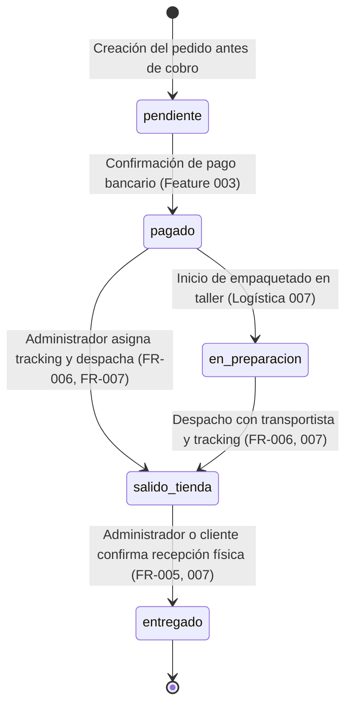
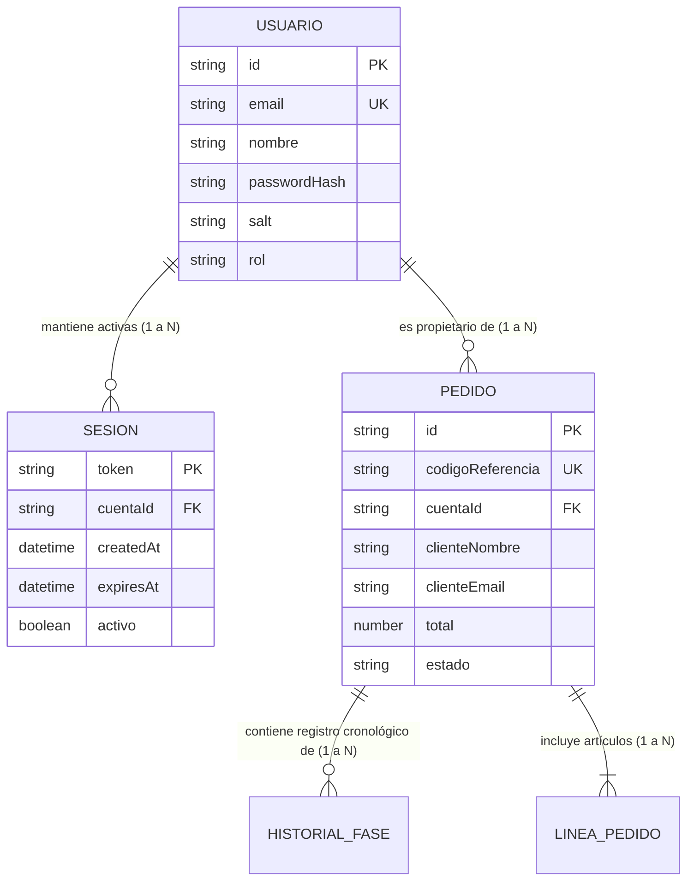

# Data Model: 004 - Cuentas de Usuario y Seguimiento de Fases de Pedido

**Feature**: `004-cuentas-seguimiento`  
**Date**: 2026-11-09  
**Status**: Complete  

---

## Entidades Principales

### 1. Entidad `Usuario` (Cuenta de Cliente / Administrador)

Representa la cuenta personal registrada de un comprador o empleado de la tienda.

| Campo | Tipo | Requerido | Descripción y Reglas de Validación |
|-------|------|-----------|-------------------------------------|
| `id` | `String (UUID v4)` | Sí | Identificador único universal de la cuenta. |
| `nombre` | `String` | Sí | Nombre del usuario (1 a 100 caracteres, sin espacios en blanco superfluos). |
| `email` | `String` | Sí | Correo electrónico único en el sistema. Formato válido según estándar RFC 5322. Normalizado a minúsculas. |
| `passwordHash` | `String` | Sí | Hash criptográfico derivado mediante `node:crypto.scryptSync`. No se expone nunca en respuestas de la API. |
| `salt` | `String` | Sí | Sal criptográfica aleatoria de 16 bytes generada con `node:crypto.randomBytes`. |
| `rol` | `String` | Sí | Rol de acceso: `'cliente'` (por defecto para registros públicos) o `'admin'` (para gestión de fases). |
| `createdAt` | `String (ISO 8601)` | Sí | Marca temporal de creación de la cuenta. |
| `updatedAt` | `String (ISO 8601)` | Sí | Marca temporal de última actualización. |

**Reglas de validación de negocio**:
- **Email único**: No pueden existir dos cuentas con el mismo correo electrónico (ignora mayúsculas/minúsculas).
- **Contraseña determinista**: Longitud mínima obligatoria de 8 caracteres al registrarse (FR-001 y clarificación 2026-11-09).
- **Mínima información (Principio V)**: No se solicitan datos innecesarios en el registro (solo nombre, email y contraseña).

---

### 2. Entidad `Sesion` (Sesión de Usuario Persistente)

Gestiona la autenticación activa del usuario entre navegaciones y reinicios del navegador durante un período de 30 días (SC-002, FR-002).

| Campo | Tipo | Requerido | Descripción y Reglas de Validación |
|-------|------|-----------|-------------------------------------|
| `token` | `String (Hex 64 chars)` | Sí | Token aleatorio criptográficamente seguro (32 bytes generados por `randomBytes`). |
| `cuentaId` | `String (UUID v4)` | Sí | Clave foránea que referencia al `Usuario.id` propietario de la sesión. |
| `createdAt` | `String (ISO 8601)` | Sí | Fecha de emisión de la sesión. |
| `expiresAt` | `String (ISO 8601)` | Sí | Fecha de caducidad automática (30 días desde la creación o última renovación). |
| `lastAccessAt` | `String (ISO 8601)` | Sí | Marca temporal del último acceso realizado con este token. |
| `activo` | `Boolean` | Sí | `true` mientras la sesión esté vigente; pasa a `false` tras el cierre explícito de sesión (`logout`). |

---

### 3. Entidad `Pedido` (Extensión y Consulta para Feature 004)

Reutiliza la entidad `Order` de `backend/src/models/order.model.js` vinculándola con la cuenta del usuario y gestionando las fases oficiales en plena compatibilidad con `CONSTANTS.ORDER_STATUS` (Features 003, 007 y 008).

| Campo | Tipo | Requerido | Descripción y Reglas de Validación |
|-------|------|-----------|-------------------------------------|
| `id` | `String (UUID v4)` | Sí | Identificador interno único del pedido. |
| `codigoReferencia` | `String` | Sí | Código amigable visible para el cliente (ej. `PED-20261013-A1B2`). |
| `cuentaId` | `String (UUID v4)` | No | Identificador de la cuenta del usuario comprador (`null` si se realizó como invitado anónimo). |
| `clienteNombre` | `String` | Sí | Nombre registrado en la compra. |
| `clienteEmail` | `String` | Sí | Correo electrónico de contacto del comprador. |
| `total` | `Number` | Sí | Importe monetario total en euros (`€`), con precisión de 2 decimales. |
| `estado` | `Enum (CONSTANTS.ORDER_STATUS)` | Sí | Estado del ciclo de vida del pedido (`'pendiente'`, `'pagado'`, `'en_preparacion'`, `'salido_tienda'`, `'entregado'`). En el stepper del cliente se mapea visualmente a las 4 fases principales. |
| `envio` | `DatosExpedicion` | No | Instancia u objeto de seguimiento de expedición (`numeroSeguimiento`, `transportista`, `fechaSalida`, `notas`) compatible con Feature 007. |
| `lineas` | `Array<OrderLine>` | Sí | Desglose de piezas artesanales adquiridas, cantidades y subtotales en euros. |
| `historialFases` | `Array<HistorialFase>` | Sí | Registro cronológico inmutable de cambios de estado y fechas asociadas. |
| `fechaCreacion` | `String (ISO 8601)` | Sí | Fecha de registro inicial de la orden. |

---

### 4. Entidad `HistorialFase` (Entrada de Trazabilidad de Estados)

| Campo | Tipo | Requerido | Descripción |
|-------|------|-----------|-------------|
| `fase` | `Enum` | Sí | Código de la fase alcanzada (`'pendiente'`, `'pagado'`, `'salido_tienda'`, `'entregado'` o `'en_preparacion'`). |
| `fecha` | `String (ISO 8601)` | Sí | Momento exacto del cambio de fase. |
| `responsable` | `String` | Sí | Identificador del actor que ejecutó el cambio (`'sistema'` o `'admin'`). |
| `notas` | `String` | No | Observaciones complementarias (ej. transportista o rectificación). |

---

## Máquina de Estados y Fases Oficiales

De acuerdo con el requisito funcional **FR-005**, las clarificaciones acordadas y la compatibilidad con el sistema logístico (Feature 007) y de ventas (Feature 008):

### Tabla de Fases, Códigos Internos y Representación Visual

| Paso Visual | Etiqueta Visual (`es-ES`) | Código Interno en Base de Datos / API | Requisitos para Entrar en la Fase | Visualización del Tracking |
|-------------|---------------------------|---------------------------------------|-----------------------------------|----------------------------|
| 1 | **Pendiente** | `pendiente` | Pedido iniciado pero en espera de pago. | No disponible. |
| 2 | **Pagado** | `pagado` *(o `en_preparacion`)* | Pago autorizado por la pasarela bancaria. (Si el taller lo pone en preparación, en la UI se muestra dentro del paso Pagado / En preparación). | En preparación en el taller. |
| 3 | **Salido de la tienda** | `salido_tienda` | Despacho registrado; requiere introducir obligatoriamente `numeroSeguimiento` (6 a 32 caracteres) y transportista. | **Visible** para el cliente en "Mis compras" y en el detalle. |
| 4 | **Entregado** | `entregado` | Paquete entregado al destinatario final. | **Visible** con confirmación de entrega. |

---

## Relaciones entre Entidades

