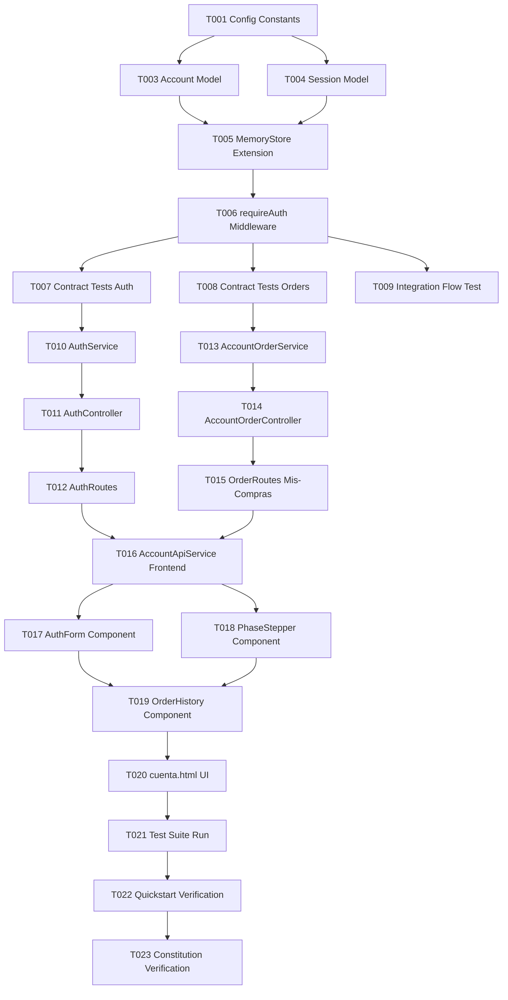

# Tasks: 004 - Cuentas de Usuario y Seguimiento de Fases de Pedido

**Input**: Design documents from `specs/004-cuentas-seguimiento/` (`spec.md`, `plan.md`, `research.md`, `data-model.md`, `contracts/cuentas-seguimiento-api.yaml`, `quickstart.md`)  
**Prerequisites**: `plan.md` (completed), `spec.md` (completed with formal clarifications), `data-model.md` (completed), `contracts/` (completed)  
**Tests**: Se incluyen pruebas automatizadas de contratos OpenAPI e integración end-to-end de acuerdo con los criterios de prueba verificables del proyecto.  
**Organization**: Tareas agrupadas por historia de usuario para garantizar implementación autónoma, trazabilidad y verificación independiente.

---

## Format: `- [ ] [TaskID] [P?] [Story?] Description with file path`

- **[P]**: Tarea paralelizable (archivos independientes, sin dependencias bloqueantes)
- **[Story]**: Identificador de la historia de usuario (`[US1]`)
- Rutas de archivo exactas en cada tarea

---

## Phase 1: Setup (Shared Infrastructure)

**Purpose**: Inicialización de constantes y configuración compartida de la feature sin alterar otras historias de usuario.

- [X] T001 Definir constantes de autenticación y fases en `backend/src/config/constants.js` incluyendo `SESSION: { DURATION_DAYS: 30, DURATION_MS: 30 * 24 * 60 * 60 * 1000, TOKEN_BYTES: 32 }`, regla de contraseña `PASSWORD: { MIN_LENGTH: 8 }` y fases oficiales `ORDER_PHASES: { PENDING: 'pendiente', PAID: 'pagado', SHIPPED: 'salido_tienda', DELIVERED: 'entregado' }` junto con el diccionario de etiquetas visuales en español `PHASE_LABELS: { pendiente: 'Pendiente', pagado: 'Pagado', en_preparacion: 'En preparación', salido_tienda: 'Salido de la tienda', entregado: 'Entregado' }`.
- [X] T002 [P] Registrar la ruta estática para la vista de cuentas `app.get('/cuenta', ...)` y `app.get('/cuenta.html', ...)` en `backend/src/server.js` sirviendo `frontend/public/cuenta.html` sin interferir con las rutas existentes de catálogo, carrito, checkout, logística o ventas.

---

## Phase 2: Foundational (Blocking Prerequisites)

**Purpose**: Modelos base y almacén en memoria compartidos que bloquean la implementación de la historia de usuario.

**⚠️ CRITICAL**: La implementación de la historia de usuario no puede comenzar hasta completar esta fase.

- [X] T003 [P] Implementar el modelo `Account` (`Usuario`) en `backend/src/models/account.model.js` con campos `id` (UUID v4), `nombre` (string 1..100 caracteres requerido), `email` (string formato RFC 5322 normalizado a minúsculas, requerido y único), `passwordHash` (string derivado scrypt 64 bytes), `salt` (string hex 16 bytes), `rol` (enum `'cliente'` \| `'admin'`), `createdAt` (ISO 8601) y `updatedAt` (ISO 8601).
- [X] T004 [P] Implementar el modelo `Session` (`Sesion`) en `backend/src/models/session.model.js` con campos `token` (string hex de 64 caracteres generado con 32 bytes aleatorios), `cuentaId` (UUID v4 FK a `Account.id`), `createdAt` (ISO 8601), `expiresAt` (ISO 8601 a 30 días), `lastAccessAt` (ISO 8601) y `activo` (boolean, default true).
- [X] T005 Extender `MemoryStore` en `backend/src/models/store.js` agregando los mapas `this.accounts = new Map()`, `this.accountsByEmail = new Map()`, y `this.sessions = new Map()`, con métodos de acceso `saveAccount(account)`, `getAccountById(id)`, `getAccountByEmail(email)`, `saveSession(session)`, `getSessionByToken(token)`, `deleteSession(token)` y `getOrdersByAccountId(cuentaId)`.
- [X] T006 Implementar el middleware `requireAuth` en `backend/src/middleware/account-auth.js` (validando token persistente en `store.sessions`, `activo === true`, no expiración, y vinculando `req.user = account`) y actualizar `requireAdminRole` en `backend/src/middleware/auth.js` para admitir autorización dual (reconociendo tanto sesión con `rol === 'admin'` como cabecera `x-user-role: admin` para compatibilidad de tests).

**Checkpoint**: Infraestructura base lista. La implementación de la historia de usuario puede comenzar.

---

## Phase 3: User Story 1 - Registro, Sesión Persistente y Panel de Historial de Pedidos (Priority: P1) 🎯 MVP

**Goal**: Permitir al comprador crear una cuenta personal con contraseña segura (≥ 8 caracteres), iniciar y cerrar sesión conservando la sesión activa durante 30 días (SC-002), consultar en su área privada "Mis compras" el historial cronológico de compras con desglose e importe en euros (`€`), visualizar en cuál de las 4 fases ("pendiente", "pagado", "salido de la tienda", "entregado") se encuentra cada pedido con código de seguimiento, y permitir al administrador actualizar manualmente la fase de pedido (FR-007), garantizando aislamiento estricto de accesos cruzados (IDOR).

**Independent Test**: Un nuevo cliente se registra con `elena@artesania.es` y contraseña de 8 caracteres. Cierra el navegador y vuelve a acceder directamente al sitio confirmando que sigue autenticado. Accede a "Mis compras" y ve su pedido anterior con su fecha, desglose de piezas, total en euros y la barra visual indicando en cuál de las 4 fases está. Al despacharse el pedido con código de seguimiento por un administrador, el cliente visualiza el tracking asignado. Un segundo cliente no puede acceder a los pedidos de Elena mediante URL.

### Tests for User Story 1

> **NOTE: Escribir y verificar que estos tests fallen antes de implementar las rutas y servicios.**

- [X] T007 [P] [US1] Crear pruebas de contrato OpenAPI para los endpoints de autenticación (`POST /api/auth/registro`, `POST /api/auth/login`, `POST /api/auth/logout`, `GET /api/auth/me`) en `tests/contract/cuentas-seguimiento-api.test.js` validando esquemas y respuestas de error (400 para contraseñas < 8 caracteres, 401 para credenciales inválidas y 409 para email duplicado).
- [X] T008 [P] [US1] Crear pruebas de contrato OpenAPI para los endpoints de pedidos (`GET /api/pedidos/mis-compras`, `GET /api/pedidos/mis-compras/:codigoReferencia`, `PUT /api/pedidos/:codigoReferencia/fase`) en `tests/contract/cuentas-seguimiento-api.test.js` validando autorización 401, aislamiento IDOR con 403, y requisito de rol administrador para modificación de fases.
- [X] T009 [P] [US1] Crear prueba de integración end-to-end en `tests/integration/cuentas-seguimiento-flow.test.js` cubriendo el ciclo completo: registro de usuario, validación de contraseña corta (< 8 caracteres), rechazo de email duplicado, login y emisión de token persistente, creación de pedido asociado a `cuentaId`, consulta de historial "Mis compras", avance de fase manual a "salido de la tienda" con código de seguimiento por administrador, y rechazo de acceso cruzado entre dos usuarios distintos (IDOR).

### Implementation for User Story 1

- [X] T010 [US1] Implementar el servicio de autenticación `AuthService` en `backend/src/services/auth.service.js` con métodos `hashPassword(password, salt)` usando `node:crypto.scryptSync`, `register({ nombre, email, password })` validando regla `password.length >= 8` y unicidad de email, `login({ email, password })` verificando credenciales, `createSession(cuentaId)` con expiración a 30 días, y `logout(token)` para invalidación atómica.
- [X] T011 [US1] Implementar `AuthController` en `backend/src/controllers/auth.controller.js` gestionando `registro`, `login`, `logout` y `me`, devolviendo respuestas estructuradas conforme al contrato OpenAPI y gestionando errores (`CONTRASENA_CORTA`, `EMAIL_DUPLICADO`, `CREDENCIALES_INVALIDAS`).
- [X] T012 [US1] Crear el enrutador de autenticación en `backend/src/routes/auth.routes.js` con las rutas `/api/auth/registro`, `/api/auth/login`, `/api/auth/logout` y `/api/auth/me`, y registrarlo en `backend/src/server.js`.
- [X] T013 [US1] Implementar `AccountOrderService` en `backend/src/services/account-order.service.js` con métodos `getCustomerOrders(cuentaId, email)` (retornando listado cronológico de compras), `getOrderForCustomer(cuentaId, email, codigoReferencia)` (verificando estricta coincidencia de propiedad para evitar IDOR), y `updateOrderPhase({ codigoReferencia, fase, numeroSeguimiento, transportista, notas })` (validando que la fase pertenezca a los estados oficiales `['pendiente', 'pagado', 'en_preparacion', 'salido_tienda', 'entregado']` o normalizando `'salido de la tienda'`, exigiendo código de seguimiento de 6 a 32 caracteres para fase 'salido_tienda', registrando el tracking mediante `store.updateOrderShipment` en `order.envio` para coherencia con logística 007, y registrando la transición en `historialFases`).
- [X] T014 [US1] Implementar `AccountOrderController` en `backend/src/controllers/account-order.controller.js` con controladores para `listMyOrders`, `getMyOrderDetails` y `updatePhase` (proyectando `order.envio?.numeroSeguimiento` y `order.envio?.transportista` en las respuestas para el cliente).
- [X] T015 [US1] Configurar y proteger las rutas de pedidos en `backend/src/routes/order.routes.js` registrando `GET /api/pedidos/mis-compras` (con `requireAuth`), `GET /api/pedidos/mis-compras/:codigoReferencia` (con `requireAuth`), y `PUT /api/pedidos/:codigoReferencia/fase` (con `requireAdminRole`) **antes** de `GET /:codigoReferencia` para evitar sombreado de rutas en Express.
- [X] T016 [P] [US1] Implementar el cliente HTTP `AccountApiService` en `frontend/src/services/account-api.service.js` con métodos para llamar a `/api/auth/*` y `/api/pedidos/mis-compras/*`, gestionando el token de sesión en `localStorage` (`tienda_online_session_token`) e incluyendo la cabecera `Authorization: Bearer <token>`.
- [X] T017 [P] [US1] Implementar el componente de formularios de acceso y registro en `frontend/src/components/cuenta/auth-form.js` con cambio interactivo entre pestañas "Iniciar sesión" y "Crear cuenta", validación en cliente de longitud mínima de contraseña (8 caracteres), feedback visual de errores en español (`es-ES`) y redirección al panel privado tras autenticación.
- [X] T018 [P] [US1] Implementar el componente visual de seguimiento de fases `PhaseStepper` en `frontend/src/components/cuenta/phase-stepper.js` renderizando un indicador visual de 4 pasos ("Pendiente", "Pagado", "Salido de la tienda", "Entregado") marcando la fase activa (asimilando `'en_preparacion'` dentro del paso Pagado/Preparación) y mostrando el código de seguimiento registrado cuando corresponda.
- [X] T019 [US1] Implementar el componente de panel privado en `frontend/src/components/cuenta/order-history.js` que obtiene los pedidos del usuario autenticado, renderiza la tabla cronológica con fecha, referencia, total en euros (`€`), estado, estado vacío si no existen compras, y modal o vista de detalle integrando `PhaseStepper`.
- [ ] T020 [US1] Crear la página principal de cuentas en `frontend/public/cuenta.html` y los estilos responsivos en `frontend/src/styles/cuenta.css` articulando la cabecera de usuario con botón "Cerrar sesión", el contenedor de login/registro (`auth-form`) y el panel "Mis compras" (`order-history`).

**Checkpoint**: User Story 1 implementada y verificable de forma autónoma.

---

## Phase 4: Polish & Cross-Cutting Concerns

**Purpose**: Verificación de calidad, cumplimiento constitucional y validación rápida.

- [ ] T021 [P] Ejecutar la suite completa de pruebas unitarias, contratos e integración de la feature mediante `node --test tests/contract/cuentas-seguimiento-api.test.js tests/integration/cuentas-seguimiento-flow.test.js` y verificar que todos los casos pasen en verde.
- [ ] T022 [P] Ejecutar y validar manualmente los 5 escenarios descritos en `specs/004-cuentas-seguimiento/quickstart.md` en el navegador web local.
- [ ] T023 Verificar el cumplimiento estricto de la Constitución del proyecto: confirmar cero dependencias npm externas añadidas (Principio I), todos los textos y mensajes en español `es-ES` y precios en euros `€` (Principio II), ausencia de alcance fantasma respetando las clarificaciones de la spec (Principio III), verificación visual en navegador por persona no técnica (Principio IV) y contraseñas protegidas mediante hash sin datos de usuario superfluos (Principio V).

---

## Dependencies & Execution Order

### Phase Dependencies

- **Setup (Phase 1)**: Sin dependencias, ejecutable de inmediato.
- **Foundational (Phase 2)**: Depende de Phase 1 (T001, T002). Bloquea la implementación de las historias de usuario.
- **User Story 1 (Phase 3)**: Depende de Phase 2 (T003 - T006). Todos sus tests deben escribirse y fallar antes de la implementación.
- **Polish (Phase 4)**: Depende de completar Phase 3.

### Within User Story 1

---

## Parallel Opportunities

- **Setup & Foundational**:
  - `T002` (servidor ruta `/cuenta`), `T003` (modelo Account) y `T004` (modelo Session) pueden ejecutarse en paralelo.
- **Tests de User Story 1**:
  - `T007` (contrato auth), `T008` (contrato pedidos) y `T009` (flujo integración) pueden desarrollarse simultáneamente.
- **Frontend Components**:
  - `T016` (servicio API frontend), `T017` (formulario auth) y `T018` (stepper visual de fases) pueden desarrollarse en paralelo una vez establecidos los contratos.
- **Validaciones finales**:
  - `T021` (tests automatizados), `T022` (validación de escenarios quickstart) y `T023` (chequeo constitucional) pueden verificarse en paralelo.

---

## Implementation Strategy (MVP)

1. **Fase 1 + 2**: Inicializar constantes (`SESSION`, `PASSWORD`), crear modelos `Account` y `Session`, extender `store.js` e implementar el middleware `requireAuth`.
2. **Fase 3 (Backend)**: Escribir tests de contrato, implementar `AuthService` + `AuthController`, `AccountOrderService` + `AccountOrderController`, y montar las rutas `/api/auth` y `/api/pedidos/mis-compras`.
3. **Fase 3 (Frontend)**: Construir `cuenta.html`, `auth-form.js`, `order-history.js` y `phase-stepper.js`.
4. **Validación**: Ejecutar tests automatizados (`node --test`) y comprobar los 5 escenarios en `quickstart.md`.
