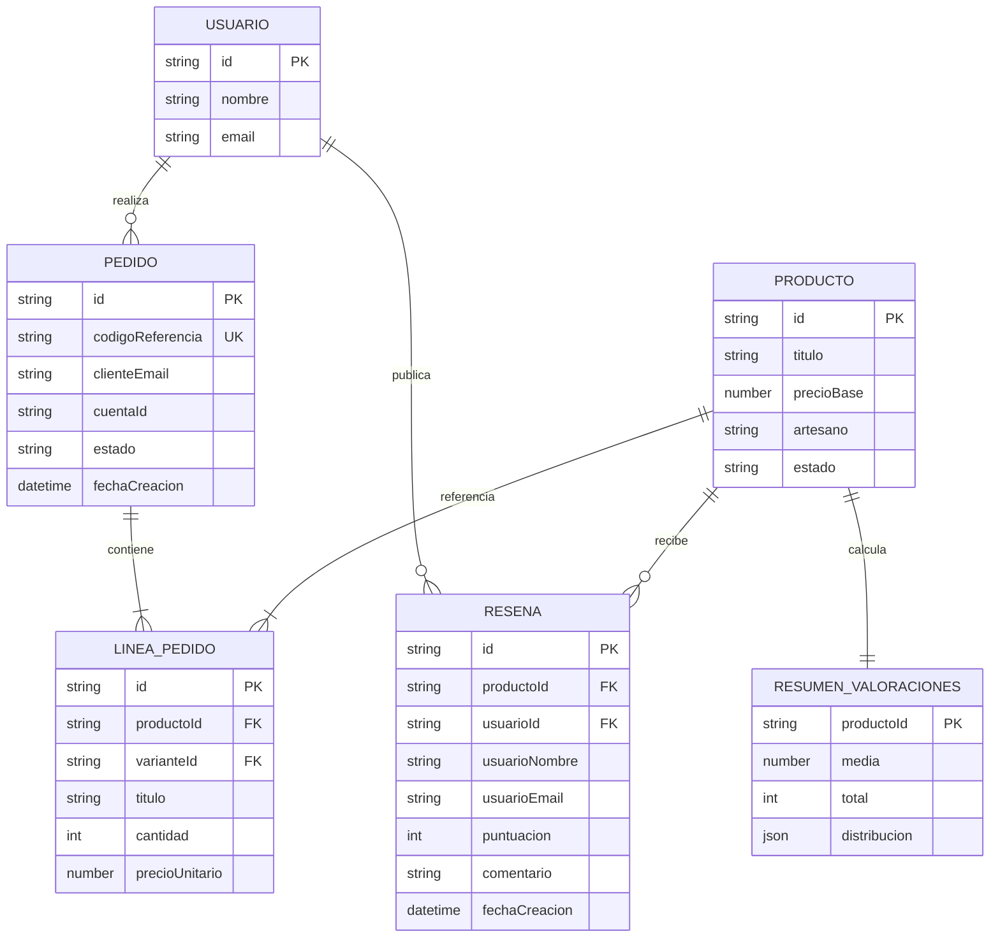

# Data Model: 005 - Sistema de Valoraciones y Comentarios de Productos

**Branch**: `feat/valoraciones`  
**Date**: 2026-11-10  
**Status**: Completed  
**Feature Spec**: [spec.md](./spec.md)

---

## 1. Diagrama Entidad-Relación

---

## 2. Definición Detallada de Entidades

### 2.1. Resena (Review)

Representa la valoración numérica y comentario de texto emitido por un comprador verificado sobre un artículo de la tienda online.

| Campo | Tipo | Obligatorio | Descripción | Restricciones / Reglas | Ejemplo |
|---|---|:---:|---|---|---|
| `id` | `string` | Sí | Identificador unívoco de la valoración | UUID v4 generado automáticamente | `"res-a1b2c3d4-e5f6-7890"` |
| `productoId` | `string` | Sí | Identificador del producto calificado | Debe existir en el catálogo | `"art-001"` |
| `usuarioId` | `string` | Sí | Identificador único del comprador | Cadena alfanumérica no vacía | `"usr-101"` |
| `usuarioNombre` | `string` | Sí | Nombre de pila o visible del comprador | Mínimo 2 caracteres, máx. 100 | `"María González"` |
| `usuarioEmail` | `string` | Sí | Correo electrónico del cliente | Formato de email estándar válido | `"maria.gonzalez@example.com"` |
| `puntuacion` | `integer` | Sí | Puntuación en estrellas | Número entero estricto entre 1 y 5 | `5` |
| `comentario` | `string` | Sí | Texto explicativo de la experiencia | Entre 3 y 1.000 caracteres (sin solo espacios) | `"El acabado de cerámica es excelente, llegó perfecto."` |
| `fechaCreacion` | `string` | Sí | Marca temporal de publicación | Formato ISO 8601 UTC | `"2026-11-10T16:00:00.000Z"` |

**Clave de Unicidad**:
- Par único: `(usuarioId, productoId)`. Un mismo usuario no puede tener más de una reseña activa sobre el mismo producto.

---

### 2.2. ResumenValoraciones (Rating Summary)

Objeto calculado en tiempo real que consolida las métricas públicas de reputación del producto.

| Campo | Tipo | Obligatorio | Descripción | Ejemplo |
|---|---|:---:|---|---|
| `productoId` | `string` | Sí | Identificador del producto asociado | `"art-001"` |
| `media` | `number` | Sí | Nota media redondeada a un decimal (0.0 a 5.0) | `4.8` |
| `total` | `integer` | Sí | Cantidad total de reseñas publicadas | `12` |
| `distribucion` | `object` | Sí | Desglose por número de estrellas `{ 1: N, 2: N, 3: N, 4: N, 5: N }` | `{"5": 10, "4": 2, "3": 0, "2": 0, "1": 0}` |
| `items` | `Array<Resena>` | Sí | Colección de reseñas ordenadas de más reciente a más antigua | `[...]` |

---

### 2.3. ComprobacionElegibilidad (Eligibility Check)

Estructura de respuesta que informa al cliente sobre su capacidad para valorar un producto en el momento actual.

| Campo | Tipo | Obligatorio | Descripción | Posibles Valores |
|---|---|:---:|---|---|
| `productoId` | `string` | Sí | Identificador del producto consultado | `"art-001"` |
| `usuarioId` | `string` | No | Identificador del usuario consultante (null si anónimo) | `"usr-101"` |
| `puedeValorar` | `boolean` | Sí | `true` si cumple todas las condiciones para enviar una reseña | `true` / `false` |
| `motivo` | `string` | Sí | Código de estado de elegibilidad | `COMPRA_VERIFICADA`, `SIN_COMPRA`, `NO_AUTENTICADO`, `YA_VALORADO` |
| `mensaje` | `string` | Sí | Mensaje explicativo amigable en español (`es-ES`) | Ej. *"Solo los clientes que hayan comprado previamente este producto y recibido su pedido pueden valorarlo."* |
| `resenaPrevia` | `Resena \| null` | No | Datos de la reseña previa si el usuario ya valoró el producto | Objeto Resena o `null` |

---

## 3. Reglas de Validación y Negocio

1. **Regla de Compra Verificada (FR-001, FR-002)**:
   - Para que `puedeValorar === true`, el usuario debe tener al menos un pedido donde:
     - `order.clienteEmail === usuarioEmail` o `order.cuentaId === usuarioId`
     - `order.estado` pertenezca a los estados permitidos: `'pagado'`, `'en_preparacion'`, `'salido_tienda'`, `'entregado'` (o `'completado'`).
     - Al menos una línea de `order.lineas` coincida con `productoId` o con el `productoId` de la variante adquirida.
2. **Regla de Única Valoración (FR-004, FR-007)**:
   - Si ya existe una valoración para el par `(usuarioId, productoId)`, `puedeValorar` pasa a ser `false`, `motivo = "YA_VALORADO"` y cualquier intento de envío posterior devolverá error HTTP 409.
3. **Regla de Campos Obligatorios (FR-005, FR-006)**:
   - Puntuación: obligatoria, entero en $[1, 5]$.
   - Comentario: obligatorio, longitud útil $\ge 3$ caracteres. Si solo contiene espacios o saltos de línea, es inválido.
4. **Regla de Actualización Inmediata (FR-009, SC-004)**:
   - Al publicarse una nueva reseña, se almacena de inmediato en el índice de reseñas y cualquier consulta posterior al resumen del producto reflejará el nuevo cómputo de `media` y `total`.
5. **Regla de Idioma y Mercado (Principio II de la Constitución)**:
   - Todos los mensajes de validación y de estado se emiten en español de España (`es-ES`).
