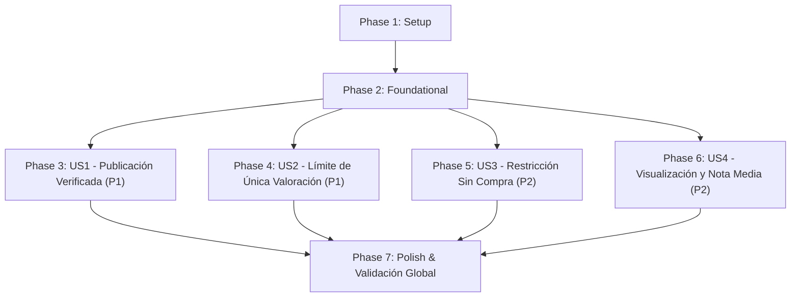

# Tasks: 005 - Sistema de Valoraciones y Comentarios de Productos

**Branch**: `feat/valoraciones` | **Fecha**: 2026-11-10 | **Spec**: [spec.md](./spec.md) | **Plan**: [plan.md](./plan.md)

Desglose secuencial de tareas ordenadas por dependencias para la implementación del sistema de valoraciones y reseñas de productos adquiridos: verificación estricta de compra previa en pedidos entregados/completados, límite inmutable de una (1) única valoración por comprador y producto, validación de 1 a 5 estrellas con comentario obligatorio, cálculo dinámico de la nota media del producto y listado público cronológico con avisos informativos en español (`es-ES`).

---

## Phase 1: Setup (Infraestructura Compartida)

**Propósito**: Configuración de constantes globales de reseñas, límites de puntuación, cliente de API frontend y estilos visuales base.

- [X] T001 Actualizar constantes del sistema con límites de puntuación (1 a 5 estrellas), mensajes estándar y códigos de estado de elegibilidad en `backend/src/config/constants.js`
- [X] T002 [P] Crear cliente HTTP para interactuar con los endpoints `/api/resenas/*` (`getReviewsByProduct`, `checkReviewEligibility`, `createReview`) en `frontend/src/services/review-api.service.js`
- [X] T003 [P] Crear hoja de estilos CSS con diseño responsive para el sistema de estrellas interactivas, avisos de verificación y modal accesible en `frontend/src/styles/resenas.css`

---

## Phase 2: Foundational (Prerrequisitos Bloqueantes)

**Propósito**: Entidades base, almacenamiento en memoria, endpoints REST y pruebas de contrato necesarias antes de construir las historias de usuario.

**⚠️ CRÍTICO**: Ninguna tarea de historia de usuario puede comenzar hasta que esta fase esté completada.

- [X] T004 [P] Implementar modelo de entidad `Review` con validaciones de campos obligatorios (`id` UUID v4, `productoId` string, `usuarioId` string, `puntuacion` entero entre 1 y 5, `comentario` entre 3 y 1000 caracteres no vacío tras trim, `fechaCreacion` ISO 8601 UTC) en `backend/src/models/review.model.js`
- [X] T005 [P] Extender `backend/src/models/store.js` con colecciones `this.reviews` (Map indexado por clave compuesta `${usuarioId}:${productoId}`) y `this.reviewsByProduct` (Map de listas de reseñas), incluyendo métodos `saveReview`, `getReviewByUserAndProduct`, `getReviewsByProductId` y `hasUserPurchasedProduct`
- [X] T006 [P] Implementar pruebas de contrato OpenAPI para los endpoints de reseñas (`GET /api/resenas/producto/:productoId`, `GET /api/resenas/elegibilidad/:productoId`, `POST /api/resenas`) conforme a `contracts/resenas-api.yaml` en `tests/contract/resenas-api.test.js`
- [X] T007 Implementar servicio base `ReviewService` con lógica de verificación sobre `store.orders`, cálculo de nota media redondeada a un decimal y registro en memoria en `backend/src/services/review.service.js`
- [X] T008 Implementar controlador REST `ReviewController` con validación de entradas, extracción de identidad (`x-usuario-id`, `x-usuario-nombre`, `x-usuario-email`) y códigos HTTP de respuesta (200, 201, 400, 403, 404, 409) en `backend/src/controllers/review.controller.js`
- [X] T009 Registrar y montar las rutas de reseñas en `backend/src/routes/review.routes.js` e integrarlas en `backend/src/server.js` bajo `/api/resenas`

**Checkpoint**: Base de almacenamiento, endpoints REST y pruebas de contrato preparadas. La implementación de las historias de usuario puede comenzar.

---

## Phase 3: User Story 1 - Valoración y Reseña de Productos Comprados (Priority: P1) 🎯 MVP

**Meta**: Permitir a un comprador autenticado con un pedido completado o entregado calificar con 1 a 5 estrellas y redactar un comentario explicativo obligatorio, recibiendo confirmación visible de publicación ("¡Gracias por tu valoración! Tu reseña ha sido publicada con éxito.").

**Independent Test**: Comprador verificado con pedido completado del producto `art-001` envía una valoración de 5 estrellas con comentario descriptivo; recibe HTTP 201 Created y comprueba que la reseña aparece publicada de forma inmediata.

### Pruebas de User Story 1
- [X] T010 [P] [US1] Implementar pruebas de integración para el flujo de publicación de reseña por comprador verificado y validación de campos requeridos en `tests/integration/quickstart-resenas.test.js`

### Implementación de User Story 1
- [X] T011 [US1] Implementar en `backend/src/services/review.service.js` el método `createReview` que verifica el pedido en estado `pagado`, `en_preparacion`, `salido_tienda` o `entregado`, persiste la opinión y emite el mensaje de confirmación en español
- [X] T012 [P] [US1] Implementar componente de formulario interactivo con selector accesible de 1 a 5 estrellas, campo de comentario y alertas de confirmación de éxito en `frontend/src/components/resenas/review-form.js`
- [X] T013 [US1] Integrar el formulario de reseñas dentro del contenedor modal en `frontend/src/components/resenas/product-reviews-modal.js` permitiendo el envío reactivo sin recarga de página

**Checkpoint**: User Story 1 completa. Los compradores verificados pueden publicar sus valoraciones de forma independiente (MVP funcional).

---

## Phase 4: User Story 2 - Límite Estricto de Única Valoración por Producto (Priority: P1)

**Meta**: Impedir el registro de opiniones duplicadas para un mismo producto por parte del mismo comprador, denegando el reenvío con error HTTP 409 e informando en la interfaz con el mensaje: "Ya has valorado este producto".

**Independent Test**: Un usuario que ya publicó su reseña sobre `art-001` intenta enviar una segunda reseña; el sistema responde HTTP 409 Conflict con código `VALORACION_DUPLICADA` y la interfaz bloquea el formulario mostrando la opinión previa.

### Pruebas de User Story 2
- [X] T014 [P] [US2] Agregar prueba de integración para el bloqueo de reseñas duplicadas (HTTP 409) y comprobación de idempotencia en `tests/integration/quickstart-resenas.test.js`

### Implementación de User Story 2
- [X] T015 [US2] Implementar en `backend/src/services/review.service.js` la verificación de unicidad por clave `${usuarioId}:${productoId}` en `store.js`, rechazando envíos repetidos con código `VALORACION_DUPLICADA`
- [X] T016 [P] [US2] Implementar en `frontend/src/components/resenas/product-reviews-modal.js` el estado informativo "Ya has valorado este producto", deshabilitando el formulario y mostrando la calificación previamente emitida

**Checkpoint**: User Story 2 completa. Queda garantizada la unicidad estricta de reseñas por comprador y producto.

---

## Phase 5: User Story 3 - Restricción para Usuarios Sin Compra Previa (Priority: P2)

**Meta**: Ocultar o deshabilitar el formulario de valoración para visitantes no autenticados o clientes sin compra completada del artículo, mostrando avisos informativos claros en español.

**Independent Test**: Un usuario anónimo o registrado sin pedidos entregados de `art-001` accede a la ficha; el sistema devuelve `puedeValorar: false` con mensaje informativo ("Solo los clientes que hayan comprado previamente este producto pueden valorarlo") y oculta el formulario.

### Pruebas de User Story 3
- [X] T017 [P] [US3] Agregar pruebas de integración para la comprobación de elegibilidad de usuarios sin compra o anónimos en `tests/integration/quickstart-resenas.test.js`

### Implementación de User Story 3
- [X] T018 [US3] Implementar en `backend/src/services/review.service.js` el método `checkReviewEligibility` que distingue los estados `NO_AUTENTICADO`, `SIN_COMPRA`, `COMPRA_VERIFICADA` y `YA_VALORADO` con mensajes explicativos en español (`es-ES`)
- [X] T019 [P] [US3] Implementar en `frontend/src/components/resenas/product-reviews-modal.js` la renderización de avisos informativos y ocultación condicional del formulario según la elegibilidad recibida

**Checkpoint**: User Story 3 completa. El catálogo queda protegido contra opiniones ficticias o no verificadas.

---

## Phase 6: User Story 4 - Visualización Pública de Reseñas y Recálculo de Nota Media (Priority: P2)

**Meta**: Calcular y mostrar de forma pública la nota media en estrellas con un decimal (ej. "4,8 / 5"), el recuento total de opiniones y el listado cronológico de reseñas con autor, estrellas, fecha (`es-ES`) y comentario, actualizándose al instante tras una nueva valoración.

**Independent Test**: Consultar un producto nuevo (muestra estado vacío "Este producto aún no cuenta con valoraciones"); tras guardar una reseña de 5 estrellas y otra de 4 estrellas, la nota media cambia inmediatamente a 4,5 y el total a 2 en la interfaz pública.

### Pruebas de User Story 4
- [X] T020 [P] [US4] Agregar pruebas de integración para el cálculo de nota media, distribución de estrellas y renderizado de reseñas públicas en `tests/integration/quickstart-resenas.test.js`

### Implementación de User Story 4
- [X] T021 [US4] Implementar en `backend/src/services/review.service.js` el cálculo dinámico de `media` (`Math.round((suma / total) * 10) / 10`), total de reseñas, distribución de estrellas y ordenación cronológica descendente de `items`
- [X] T022 [P] [US4] Modificar `frontend/src/components/catalogo/product-grid.js` para incluir en cada tarjeta del catálogo el indicador visual de nota media en estrellas y el botón disparador "Opiniones" / "Valorar"
- [X] T023 [P] [US4] Implementar en `frontend/src/components/resenas/product-reviews-modal.js` el listado de reseñas con nombre del comprador, estrellas, fecha formateada en español (`es-ES`) y estado amigable cuando no existan opiniones
- [X] T024 [US4] Integrar en `frontend/public/catalogo.html` la inicialización del modal de reseñas al hacer clic en cualquier tarjeta del catálogo y la recarga inmediata de la nota media tras publicar una reseña

**Checkpoint**: User Story 4 completa. El sistema de feedback y reputación es plenamente visible y reactivo en el catálogo público.

---

## Phase 7: Polish & Cross-Cutting Concerns

**Propósito**: Validación global de calidad, accesibilidad y ejecución de todos los escenarios de prueba.

- [X] T025 [P] Ejecutar la suite completa de pruebas unitarias, de contrato e integración con `npm.cmd test` verificando 100% de éxito
- [X] T026 [P] Verificar accesibilidad en `frontend/src/components/resenas/product-reviews-modal.js` (cierre con tecla Escape, foco gestionado, etiquetas `aria-label` para botones de estrellas y atributos `role="dialog"`)
- [X] T027 Ejecutar y validar los 5 escenarios descritos en `specs/005-resenas-valoraciones/quickstart.md` confirmando la total conformidad con los criterios de aceptación

---

## Dependencies & Execution Order

### Phase Dependencies

### User Story Dependencies

- **User Story 1 (P1)**: Depende de Phase 2. Entrega el núcleo operativo de publicación verificada (MVP).
- **User Story 2 (P1)**: Depende de Phase 2. Utiliza el índice de unicidad en `store.js` para bloquear duplicados.
- **User Story 3 (P2)**: Depende de Phase 2. Añade comprobación previa de elegibilidad para usuarios sin compra.
- **User Story 4 (P2)**: Depende de Phase 2 y consume las reseñas de US1 para calcular la nota media y listar opiniones.

---

## Parallel Opportunities

- **Setup (Phase 1)**: `T002` (servicio API cliente) y `T003` (estilos CSS) pueden desarrollarse en paralelo con `T001`.
- **Foundational (Phase 2)**: `T004` (modelo Review), `T005` (métodos store) y `T006` (test contrato) pueden desarrollarse en paralelo.
- **Entre historias de usuario**: Una vez completada Phase 2, las pruebas e implementaciones de UI de cada historia marcadas con `[P]` pueden ejecutarse concurrentemente.
- **Polish (Phase 7)**: `T025` y `T026` son paralelizables.

---

## Implementation Strategy

### MVP First (User Story 1 Only)

1. Completar **Phase 1: Setup** (`T001` a `T003`).
2. Completar **Phase 2: Foundational** (`T004` a `T009`).
3. Completar **Phase 3: User Story 1** (`T010` a `T013`).
4. **Validar MVP**: Probar de forma aislada que un comprador verificado puede publicar su opinión de 1 a 5 estrellas con comentario.

### Entrega Incremental

1. MVP funcional completado (Publicación verificada).
2. Añadir **User Story 2** para proteger contra duplicados (HTTP 409).
3. Añadir **User Story 3** para feedback y avisos a usuarios sin compra.
4. Añadir **User Story 4** para exhibir la nota media en las tarjetas de catálogo y el desglose de opiniones.
5. Ejecutar **Phase 7: Polish** y validación de `quickstart.md`.
