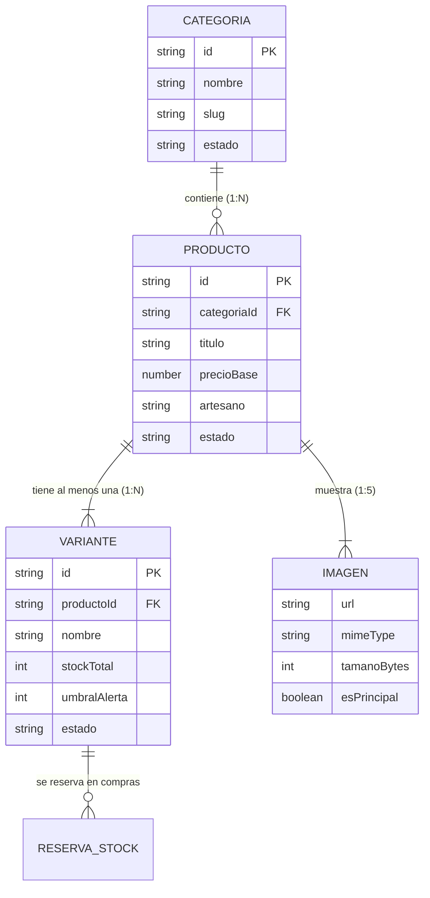

# Data Model: 006 - Administración de Productos y Alertas de Stock Bajo

**Feature**: `006-administracion-catalogo` | **Fecha**: 2026-10-20  
**Spec**: [spec.md](./spec.md) | **Plan**: [plan.md](./plan.md)

Define las estructuras de datos, relaciones, validaciones y máquina de estados para la administración del catálogo de artesanías, gestión de variantes y cálculo de alertas de stock.

---

## 1. Entidades y Esquemas de Datos

### Entidad: Categoria (Category)

Representa las agrupaciones temáticas del catálogo artesanal (por ejemplo, "Cerámica", "Textil", "Madera", "Joyería").

```typescript
interface Categoria {
  id: string;               // Identificador único (ej: "cat-ceramica")
  nombre: string;           // Nombre visible en español (ej: "Cerámica Tradicional")
  descripcion?: string;     // Descripción detallada de las piezas de la categoría
  slug: string;             // Cadena URL amigable (ej: "ceramica-tradicional")
  estado: EstadoCategoria;  // Estado de la categoría
  createdAt: string;        // Fecha ISO de creación
  updatedAt: string;        // Fecha ISO de última modificación
}

type EstadoCategoria = 'activa' | 'archivada';
```

**Reglas de validación**:
- `nombre`: Obligatorio, entre 2 y 80 caracteres. No puede repetirse entre categorías activas.
- `estado`: Por defecto `'activa'`.
- **Integridad referencial**: No puede transicionar a `'archivada'` si existen productos activos asociados a esta categoría.

---

### Entidad: Producto (Product)

Ficha descriptiva central de la pieza artesanal.

```typescript
interface Producto {
  id: string;               // Identificador único (ej: "art-001" o UUID)
  titulo: string;           // Título comercial en español (ej: "Jarrón de Cerámica Esmaltada Azul")
  descripcion: string;      // Descripción de la técnica, materiales y cuidados
  categoriaId: string;      // Clave foránea referenciando a Categoria.id
  artesano: string;         // Nombre o taller del artesano creador
  precioBase: number;       // Precio oficial en euros con 2 decimales (ej: 45.00)
  moneda: 'EUR';            // Moneda oficial según Constitución
  imagenes: RecursoImagen[];// Lista de imágenes asociadas (1 a 5 elementos)
  estado: EstadoProducto;   // Estado en catálogo
  createdAt: string;        // Fecha ISO de creación
  updatedAt: string;        // Fecha ISO de última modificación
}

type EstadoProducto = 'activo' | 'archivado';
```

**Reglas de validación**:
- `titulo`: Obligatorio, entre 3 y 150 caracteres.
- `precioBase`: Número estrictamente mayor que cero ($> 0$), con un máximo de 2 posiciones decimales.
- `categoriaId`: Debe existir una categoría activa con ese identificador.
- `imagenes`: Array con un mínimo de 1 y un máximo de 5 imágenes. Cada imagen no debe superar los 5 MB.
- `estado`: Por defecto `'activo'`. Si tiene pedidos asociados en el histórico, no puede eliminarse físicamente, pasando a `'archivado'`.

---

### Entidad: Variante (Product Variant)

Opción física específica de la pieza artesanal (talla, tonalidad, acabado o estándar "Única").

```typescript
interface Variante {
  id: string;               // Identificador único (ej: "var-001-azul" o UUID)
  productoId: string;       // Clave foránea referenciando a Producto.id
  nombre: string;           // Nombre de la opción (ej: "Pequeño", "Azul Cobalto", "Única")
  sku?: string;             // Código identificador interno opcional (ej: "JAR-AZU-P")
  stockTotal: number;       // Cantidad física total en taller (entero >= 0)
  umbralAlerta: number;     // Nivel mínimo de existencias antes de disparar aviso (entero >= 0, default: 3)
  estado: EstadoVariante;   // Estado operativo
  createdAt: string;        // Fecha ISO de creación
  updatedAt: string;        // Fecha ISO de última modificación
}

type EstadoVariante = 'activa' | 'archivada';
```

**Reglas de validación**:
- `productoId`: Obligatorio, debe corresponder a un producto existente.
- `nombre`: Entre 1 y 60 caracteres (ej: "Única" si el producto no tiene variantes diferenciadas).
- `stockTotal`: Entero $\ge 0$.
- `umbralAlerta`: Entero $\ge 0$. Si se omite en la creación, se asigna `3`.
- **Regla de negocio (FR-004)**: Toda variante comparte el `precioBase` del producto al que pertenece; no admite precio independiente.

---

### Entidad: RecursoImagen (Product Image)

```typescript
interface RecursoImagen {
  url: string;              // Ruta relativa local o URL accesible (ej: "/public/uploads/jarron-1.webp")
  nombreArchivo: string;    // Nombre original del archivo (ej: "jarron-azul.webp")
  mimeType: 'image/jpeg' | 'image/png' | 'image/webp'; // Formatos autorizados
  tamanoBytes: number;      // Tamaño en bytes (máximo 5 * 1024 * 1024 bytes = 5.242.880 B)
  esPrincipal: boolean;     // Indica si es la foto de portada del producto
}
```

---

### Modelo Calculado: AlertaStock (Stock Alert DTO)

Estructura generada dinámicamente para alimentar el panel administrativo de inventario y alertas:

```typescript
interface AlertaStock {
  productoId: string;
  productoTitulo: string;
  varianteId: string;
  varianteNombre: string;
  artesano: string;
  categoriaNombre: string;
  precioBase: number;
  stockTotal: number;
  stockReservado: number;
  stockDisponible: number;  // stockTotal - stockReservadoActivo
  umbralAlerta: number;
  estadoAlerta: 'normal' | 'stock_bajo' | 'agotado';
  mensajeAlerta: string;    // Ej: "Stock bajo (1 unidad restante)" o "Agotada"
}
```

---

## 2. Relaciones entre Entidades



---

## 3. Máquinas de Estados y Transiciones

### Ciclo de Vida de la Categoría
$$\text{"activa"} \underset{\text{reactivar}}{\overset{\text{archivar (requiere 0 productos activos)}}{\rightleftharpoons}} \text{"archivada"}$$

### Ciclo de Vida del Producto
$$\text{"activo"} \xrightarrow{\text{archivar / desactivar}} \text{"archivado"}$$
*(Si el producto no tiene compras previas, se permite además el borrado físico permanente)*.

### Estado Operativo del Stock de una Variante
$$\text{stockDisponible} = \begin{cases} 0 & \rightarrow \textbf{"agotado"} \text{ (se muestra como 'Agotada' en tienda)} \\ 1 \le \text{stockDisponible} \le \text{umbralAlerta} & \rightarrow \textbf{"stock\_bajo"} \text{ (alerta destacada en panel)} \\ > \text{umbralAlerta} & \rightarrow \textbf{"normal"} \text{ (inventario suficiente)} \end{cases}$$
