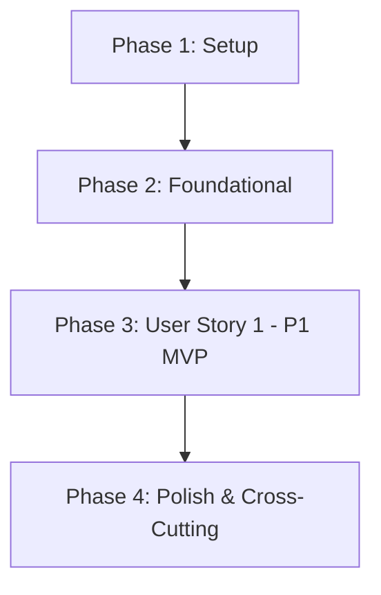

# Tasks: 006 - Administración de Productos y Alertas de Stock Bajo

**Branch**: `006-administracion-catalogo` | **Fecha**: 2026-10-20 | **Spec**: [spec.md](./spec.md) | **Plan**: [plan.md](./plan.md)

Desglose de tareas ordenadas por dependencias para la implementación del panel administrativo del catálogo artesanal: administración de categorías (creación, edición, archivado condicional), alta y edición de productos con hasta 5 imágenes (JPG/PNG/WebP, máx. 5 MB) y precio base en euros (€), definición de variantes con inventario independiente (con variante estándar "Única" por defecto), cálculo y visualización de alertas tempranas de stock bajo, bloqueo de orfandad y sincronización en tiempo real con las ventas de la tienda.

---

## Phase 1: Setup (Infraestructura Compartida)

**Propósito**: Inicialización de constantes del catálogo, umbrales de stock, límites de imágenes y cliente HTTP base.

- [X] T001 Actualizar constantes del sistema con umbrales de alerta por defecto (3 unidades), límites de imágenes (5 fotos, 5 MB, tipos MIME permitidos) y roles en `backend/src/config/constants.js`
- [X] T002 [P] Crear cliente HTTP base para interactuar con los endpoints de administración en `frontend/src/services/catalog-admin-api.service.js`

---

## Phase 2: Foundational (Prerrequisitos Bloqueantes)

**Propósito**: Modelos de datos, extensión de almacenamiento en memoria y middleware de seguridad requeridos por todas las funcionalidades administrativas.

**⚠️ CRÍTICO**: Ninguna tarea de la historia de usuario puede comenzar hasta que esta fase esté completada.

- [X] T003 [P] Crear modelos y esquemas de validación de Categoria, Producto y Variante en `backend/src/models/category.model.js` y `backend/src/models/product.model.js`
- [X] T004 Extender el almacén `MemoryStore` con colecciones `categories`, `products` y `variants` e integración con el inventario transaccional existente en `backend/src/models/store.js`
- [X] T005 [P] Implementar middleware de autenticación y autorización para verificar el rol de administrador (`requireAdminRole`) en `backend/src/middleware/auth.js`
- [X] T006 Configurar montaje de rutas administrativas `/api/admin/*` y servicio de estáticos del panel en `backend/src/server.js`

**Checkpoint**: Infraestructura, almacenamiento en memoria y autorización listos. Puede comenzar la implementación de la historia de usuario.

---

## Phase 3: User Story 1 - Gestión del Catálogo, Variantes y Alerta Temprana de Stock (Priority: P1) 🎯 MVP

**Meta**: Permitir al responsable de la tienda acceder a un panel administrativo para dar de alta y editar productos, asociarles categorías, subir hasta 5 fotografías (máx. 5 MB), definir variantes (con variante "Única" por defecto) compartiendo el precio base en euros (€), monitorizar alertas visuales inmediatas cuando el stock sea menor o igual al umbral fijado o se agote, bloquear el archivado de categorías con productos en uso y sincronizar el inventario con las ventas del checkout.

**Independent Test**:
1. Acceder al panel de administración y crear la categoría "Cerámica".
2. Dar de alta un jarrón asignándole la categoría "Cerámica", precio base 45.00 €, subir 2 fotos y crear 2 variantes ("Pequeño - 3 unidades" y "Grande - 1 unidad") con umbral de aviso en 2 unidades; comprobar su publicación en la tienda.
3. Verificar que en el panel administrativo la variante "Grande" muestra de forma destacada el distintivo visual "Stock bajo (1 unidad restante)".
4. Intentar archivar la categoría "Cerámica"; verificar bloqueo con error HTTP 409 y mensaje informativo indicando reasignar los productos primero.
5. Crear un producto sin variantes explícitas; comprobar que el sistema crea automáticamente la variante estándar "Única".
6. Intentar subir más de 5 fotos o una imagen superior a 5 MB; verificar respuesta HTTP 400 con mensaje de validación en español.
7. Simular la compra de 1 unidad de la variante "Grande" desde el checkout; comprobar que el stock pasa a 0 y la variante se marca inmediatamente como "Agotada" en el panel y en la tienda pública.
8. Intentar acceder a los endpoints administrativos sin cabecera o rol de administrador; verificar respuesta HTTP 403 Forbidden.

### Pruebas de User Story 1

> **NOTA: Escribir y verificar que fallen antes de completar la implementación correspondiente.**

- [X] T007 [P] [US1] Pruebas de contrato OpenAPI para los endpoints administrativos (`/categorias`, `/categorias/{id}/archivar`, `/productos`, `/productos/{id}`, `/variantes/{id}/stock`, `/alertas-stock`) en `tests/contract/catalogo-admin-api.test.js`
- [X] T008 [P] [US1] Pruebas de integración del ciclo de vida del catálogo (creación de categoría, alta de producto con fotos/variantes, cálculo dinámico de alertas de stock, bloqueo de archivado en uso y descuento por venta) en `tests/integration/catalog-flow.test.js`

### Lógica de Negocio y Backend

- [X] T009 [US1] Implementar CatalogAdminService (CRUD de categorías, bloqueo de archivado con productos activos, CRUD de productos, variante estándar "Única" automática, validación de fotos y cálculo de alertas de stock bajo) en `backend/src/services/catalog-admin.service.js`
- [X] T010 [US1] Implementar CatalogAdminController para validaciones de parámetros, control de errores HTTP y respuestas en `backend/src/controllers/catalog-admin.controller.js`
- [X] T011 [US1] Registrar y montar las rutas administrativas en `backend/src/routes/catalog-admin.routes.js`

### Componentes de Interfaz de Usuario (Frontend)

- [X] T012 [P] [US1] Implementar componente de gestión y archivado de categorías con control de errores de integridad en `frontend/src/components/admin/category-manager.js`
- [X] T013 [P] [US1] Implementar formulario de alta y edición de productos con carga y previsualización de hasta 5 imágenes y configuración de variantes en `frontend/src/components/admin/product-form.js`
- [X] T014 [P] [US1] Implementar tabla interactiva de productos con distintivos visuales de stock bajo y agotado en `frontend/src/components/admin/product-list-table.js`
- [X] T015 [P] [US1] Implementar widget de resumen y filtro rápido de stock bajo y agotados en `frontend/src/components/admin/stock-alerts-widget.js`
- [X] T016 [P] [US1] Crear hoja de estilos CSS responsiva para el panel administrativo, formularios y distintivos de alerta en `frontend/src/styles/admin-catalogo.css`
- [X] T017 [US1] Integrar la página HTML completa del panel de administración en `frontend/public/admin/catalogo.html`

**Checkpoint**: User Story 1 completada de principio a fin, satisfaciendo los 7 requisitos funcionales (FR-001 a FR-007) y los 3 criterios de éxito medibles (SC-001 a SC-003).

---

## Phase 4: Polish & Cross-Cutting Concerns

**Propósito**: Verificaciones de calidad, estándares constitucionales y validación de aceptación.

- [X] T018 [P] Auditar y asegurar que el 100% de los textos, formularios, mensajes de error y badges estén en español de España (`es-ES`) y los precios en euros (`€`) conforme al Principio II
- [X] T019 [P] Auditar sanitización y validación estricta de subidas de imágenes (tipos MIME autorizados y límite de 5 MB) conforme a los Principios I y V
- [X] T020 [P] Implementar suite de validación automatizada de los 7 escenarios descritos en quickstart.md en `tests/integration/quickstart-catalogo.test.js`
- [X] T021 Ejecutar la batería completa de validación manual paso a paso descrita en `specs/006-administracion-catalogo/quickstart.md`

---

## Dependencies & Execution Order

### Dependencias entre Fases



### Orden de Ejecución Interno en User Story 1
1. **Pruebas primero**: Escribir pruebas de contrato (`T007`) e integración (`T008`) asegurando que fallen antes del código de producción.
2. **Servicio de negocio**: `T009` (CatalogAdminService) implementa las reglas de integridad referencial, variante estándar y cálculo reactivo de alertas.
3. **Controlador y Rutas**: `T010` y `T011` exponen y protegen los endpoints REST bajo `/api/admin/*`.
4. **Componentes Frontend**: El gestor de categorías (`T012`), formulario de productos (`T013`), tabla de inventario (`T014`), widget de alertas (`T015`) y estilos (`T016`) pueden implementarse en paralelo antes del ensamblaje en `catalogo.html` (`T017`).
5. **Validación**: La Fase 4 valida la conformidad constitucional y la suite de `quickstart.md`.

---

## Oportunidades de Ejecución en Paralelo

### Fase 1 y 2
- `T002` (Cliente HTTP API) puede desarrollarse en paralelo con `T001` (Constantes).
- `T003` (Modelos), `T005` (Middleware Auth) y `T004` (Almacén Store) son altamente paralelizables.

### Fase 3 (User Story 1)
- Las pruebas de contrato (`T007`) y de integración (`T008`) pueden escribirse simultáneamente.
- Los componentes de frontend (`T012`, `T013`, `T014`, `T015`, `T016`) pueden implementarse en paralelo una vez definido el contrato de API.

---

## Parallel Example: User Story 1

```bash
# Ejecutar la creación de pruebas de US1 en paralelo:
Task: "Pruebas de contrato OpenAPI en tests/contract/catalogo-admin-api.test.js"
Task: "Pruebas de integración del flujo de catálogo en tests/integration/catalog-flow.test.js"

# Ejecutar la creación de componentes UI en paralelo:
Task: "Implementar category-manager.js en frontend/src/components/admin/category-manager.js"
Task: "Implementar product-form.js en frontend/src/components/admin/product-form.js"
Task: "Implementar product-list-table.js en frontend/src/components/admin/product-list-table.js"
Task: "Implementar stock-alerts-widget.js en frontend/src/components/admin/stock-alerts-widget.js"
Task: "Crear admin-catalogo.css en frontend/src/styles/admin-catalogo.css"
```

---

## Implementation Strategy

### MVP First (User Story 1 Only)
1. Completar Fase 1 (Setup) y Fase 2 (Foundational).
2. Completar Fase 3 (User Story 1 - P1).
3. **Punto de control**: Validar User Story 1 de forma independiente usando los escenarios de `quickstart.md`.
4. Completar Fase 4 (Polish & Auditoría constitucional).

### Estrategia de Entrega Incremental
1. **Incremento 1**: Modelos de categorías y productos con almacenamiento en memoria integrado con `store.js`.
2. **Incremento 2**: Endpoints REST administrativos `/api/admin/*` con protección por rol y reglas de integridad.
3. **Incremento 3**: Interfaz visual de administración con badges de stock bajo, previsualización de imágenes y formularios reactivos.
4. **Incremento 4**: Validación cruzada con el checkout para comprobar el descuento de stock instantáneo.
