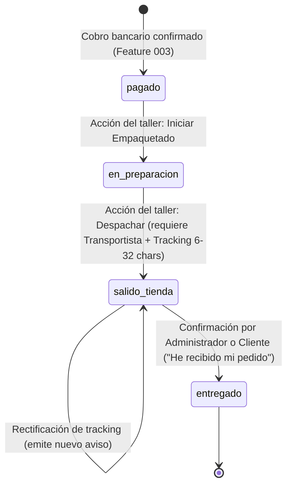

# Data Model: 007 - Procesamiento Logístico y Notificación de Envío

**Feature**: `007-logistica-envios` | **Fecha**: 2026-10-14  
**Spec**: [spec.md](./spec.md) | **Plan**: [plan.md](./plan.md)

Define las estructuras de datos, relaciones, validaciones y máquina de estados para la gestión de envíos y notificaciones automáticas.

---

## 1. Entidades y Estructuras

### Entidad: Pedido (Order) - Extensiones Logísticas

La entidad central `Pedido` incorpora los atributos de expedición física y el histórico de avisos generados:

```typescript
interface Pedido {
  id: string;                       // Identificador UUID interno
  codigoReferencia: string;         // Ej: "PED-20261014-9988"
  transaccionId: string;            // Identificador bancario de cobro
  clienteNombre: string;            // Nombre y apellidos del comprador
  clienteEmail: string;             // Correo electrónico de notificación
  cuentaId: string | null;          // Identificador de cuenta registrada (o null para invitado)
  lineas: LineaPedido[];            // Artículos comprados
  total: number;                    // Importe total en euros (ej: 45.00)
  moneda: 'EUR';                    // Moneda según Constitución (EUR)
  estado: EstadoPedido;             // Estado del ciclo de vida (ver máquina de estados)
  envio: DatosExpedicion | null;    // Datos de transporte (asignados al despachar)
  avisosEnvio: AvisoEnvio[];        // Registro de notificaciones emitidas
  createdAt: string;                // Fecha ISO de creación tras cobro
  updatedAt: string;                // Fecha ISO de última modificación
}

type EstadoPedido = 
  | 'pendiente'
  | 'pagado'
  | 'en_preparacion'
  | 'salido_tienda'
  | 'entregado';
```

---

### Entidad: DatosExpedicion (Shipment Details)

Almacena la información de despacho y trazabilidad del paquete:

```typescript
interface DatosExpedicion {
  transportista: string;            // Ej: "Correos", "SEUR", "MRW", "GLS", "DHL"
  numeroSeguimiento: string;        // Código alfanumérico (6 a 32 caracteres)
  fechaSalida: string;              // Fecha y hora ISO del cambio a "salido_tienda"
  fechaEntrega?: string | null;     // Fecha y hora ISO del cambio a "entregado"
  notas?: string | null;            // Observaciones opcionales del empaquetado
  rectificaciones?: RectificacionSeguimiento[]; // Historial de correcciones
}

interface RectificacionSeguimiento {
  numeroAnterior: string;
  transportistaAnterior: string;
  motivo: string;
  fecha: string;
}
```

---

### Entidad: AvisoEnvio (Shipping Notification)

Representa cada notificación automática generada para el comprador:

```typescript
interface AvisoEnvio {
  id: string;                       // UUID del aviso
  pedidoId: string;                 // Referencia al pedido
  codigoReferencia: string;         // Código de pedido (ej: "PED-20261014-XXXX")
  tipo: 'salida_almacen' | 'rectificacion_tracking' | 'confirmacion_entrega';
  canal: 'email_simulado' | 'panel_usuario';
  destinatarioEmail: string;        // Email de destino
  asunto: string;                   // Asunto del correo en es-ES
  cuerpoTexto: string;              // Contenido descriptivo del aviso
  transportista: string;            // Empresa de transporte asignada
  numeroSeguimiento: string;        // Código de seguimiento informado
  fechaEmision: string;             // Marca temporal ISO de emisión
}
```

---

## 2. Máquina de Estados y Transiciones Válidas



### Reglas de Transición:
1. **`pagado` $\rightarrow$ `en_preparacion`**:
   - Disparador: Administrador pulsa *"Iniciar preparación / Empaquetar"*.
   - Validación: El pedido debe encontrarse en estado `pagado`.
2. **`en_preparacion` $\rightarrow$ `salido_tienda`**:
   - Disparador: Administrador completa el formulario de expedición y pulsa *"Confirmar Envío"*.
   - Validación: `transportista` no vacío y `numeroSeguimiento` con formato válido de 6 a 32 caracteres alfanuméricos.
   - Efecto secundario: Se emite de forma automática el `AvisoEnvio` en menos de 3 segundos (SC-002).
3. **`salido_tienda` $\rightarrow$ `entregado`**:
   - Disparador: Administrador pulsa *"Marcar como entregado"* o el cliente pulsa *"Confirmar recepción / He recibido mi pedido"*.
   - Validación: El pedido debe estar en estado `salido_tienda`.
   - Efecto secundario: Se registra `fechaEntrega` y se genera aviso de recepción final.

---

## 3. Validaciones de Negocio

| Campo | Regla de Validación | Mensaje de Error (es-ES) |
|-------|---------------------|--------------------------|
| `transportista` | Cadena no vacía de lista permitida o texto específico | "Debe seleccionar o indicar la empresa de transporte." |
| `numeroSeguimiento` | Cadena alfanumérica entre 6 y 32 caracteres (`/^[A-Za-z0-9\-_]{6,32}$/`) | "El número de seguimiento debe tener entre 6 y 32 caracteres alfanuméricos." |
| `transicion` | Solo transiciones permitidas según la máquina de estados | "No se puede avanzar el pedido al estado solicitado desde su estado actual." |
