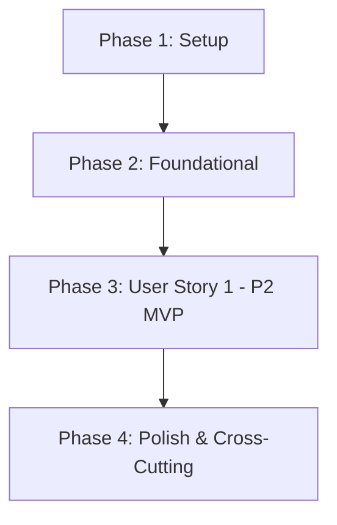

# Tasks: 007 - Procesamiento Logístico y Notificación de Envío

**Branch**: `007-logistica-envios` | **Fecha**: 2026-10-14 | **Spec**: [spec.md](./spec.md) | **Plan**: [plan.md](./plan.md)

Desglose de tareas ordenadas por dependencias para la implementación de la gestión del ciclo logístico de pedidos, empaquetado en taller ("en preparación"), despacho con transportista y código de seguimiento ("salido de la tienda"), avisos automáticos multicanal (email simulado y panel de usuario), rectificación de erratas y confirmación de entrega definitiva.

---

## Phase 1: Setup (Infraestructura Compartida)

**Propósito**: Inicialización de constantes de transporte, estados logísticos y cliente API.

- [X] T001 Actualizar constantes del sistema con los estados logísticos (`en_preparacion`, `salido_tienda`, `entregado`) y lista de transportistas en `backend/src/config/constants.js`
- [X] T002 [P] Crear cliente HTTP base para interactuar con los endpoints logísticos en `frontend/src/services/logistics-api.service.js`

---

## Phase 2: Foundational (Prerrequisitos Bloqueantes)

**Propósito**: Componentes de dominio y almacenamiento base que deben estar listos antes de implementar las pantallas y flujos operativos.

- [X] T003 [P] Crear modelos de DatosExpedicion y AvisoEnvio en `backend/src/models/shipment.model.js`
- [X] T004 Extender el almacén de datos `MemoryStore` con transiciones de estado de pedido, almacenamiento de expedición y registro de avisos en `backend/src/models/store.js`
- [X] T005 Configurar montaje de rutas logísticas y servicio de estáticos de logística en `backend/src/server.js`

**Checkpoint**: Infraestructura y modelos base operativos. Comienza la implementación de la historia de usuario.

---

## Phase 3: User Story 1 - Gestión del Ciclo de Despacho y Aviso de Seguimiento (Priority: P2) 🎯 MVP

**Meta**: Permitir al gestor del taller listar pedidos pagados, avanzarlos a "en preparación" al empaquetarlos, asignarles transportista y número de seguimiento (6-32 caracteres) para transicionar a "salido de la tienda", disparar notificaciones multicanal inmediatas (< 3 s) con email simulado observable, permitir rectificaciones y posibilitar la confirmación de entrega por el administrador o el cliente.

**Independent Test**:
1. Acceder al panel de logística con un pedido en estado "pagado" y pulsar "Iniciar preparación"; comprobar cambio de estado inmediato a "en preparación".
2. Seleccionar el transportista (ej. Correos) e introducir el código `CORREOS-ES-998877`; verificar transición a "salido de la tienda" y emisión automática de la notificación de envío con email simulado.
3. Probar la introducción de código vacío o menor a 6 caracteres; verificar mensaje de error en español y bloqueo del despacho.
4. Rectificar una errata en el código de seguimiento; verificar actualización y emisión del aviso de rectificación al cliente.
5. Confirmar recepción física como comprador mediante "He recibido mi pedido" o como administrador; verificar estado final "entregado".

### Pruebas de User Story 1

> **NOTA: Escribir y verificar que fallen antes de completar la implementación correspondiente.**

- [X] T006 [P] [US1] Pruebas de contrato para la API logística (`/transportistas`, `/pedidos`, `/preparar`, `/despachar`, `/rectificar-tracking`, `/entregar`, `/avisos`) en `tests/contract/logistica-api.test.js`
- [X] T007 [P] [US1] Pruebas de integración del ciclo de vida logístico completo (pagado → en preparación → salido con tracking y aviso → entregado) en `tests/integration/logistica-flow.test.js`

### Modelos y Lógica de Negocio

- [X] T008 [US1] Implementar LogisticsService (empaquetado, validación de tracking de 6-32 chars, emisión de avisos multicanal y confirmación de entrega) en `backend/src/services/logistics.service.js`

### Controladores y Rutas del Backend

- [X] T009 [US1] Implementar LogisticsController para gestionar las peticiones REST y validaciones de parámetros en `backend/src/controllers/logistics.controller.js`
- [X] T010 [US1] Registrar y montar las rutas logísticas en `backend/src/routes/logistics.routes.js`

### Componentes de Interfaz de Usuario (Frontend)

- [X] T011 [P] [US1] Implementar componente de tabla de pedidos del taller con filtros por estado en `frontend/src/components/logistics-orders-table.js`
- [X] T012 [P] [US1] Implementar diálogo modal interactivo para asignar empresa de transporte y número de seguimiento en `frontend/src/components/dispatch-modal.js`
- [X] T013 [P] [US1] Implementar componente de seguimiento del pedido para el cliente con acción "He recibido mi pedido" en `frontend/src/components/tracking-view.js`
- [X] T014 [P] [US1] Implementar modal visor de correo electrónico simulado para inspección de avisos emitidos en `frontend/src/components/shipping-notice-modal.js`
- [X] T015 [P] [US1] Crear hoja de estilos CSS responsiva para el panel de taller y seguimiento en `frontend/src/styles/logistica.css`
- [X] T016 [US1] Integrar la página HTML completa de gestión logística y consulta de pedidos en `frontend/public/logistica.html`

**Checkpoint**: User Story 1 completada de extremo a extremo, cumpliendo todos los criterios de aceptación y los 6 requisitos funcionales.

---

## Phase 4: Polish & Cross-Cutting Concerns

**Propósito**: Verificaciones de calidad, estándares constitucionales y validación de aceptación.

- [X] T017 [P] Auditar y asegurar que el 100% de los textos, estados, avisos de envío y errores estén en español de España (`es-ES`) conforme al Principio II
- [X] T018 [P] Auditar el código y registros para asegurar que no se almacenen ni impriman datos personales sensibles en logs conforme al Principio V
- [X] T019 [P] Implementar suite de validación automatizada de los 5 escenarios descritos en quickstart.md en `tests/integration/quickstart-logistica.test.js`
- [X] T020 Ejecutar la batería completa de validación manual paso a paso descrita en `specs/007-logistica-envios/quickstart.md`

---

## Dependencies & Execution Order

### Dependencias entre Fases

### Orden de Ejecución Interno en User Story 1
1. **Pruebas primero**: Escribir pruebas de contrato (`T006`) e integración (`T007`) asegurando que fallen antes del código de producción.
2. **Servicio de negocio**: `T008` (LogisticsService) encapsula las reglas de empaquetado, tracking y avisos.
3. **Controlador y Rutas**: `T009` y `T010` exponen la API REST.
4. **Componentes Frontend**: La tabla (`T011`), modal de despacho (`T012`), vista de tracking (`T013`), visor de avisos (`T014`) y estilos (`T015`) se construyen en paralelo antes de ensamblar la página principal (`T016`).
5. **Validación**: Fase 4 valida la conformidad constitucional y las pruebas automatizadas de `quickstart.md`.

---

## Oportunidades de Ejecución en Paralelo

### Paralelismo en Setup y Foundational
- `T002` (Cliente API) se puede desarrollar en paralelo con `T001` (Constantes).
- `T003` (Modelos de expedición y aviso) se puede realizar en paralelo con `T004` (Almacén de datos).

### Paralelismo en User Story 1
- `T006` (Pruebas de contrato) y `T007` (Pruebas de integración) se pueden escribir en paralelo.
- `T011` (Tabla de pedidos), `T012` (Modal de despacho), `T013` (Vista de seguimiento) y `T014` (Visor de avisos) se pueden programar en paralelo.
- `T015` (Estilos CSS) se puede crear en paralelo con los componentes JavaScript.

---

## Estrategia de Implementación

### Alcance MVP Recomendado
El alcance MVP para esta funcionalidad corresponde íntegramente a **User Story 1 (Fases 1, 2 y 3)**:
1. Completar Setup (Fase 1) y Foundational (Fase 2).
2. Desarrollar la máquina de estados, asignación de tracking con transportista y generación de avisos automáticos.
3. Validar con los 5 escenarios de prueba de [quickstart.md](./quickstart.md).
4. Finalizar con la auditoría de idioma y ejecución de pruebas (Fase 4).
