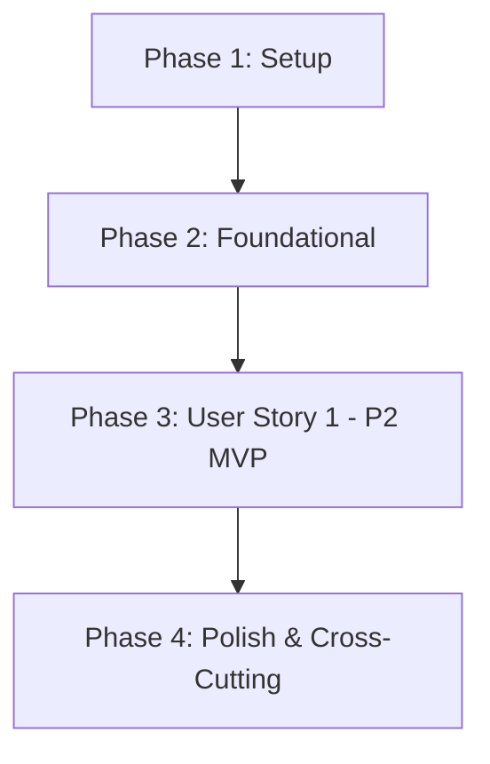

# Tasks: 008 - Resumen de Ventas y Exportación de Métricas

**Branch**: `008-resumen-ventas` | **Fecha**: 2026-10-27 | **Spec**: [spec.md](./spec.md) | **Plan**: [plan.md](./plan.md)

Desglose de tareas accionables ordenadas por dependencias para la implementación del cuadro de mando de ventas para administradores, cálculo de facturación en euros (€), ranking Top 5 de productos más vendidos, filtrado por períodos predefinidos o rango personalizado, y exportación transaccional estructurada en CSV compatible con Microsoft Excel en español (`es-ES`).

---

## Phase 1: Setup (Infraestructura Compartida)

**Propósito**: Inicialización de constantes de reporte, configuración de períodos y cliente API frontend.

- [X] T001 Definir constantes para períodos de reporte ('7_dias', '30_dias', '1_ano', 'personalizado') y formato de exportación CSV en `backend/src/config/constants.js`
- [X] T002 [P] Crear el cliente HTTP frontend para la API de informes de venta en `frontend/src/services/sales-report-api.service.js`

---

## Phase 2: Foundational (Prerrequisitos Bloqueantes)

**Propósito**: Modelos de datos y adaptaciones en el almacenamiento centralizado que deben estar listas antes de implementar la lógica del informe.

⚠️ **CRÍTICO**: No puede comenzar el desarrollo de las pantallas ni endpoints de la historia de usuario hasta completar esta fase.

- [X] T003 [P] Crear los modelos de datos `SalesReportSummary`, `ProductRankingItem` y `SalesTransactionDetail` en `backend/src/models/sales-report.model.js`
- [X] T004 Extender el almacén `MemoryStore` con método de consulta filtrada de pedidos cobrados en `backend/src/models/store.js`
- [X] T005 Configurar montaje de rutas de ventas administrativas (`/api/admin/ventas`) y servicio de la vista estática en `backend/src/server.js`

**Checkpoint**: Infraestructura base y modelos listos. Comienza la implementación de la historia de usuario.

---

## Phase 3: User Story 1 - Cuadro de Mando de Ventas y Exportación Externa (Priority: P2) 🎯 MVP

**Meta**: Permitir al administrador visualizar el total de facturación en euros (€), número de pedidos cobrados y Top 5 de artículos más vendidos con filtros por períodos predefinidos o rango personalizado, y descargar el detalle de transacciones en CSV con delimitador `;` y UTF-8 BOM.

**Independent Test**:
1. Acceder a `/admin/ventas.html`, seleccionar el filtro del último mes y comprobar la visualización de facturación total en euros (€), pedidos confirmados y el Top 5 ordenado por unidades vendidas desc.
2. Filtrar por rango personalizado de fechas y validar la actualización reactiva instantánea (< 1 s).
3. Pulsar "Exportar a CSV" y verificar la descarga instantánea (< 2 s) de un archivo CSV con cabeceras `Fecha;Nº Pedido;Producto;Artesano;Unidades;Importe (€)`, delimitador `;`, coma decimal y UTF-8 BOM abrible sin errores en Excel.
4. Consultar un período sin ventas y comprobar que se muestra 0,00 € y 0 pedidos, permitiendo descargar el CSV con cabeceras vacías.
5. Realizar petición sin permisos de administrador y verificar respuesta 403 Forbidden.

### Pruebas de User Story 1

> **NOTA: Escribir estas pruebas PRIMERO y verificar que fallen antes de implementar el código de producción.**

- [X] T006 [P] [US1] Pruebas de contrato para `/api/admin/ventas/resumen` y `/api/admin/ventas/exportar` según el contrato OpenAPI en `tests/contract/ventas-admin-api.test.js`
- [X] T007 [P] [US1] Pruebas de integración para cálculo de agregaciones, Top 5 con desempate y generación de CSV con UTF-8 BOM en `tests/integration/sales-report-flow.test.js`

### Modelos y Lógica de Negocio

- [X] T008 [US1] Implementar `SalesReportService` (cálculo de ingresos brutos, ranking Top 5 con desempate por facturación y serialización a CSV) en `backend/src/services/sales-report.service.js`

### Controladores y Rutas del Backend

- [X] T009 [US1] Implementar `SalesReportController` con validación de rangos de fechas, control de rol administrador y cabeceras de descarga CSV en `backend/src/controllers/sales-report.controller.js`
- [X] T010 [US1] Registrar y montar las rutas protegidas `/api/admin/ventas` en `backend/src/routes/sales-report.routes.js`

### Componentes de Interfaz de Usuario (Frontend)

- [X] T011 [P] [US1] Implementar el componente visual `SalesReportView` (selectores de fecha, tarjetas KPI, tabla Top 5 y disparador de exportación CSV) en `frontend/src/components/admin/sales-report-view.js`
- [X] T012 [P] [US1] Crear la hoja de estilos responsiva del panel de ventas en `frontend/src/styles/admin-ventas.css`
- [X] T013 [US1] Crear la página HTML del cuadro de mando administrativo en `frontend/public/admin/ventas.html` y enlazarla desde la navegación del catálogo en `frontend/public/admin/catalogo.html`

**Checkpoint**: User Story 1 completada y funcional de extremo a extremo, cumpliendo los criterios de aceptación y los 6 requisitos funcionales.

---

## Phase 4: Polish & Cross-Cutting Concerns

**Propósito**: Verificaciones de calidad, estándares constitucionales y validación de aceptación.

- [X] T014 [P] Auditar y verificar que el 100% de los textos, cabeceras del CSV, importes en euros (`€`) y mensajes de error cumplan la normativa española (`es-ES`) según el Principio II
- [X] T015 [P] Auditar que no se expongan datos personales sensibles ni información de tarjetas en las respuestas o en el archivo CSV según el Principio V
- [X] T016 [P] Implementar la suite de validación automatizada de los 6 escenarios descritos en quickstart.md en `tests/integration/quickstart-ventas.test.js`
- [X] T017 Ejecutar la batería completa de validación funcional y verificar los tiempos de rendimiento (< 1 s cálculo, < 2 s descarga) según SC-001 y SC-002 en `specs/008-resumen-ventas/quickstart.md`

---

## Dependencies & Execution Order

### Dependencias entre Fases



### Orden de Ejecución Interno en User Story 1

1. **Pruebas primero (TDD)**: Escribir pruebas de contrato (`T006`) e integración (`T007`) asegurando que fallen antes del código de producción.
2. **Servicio de negocio**: `T008` (`SalesReportService`) encapsula las reglas de agregación, ranking Top 5 y generación de CSV.
3. **Controlador y Rutas**: `T009` y `T010` exponen y protegen la API REST.
4. **Componentes Frontend**: El componente visual (`T011`) y estilos (`T012`) se desarrollan en paralelo antes de ensamblar la página principal (`T013`).
5. **Validación**: La Fase 4 valida la conformidad constitucional y las pruebas automatizadas de `quickstart.md`.

---

## Oportunidades de Ejecución en Paralelo

### Fase 1 (Setup)
- `T002` (Cliente API frontend) puede desarrollarse en paralelo con `T001` (Constantes backend).

### Fase 2 (Foundational)
- `T003` (Modelos de datos) y `T005` (Rutas en server.js) pueden desarrollarse en paralelo.

### Fase 3 (User Story 1)
- `T006` (Pruebas de contrato) y `T007` (Pruebas de integración) pueden escribirse en paralelo.
- `T011` (Componente de UI) y `T012` (Estilos CSS) pueden construirse en paralelo a la par que la capa de controladores backend.

### Fase 4 (Polish)
- `T014` (Auditoría de idioma `es-ES`), `T015` (Auditoría de seguridad de datos) y `T016` (Tests de quickstart) pueden ejecutarse en paralelo.

---

## Parallel Example: User Story 1

```bash
# Lanzar pruebas iniciales de User Story 1 en paralelo:
Task: "T006 [P] [US1] Pruebas de contrato para /api/admin/ventas/resumen y /api/admin/ventas/exportar en tests/contract/ventas-admin-api.test.js"
Task: "T007 [P] [US1] Pruebas de integración para cálculo de agregaciones, Top 5 y CSV en tests/integration/sales-report-flow.test.js"

# Desarrollar interfaz y componentes visuales en paralelo:
Task: "T011 [P] [US1] Implementar el componente visual SalesReportView en frontend/src/components/admin/sales-report-view.js"
Task: "T012 [P] [US1] Crear la hoja de estilos responsiva en frontend/src/styles/admin-ventas.css"
```

---

## Estrategia de Implementación

### MVP Primero (User Story 1)
1. Completar Fase 1 (Setup) y Fase 2 (Foundational).
2. Implementar User Story 1 (capa de servicios, endpoints y frontend).
3. **Parar y validar**: Ejecutar validación independiente de User Story 1.
4. Verificar que el cuadro de mando y la descarga CSV funcionen de forma autónoma.
5. Completar Fase 4 (Polish) y ejecutar la suite de pruebas completa `npm test`.

---

## Notas de Calidad
- Cada tarea sigue estrictamente el formato `- [ ] [TaskID] [P?] [Story?] Descripción con ruta de archivo`.
- Todos los caminos de archivo especificados son exactos y coherentes con la arquitectura existente del repositorio.
- Todas las tareas son atómicas y ejecutables directamente por agentes o desarrolladores.
