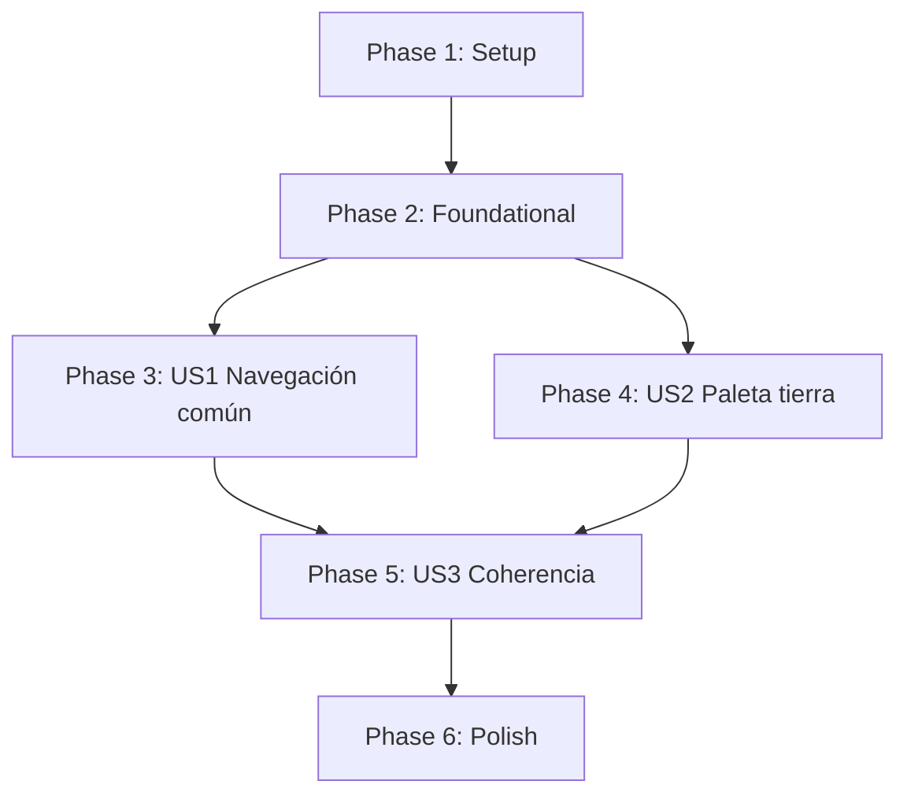

# Tasks: 009 - Identidad Visual Unificada de Tienda de Cerámica

**Branch**: `009-identidad-visual-ceramica` | **Fecha**: 2026-11-16 | **Spec**: [spec.md](./spec.md) | **Plan**: [plan.md](./plan.md)

**Input**: Documentos de diseño de `specs/009-identidad-visual-ceramica/` ([research.md](./research.md), [data-model.md](./data-model.md), [contracts/cabecera-comun.md](./contracts/cabecera-comun.md), [quickstart.md](./quickstart.md))

**Tests**: Incluidos. El plan define la prueba de integración `tests/integration/identidad-visual.test.js` y exige que la batería existente siga pasando (SC-005).

## Format: `[ID] [P?] [Story] Description`

- **[P]**: Se puede ejecutar en paralelo (archivos distintos, sin dependencias pendientes)
- **[Story]**: Historia de usuario a la que pertenece (US1, US2, US3)

## Path Conventions

Aplicación web: `frontend/public/` (páginas), `frontend/src/styles/` (hojas), `frontend/src/components/` (módulos JS), `tests/integration/` (pruebas). El backend no se modifica.

**Restricciones transversales para todas las tareas**:
- No cambiar ninguna funcionalidad, texto informativo, precio ni ID usado por scripts (FR-011).
- Conservar los títulos `<title>`, `--accent-primary` en `checkout.css` y `.reservation-badge`, que comprueba `tests/integration/static-serving.test.js`.
- Usar solo las variables CSS públicas listadas en [contracts/cabecera-comun.md §4](./contracts/cabecera-comun.md#4-variables-css-públicas).

---

## Phase 1: Setup (Infraestructura compartida)

**Propósito**: Crear la hoja de tema con los tokens de la paleta, que todo lo demás consume.

- [ ] T001 Crear `frontend/src/styles/tema-ceramica.css` con el bloque `:root` de tokens de [data-model.md](./data-model.md#entidad-1-paleta-de-colores-tierra-tokens): fondos, superficies, bordes, texto (incluido `--text-on-accent: #FFFFFF`), acento (`--accent-primary #A84B2A`, `--accent-hover #8A3B1F`, `--accent-gradient`, `--accent-soft` terracota al 12%, `--accent-artisan`), éxito/aviso/error con sus `-bg` y `-border`, `--status-pendiente|pagado|preparacion|salido|entregado`, todos los alias existentes (`--normal-*`, `--danger-*`, `--stock-in-*`, `--stock-out-*`, `--pending-*`, `--prep-*`, `--shipped-*`, `--bg-card`, `--bg-card-hover`, `--border-color`, `--border-focus`, `--card-border-focus`, `--accent-glow`), tipografías (`--font-family` Nunito Sans, `--font-heading` Fraunces, `--font-mono` JetBrains Mono, con alternativas del sistema), radios y sombras marrones suaves
- [ ] T002 Añadir a `frontend/src/styles/tema-ceramica.css` los estilos base: `body` (fondo `--bg-primary`, color `--text-main`, `--font-family`), `h1–h4` con `--font-heading`, enlaces en `--accent-primary`, `:focus-visible` con contorno terracota y `::selection` en `--accent-soft`

---

## Phase 2: Foundational (Prerrequisitos bloqueantes)

**Propósito**: Enlazar el tema en todas las páginas y retirar las definiciones de color que lo sobrescribirían.

**⚠️ CRITICAL**: Ninguna historia puede validarse hasta completar esta fase.

- [ ] T003 [P] Sustituir el `<link>` de Google Fonts y enlazar `/src/styles/tema-ceramica.css` antes de la hoja propia en `frontend/public/catalogo.html`, `frontend/public/cart.html` y `frontend/public/checkout.html`, siguiendo [contracts/cabecera-comun.md §1](./contracts/cabecera-comun.md#1-inclusión-en-cada-página)
- [ ] T004 [P] Ídem en `frontend/public/cuenta.html`, `frontend/public/logistica.html`, `frontend/public/admin/catalogo.html` y `frontend/public/admin/ventas.html`
- [ ] T005 [P] Eliminar el bloque `:root` de colores, tipografías, radios y sombras de `frontend/src/styles/catalogo.css`, `frontend/src/styles/cart.css` y `frontend/src/styles/checkout.css` (los valores pasan a venir del tema)
- [ ] T006 [P] Eliminar el bloque `:root` de `frontend/src/styles/cuenta.css`, `frontend/src/styles/logistica.css` y `frontend/src/styles/admin-catalogo.css`

**Checkpoint**: Las 7 páginas cargan el tema; los elementos que ya usaban variables aparecen en tonos tierra.

---

## Phase 3: User Story 1 - Navegación común en todas las páginas (Priority: P1) 🎯 MVP

**Goal**: La misma cabecera, con los mismos enlaces y el enlace actual resaltado, en las 7 páginas; "Administración" solo para administradores.

**Independent Test**: [quickstart.md](./quickstart.md) Escenarios 1 y 2: recorrer las páginas públicas, comprobar cabecera idéntica, enlace activo y navegación de un clic; comprobar la visibilidad de "Administración" según el rol.

### Tests for User Story 1 ⚠️

- [ ] T007 [US1] Crear `tests/integration/identidad-visual.test.js` (mismo patrón que `tests/integration/static-serving.test.js`: `app.listen(0)` + `fetch`) que, para `/catalogo`, `/carrito`, `/checkout`, `/cuenta`, `/logistica`, `/admin/catalogo` y `/admin/ventas`, compruebe que el HTML contiene `tema-ceramica.css`, `class="site-header"`, los enlaces `href="/catalogo"`, `href="/carrito"`, `href="/logistica"`, `href="/cuenta"`, `id="nav-admin"` y exactamente un `aria-current="page"`; y que las dos páginas de administración contienen `class="admin-subnav"`. Verificar que falla antes de T009–T013

### Implementation for User Story 1

- [ ] T008 [US1] Añadir a `frontend/src/styles/tema-ceramica.css` los estilos de `.site-header` (fondo blanco cálido, borde inferior arena, fija arriba), `.site-header__inner`, `__brand`, `__logo`, `__name` (Fraunces), `__nav`, `__link` (color `--text-muted`, hover `--accent-primary`), `__link[aria-current="page"]` (color terracota + subrayado o fondo `--accent-soft`), `.admin-subnav` y `.admin-subnav__link`, y el ajuste a dos filas sin desplazamiento horizontal por debajo de 720 px (research §7)
- [ ] T009 [P] [US1] Crear `frontend/src/components/site-header.js` según [contracts/cabecera-comun.md §3](./contracts/cabecera-comun.md#3-comportamiento-de-site-headerjs): si `#nav-admin` está oculto, usar `AccountApiService` (`isAuthenticated()` + `getMe()`) para mostrarlo solo cuando `rol === 'admin'`, y ocultarlo ante cualquier error
- [ ] T010 [P] [US1] En `frontend/public/catalogo.html`, sustituir la cabecera `catalogo-header` por el marcado común con `aria-current="page"` en "Catálogo", eliminar el `<script type="module">` en línea que gestiona `nav-admin` y añadir `<script type="module" src="/src/components/site-header.js">`
- [ ] T011 [P] [US1] En `frontend/public/cart.html` y `frontend/public/checkout.html`, sustituir la cabecera propia por el marcado común con `aria-current="page"` en "Cesta"; trasladar el distintivo "🧺 Cesta de Compras Persistente" y "🔒 Pasarela Bancaria Segura (PSD2 / TLS)" al inicio del `<main>` como etiqueta informativa (conservar sus IDs `badge-cesta` y `badge-seguridad`); añadir `site-header.js`
- [ ] T012 [P] [US1] En `frontend/public/cuenta.html` y `frontend/public/logistica.html`, sustituir la cabecera por el marcado común con `aria-current="page"` en "Mi Cuenta" y "Envíos" respectivamente; en `logistica.html` eliminar el script en línea de `nav-admin` y añadir `site-header.js`; en `cuenta.html` mantener `setAdminNav` (sin `site-header.js`)
- [ ] T013 [P] [US1] En `frontend/public/admin/catalogo.html` y `frontend/public/admin/ventas.html`, sustituir la cabecera por el marcado común con `#nav-admin` visible y `aria-current="page"`, y añadir debajo la `.admin-subnav` con "Catálogo e Inventario", "Informes de Ventas" y "Gestión Logística" marcando la sección actual; conservar el indicador "👤 Administrador" dentro de la subnavegación
- [ ] T014 [P] [US1] Eliminar de `frontend/src/styles/catalogo.css`, `cart.css`, `checkout.css`, `cuenta.css`, `logistica.css` y `admin-catalogo.css` las reglas de las cabeceras antiguas (`.catalogo-header`, `.site-header`, `.header-container`, `.brand-*`, `.logo-*`, `.badge-admin`, `.header-nav`, `.nav-link`, `.header-badge`, `.user-indicator`) que ya no se usan o que entran en conflicto con el tema; mantener el estilo de `.header-badge` reubicado como etiqueta informativa

**Checkpoint**: US1 completa. T007 pasa y los Escenarios 1 y 2 del quickstart se cumplen.

---

## Phase 4: User Story 2 - Paleta cálida de colores tierra (Priority: P1)

**Goal**: Ninguna página conserva fondos oscuros ni acentos índigo/violeta; estados en oliva/ocre/ladrillo; todos los textos legibles.

**Independent Test**: [quickstart.md](./quickstart.md) Escenarios 3 y 4: recorrer las 7 páginas y sus modales; comprobar contraste.

### Tests for User Story 2 ⚠️

- [ ] T015 [US2] Ampliar `tests/integration/identidad-visual.test.js` para descargar cada hoja de `/src/styles/` y comprobar que no contiene ningún color retirado de la lista de [data-model.md](./data-model.md#entidad-1-paleta-de-colores-tierra-tokens) (comparación sin distinguir mayúsculas ni espacios en `rgba(...)`), y que solo `tema-ceramica.css` define `--accent-primary:`

### Implementation for User Story 2

- [ ] T016 [P] [US2] Sustituir los colores fijos por variables del tema en `frontend/src/styles/catalogo.css` (incluidas tarjetas de producto, chips de categoría, filtros, indicadores de stock y estado vacío): blancos de texto → `--text-main`/`--text-on-accent` según el fondo; `rgba(255,255,255,…)` de bordes/fondos → `--card-border`/`--bg-secondary`; índigo/violeta → `--accent-*`; fondos oscuros → `--bg-*`/`--card-bg`; sombras negras → `--shadow-*`
- [ ] T017 [P] [US2] Ídem en `frontend/src/styles/resenas.css` (modal de reseñas, estrellas en `--accent-artisan`, formulario)
- [ ] T018 [P] [US2] Ídem en `frontend/src/styles/cart.css`
- [ ] T019 [P] [US2] Ídem en `frontend/src/styles/checkout.css` (formulario de tarjeta, temporizador `.reservation-badge`, recibo y modal 3D Secure); mantener la cadena `--accent-primary` en el archivo mediante `var(--accent-primary)`
- [ ] T020 [P] [US2] Ídem en `frontend/src/styles/cuenta.css` (formularios de acceso, historial de pedidos, stepper de fases)
- [ ] T021 [P] [US2] Ídem en `frontend/src/styles/logistica.css` (tabla de pedidos, pestañas de filtro, modal de despacho, visor de avisos, vista de seguimiento)
- [ ] T022 [P] [US2] Ídem en `frontend/src/styles/admin-catalogo.css` (tabla de productos, formulario, gestor de categorías, alertas de stock, bloqueo de acceso)
- [ ] T023 [P] [US2] Ídem en `frontend/src/styles/admin-ventas.css`, con las series de gráficos en terracota, arcilla oscuro `#7A5C3E`, oliva y ocre (research §6)
- [ ] T024 [P] [US2] Sustituir colores en línea por `var(--…)` en `frontend/src/components/admin/admin-access-guard.js`, `admin/product-form.js`, `admin/product-list-table.js` y `admin/sales-report-view.js`
- [ ] T025 [P] [US2] Sustituir colores en línea por `var(--…)` en `frontend/src/components/catalogo/empty-state.js`, `resenas/product-reviews-modal.js` y `resenas/review-form.js`

**Checkpoint**: US2 completa. T015 pasa y los Escenarios 3 y 4 del quickstart se cumplen.

---

## Phase 5: User Story 3 - Coherencia de componentes en todas las secciones (Priority: P2)

**Goal**: Botones, campos, tablas, tarjetas, etiquetas de estado, mensajes y modales con el mismo estilo en todas las páginas; cada estado de pedido con el mismo color.

**Independent Test**: [quickstart.md](./quickstart.md) Escenario 5.

### Tests for User Story 3 ⚠️

- [ ] T026 [US3] Ampliar `tests/integration/identidad-visual.test.js` para comprobar que `cuenta.css` y `logistica.css` colorean las etiquetas de estado mediante `var(--status-…)` y no con valores propios

### Implementation for User Story 3

- [ ] T027 [US3] Añadir a `frontend/src/styles/tema-ceramica.css` los estilos base compartidos de botones principal/secundario/peligro, campos (`input`, `select`, `textarea` con foco terracota), tablas (cabecera arcilla, filas con separador arena), tarjetas, mensajes de éxito/aviso/error, modales (fondo blanco cálido, velo `rgba(59, 42, 32, 0.45)`) y etiquetas de estado `.status-badge` por estado usando `--status-*`
- [ ] T028 [P] [US3] Alinear en `frontend/src/styles/cuenta.css` y `frontend/src/styles/logistica.css` las clases de estado de pedido (stepper de fases, `badge-*`/`status-*`) al mapa `--status-*`, de modo que "salido de la tienda" y el resto tengan el mismo color en ambas páginas (FR-009)
- [ ] T029 [P] [US3] Unificar en `frontend/src/styles/cart.css`, `checkout.css`, `cuenta.css`, `logistica.css`, `admin-catalogo.css` y `catalogo.css` los radios, alturas, pesos tipográficos y estados hover/focus de botones y campos con los del tema, eliminando las reglas duplicadas que contradigan T027

**Checkpoint**: Las tres historias funcionan y se validan por separado.

---

## Phase 6: Polish & Cross-Cutting Concerns

- [ ] T030 [P] Revisar en navegador a 375 px de ancho las 7 páginas y corregir en la hoja correspondiente cualquier desplazamiento horizontal (FR-010, SC-007)
- [ ] T031 [P] Verificar con un comprobador de contraste los pares texto/fondo reales de cada página (incluidos texto sobre `--accent-soft` y etiquetas de estado) y ajustar los tokens en `frontend/src/styles/tema-ceramica.css` si alguno baja de 4,5:1 (FR-007)
- [ ] T032 [P] Auditar que los textos nuevos de la cabecera y la subnavegación están en `es-ES` y que no se ha modificado ningún texto, precio ni flujo existente (Principios II y III, FR-011)
- [ ] T033 Ejecutar `npm test` y confirmar que toda la batería existente y `tests/integration/identidad-visual.test.js` pasan (SC-005)
- [ ] T034 Recorrer manualmente los 7 escenarios de `specs/009-identidad-visual-ceramica/quickstart.md`

---

## Dependencies & Execution Order

### Phase Dependencies



### User Story Dependencies

- **US1 (P1)**: depende solo de la Fase 2. Independiente de US2.
- **US2 (P1)**: depende solo de la Fase 2. Independiente de US1 (toca reglas de contenido, no de cabecera).
- **US3 (P2)**: depende de US1 y US2 (unifica sobre los estilos ya recoloreados y sobre la cabecera nueva).

### Within Each User Story

- La tarea de prueba (T007, T015, T026) se escribe primero y debe fallar.
- US1: T008 (estilos de cabecera) antes de comprobar visualmente T010–T013; T014 después de T010–T013.
- US2: T016–T025 son independientes entre sí.

### Archivos compartidos entre historias

`tema-ceramica.css` lo tocan T001, T002, T008 y T027; las hojas de página las tocan T005/T006, T014, T016–T023 y T028/T029. Si US1 y US2 se ejecutan en paralelo, hacerlo por hoja (no dos personas en la misma hoja a la vez).

### Parallel Opportunities

- Fase 2: T003, T004, T005 y T006 en paralelo.
- US1: T009–T013 en paralelo (archivos distintos).
- US2: T016–T025 en paralelo (una hoja o grupo de componentes por tarea).
- Polish: T030–T032 en paralelo.

---

## Parallel Example: User Story 2

```text
T016 catalogo.css   | T017 resenas.css     | T018 cart.css
T019 checkout.css   | T020 cuenta.css      | T021 logistica.css
T022 admin-catalogo.css | T023 admin-ventas.css
T024 componentes admin  | T025 componentes catálogo/reseñas
```

---

## Implementation Strategy

### MVP First (User Story 1)

1. Fase 1 + Fase 2 (el tema ya recolorea lo que usa variables).
2. Fase 3 (US1): cabecera común en las 7 páginas.
3. **Parar y validar** con los Escenarios 1 y 2 del quickstart.

### Incremental Delivery

1. Setup + Foundational → tema cargado.
2. US1 → navegación unificada (MVP).
3. US2 → sin restos del tema oscuro: la tienda ya "se siente" de cerámica.
4. US3 → componentes y estados coherentes.
5. Polish → móvil, contraste, auditoría y batería completa.

---

## Notes

- [P] = archivos distintos, sin dependencias pendientes.
- Hacer commit tras cada fase o grupo lógico.
- Ninguna tarea toca `backend/`.
